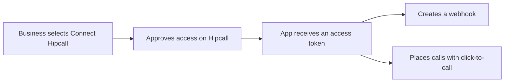

## Overview

Picture a CRM or an order management system that works alongside Hipcall. The businesses using it do not want to switch to the Hipcall dashboard every time they place a call or need to know that a call has ended. They expect to do it from the screen they already have open.

This series is for partners who build that kind of software. The business selects "Connect Hipcall" once in the partner's app. From then on, the app changes settings and sends API requests to Hipcall on the business's behalf.

This article explains how the flow works and introduces the five pieces the series covers. Set-up steps and code samples are in each piece's own article.

## How the flow works

It starts with OAuth2. When the business selects the button, it lands on Hipcall's sign-in and consent screen, sees which permissions the app is asking for and approves them. Hipcall then gives the app an access token, which the app uses from that point on to create webhooks or place calls.

Nobody copies an API key, and the partner never sees the business's Hipcall password.

## The building blocks

### OAuth2

OAuth2 is the authorisation standard that lets an app access another service on a user's behalf. With Hipcall, the app sends the user to `/oauth/authorize`. Once the user approves, the app exchanges the returned code for an access token at `/oauth/token`. The token lasts about an hour. If the app asks for the `offline_access` scope, the response also includes a refresh token.

Scopes decide what the app can reach. Creating a webhook, for example, needs `webhooks:write`.

### Click-to-call

Click-to-call starts a call from a button inside your app. When an agent selects "Call" on a customer record in the CRM, the app sends a request to the Hipcall API. With the recommended setting, the agent's Hipcall app rings first and the customer is dialled once the agent answers. You can hide the customer's number from the agent if you need to. The customer sees a company number rather than the agent's personal one.

### Speed dial

Speed dial is an extension where your web service decides which number gets called. A courier dials the speed dial extension and keys in the order number. Hipcall sends those digits to your web service in a POST request, the service replies with the number to call, and Hipcall dials it. The courier talks to the customer without ever seeing their number, which suits cases where data protection rules such as GDPR mean the courier should not hold it.

You create the speed dial record once in the dashboard, where you set the service URL and the extension number.

### SIP connections

SIP is the protocol used to set up voice calls over the internet. An external SIP connection links Hipcall to another SIP system. That could be the IP PBX in your office, or an AI voice platform such as VAPI that answers calls for you. You enter the same username and password on both sides, then set the SIP address for calls leaving Hipcall as the termination URI. Calls to the extension assigned to the connection are passed to the other system.

### Webhooks

A webhook is an HTTP request that Hipcall sends to your server when something happens in the account. When a call ends, Hipcall posts a `call.ended` event to your HTTPS address, and you check its signature to confirm it really came from Hipcall. The app can create the webhook itself through the API with its OAuth2 token, so the business does not have to set one up in the dashboard and copy the signing secret across.

## Before you start

For the articles in this series, you need:

- A Hipcall plan that includes the API and webhooks.
- An OAuth application with a client ID, a client secret and a redirect URI.
- The right permissions on the Hipcall user who approves access. Creating webhooks needs the `settings::developer` permission.
- A server that is reachable from the internet. Webhooks and speed dial both rely on Hipcall sending requests to you. Webhook addresses must use HTTPS. During development, a tunnel such as ngrok will do.

## Next steps

- Request your OAuth2 credentials and run your first token exchange in [How to Authorise Users and Get Tokens with Hipcall OAuth2](/blog/how-to-authorise-users-and-get-tokens-with-hipcall-oauth2/).
- Build the whole flow in ASP.NET Core with [How to Set Up Webhooks Through the OAuth2 API](/blog/how-to-set-up-a-hipcall-webhook-through-oauth2/).
- See the click-to-call request and number masking in [How to Start Click-to-Call Outbound Calls with OAuth2](/blog/how-to-start-click-to-call-outbound-calls-with-oauth2/).
- Browse every endpoint in the [Hipcall API reference](https://use.hipcall.com/api-docs/).
- Ask questions in the [Hipcall Community](https://community.hipcall.com/).

