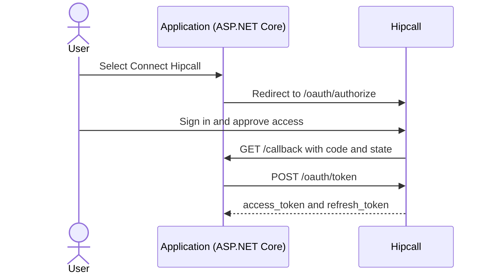

## Overview

The OAuth2 Authorisation Code flow lets your application connect to a Hipcall account with the user's permission. The user never types their Hipcall password into your app or copies an API key from the dashboard. They select a button in your app, approve the requested permissions on Hipcall, and return to your server with a one-time authorisation code. Your backend exchanges that code for an `access_token` and uses it for subsequent Hipcall API requests.

This article covers how to request OAuth2 client credentials from Hipcall, build the authorisation URL, and exchange the authorisation code for an `access_token` with ASP.NET Core Minimal API.



## Before you start

You need:

- .NET 8 SDK (`dotnet --version` must print 8.0 or higher).
- A Hipcall plan that includes API access.
- A public HTTPS address. For local development, expose port 5080 with a tunnel such as ngrok:

```bash
ngrok http 5080
```

### Get your client credentials from Hipcall

OAuth2 applications are not created in the user dashboard. To get a `Client ID` and `Client Secret`, contact the Hipcall team with your application details.

Include three things in your request:

- **Application type:** State that you are building a **Web application**, since your backend server will store the `client_secret`.
- **Redirect URI:** The full HTTPS callback URL where Hipcall will send the browser after the user approves access. For example, `https://your-server.example.com/callback` in production, or your ngrok address `https://your-tunnel.ngrok-free.dev/callback` during local testing.
- **Scopes:** The permission scopes your application needs. For basic authorisation, you can ask for `profile`, `email`, and `offline_access`. If your integration will also read calls or manage webhooks, include scopes such as `communication:read` and `webhooks:write` when you register the app; Hipcall must enable each scope on your OAuth application before you can request it.

Once your application is registered, Hipcall provides a **Client ID** and a **Client Secret**. Keep them in environment variables rather than in your source code:

```bash
export HIPCALL_CLIENT_ID="..."
export HIPCALL_CLIENT_SECRET="..."
export PUBLIC_URL="https://your-server.example.com"
```

On Windows PowerShell:

```powershell
$env:HIPCALL_CLIENT_ID = "..."
$env:HIPCALL_CLIENT_SECRET = "..."
$env:PUBLIC_URL = "https://your-server.example.com"
```

`HIPCALL_BASE_URL` is optional and defaults to `https://use.hipcall.com`. The app builds `redirect_uri` by appending `/callback` to `PUBLIC_URL`.

## Step 1: Build the authorisation URL and redirect the user

To send the user to Hipcall's consent screen, redirect the browser to `/oauth/authorize`:

```http
GET https://use.hipcall.com/oauth/authorize
  ?response_type=code
  &client_id=YOUR_CLIENT_ID
  &redirect_uri=https%3A%2F%2Fyour-server.example.com%2Fcallback
  &scope=profile+email+offline_access
  &state=5718F6D482AE78DF3322714ECAB6BD7E
```

Each query parameter has a specific job:

- `response_type`: Always `code` for the Authorisation Code flow.
- `client_id`: The application ID provided by Hipcall.
- `redirect_uri`: Must match the callback URL registered with Hipcall character for character, URL-encoded (`https%3A%2F%2F...`).
- `scope`: The permissions your app is asking for, joined with `+`. `profile` reads the user's name and ID, `email` reads their email address, and `offline_access` returns a `refresh_token` so your app can renew access when the token expires.
- `state`: A random value your app generates for each sign-in attempt to prevent cross-site request forgery (CSRF). Hipcall sends it back unchanged to `/callback`, and your app rejects any request whose `state` it does not recognise.

In ASP.NET Core, the `/login` endpoint generates a random `state`, stores it in memory, and redirects the browser:

```csharp
app.MapGet("/login", () =>
{
    var state = Convert.ToHexString(RandomNumberGenerator.GetBytes(16));
    pendingStates[state] = true;

    return Results.Redirect($"{baseUrl}/oauth/authorize?response_type=code"
        + $"&client_id={Uri.EscapeDataString(clientId)}"
        + $"&redirect_uri={Uri.EscapeDataString(redirectUri)}"
        + $"&scope={scope}&state={state}");
});
```

After the user signs in to Hipcall and approves access, Hipcall redirects the browser to `https://your-server.example.com/callback?code=...&state=...`.

## Step 2: Exchange the code for an access token

Your callback endpoint checks the `state` value first, then sends the `code` in an `application/x-www-form-urlencoded` body to `POST /oauth/token`:

```csharp
using var tokenResponse = await http.PostAsync("/oauth/token", new FormUrlEncodedContent(
    new Dictionary<string, string>
    {
        ["grant_type"] = "authorization_code",
        ["code"] = code,
        ["client_id"] = clientId,
        ["client_secret"] = clientSecret,
        ["redirect_uri"] = redirectUri
    }));
```

When the exchange succeeds, Hipcall returns `200 OK` and a JSON body like this:

```json
{
  "access_token": "SFMyNTY.g2gD...",
  "token_type": "Bearer",
  "expires_in": 3599,
  "refresh_token": "YTFjTxd_Mfen...",
  "scope": "profile email offline_access"
}
```

The `access_token` is valid for 3599 seconds (about an hour). The `scope` field lists the permissions Hipcall granted to this token. Send this token in the `Authorization: Bearer <access_token>` header when calling Hipcall API endpoints.

## The full script

Create a new web project and replace `Program.cs` with the code below:

```bash
dotnet new web -n Hipcall.OAuth
```

```csharp
using System.Collections.Concurrent;
using System.Security.Cryptography;
using System.Text.Json;

static string Env(string name) =>
    Environment.GetEnvironmentVariable(name)
    ?? throw new InvalidOperationException($"{name} is not set.");

var baseUrl = Environment.GetEnvironmentVariable("HIPCALL_BASE_URL") ?? "https://use.hipcall.com";
var clientId = Env("HIPCALL_CLIENT_ID");
var clientSecret = Env("HIPCALL_CLIENT_SECRET");
var publicUrl = Env("PUBLIC_URL").TrimEnd('/');
var redirectUri = $"{publicUrl}/callback";
const string scope = "profile+email+offline_access";

var builder = WebApplication.CreateBuilder(args);
builder.WebHost.ConfigureKestrel(options => options.ListenAnyIP(5080));
var app = builder.Build();

var http = new HttpClient { BaseAddress = new Uri(baseUrl) };
var pendingStates = new ConcurrentDictionary<string, bool>();

app.MapGet("/", () => Results.Content("<a href=\"/login\">Connect Hipcall</a>", "text/html"));

app.MapGet("/login", () =>
{
    var state = Convert.ToHexString(RandomNumberGenerator.GetBytes(16));
    pendingStates[state] = true;

    return Results.Redirect($"{baseUrl}/oauth/authorize?response_type=code"
        + $"&client_id={Uri.EscapeDataString(clientId)}"
        + $"&redirect_uri={Uri.EscapeDataString(redirectUri)}"
        + $"&scope={scope}&state={state}");
});

app.MapGet("/callback", async (string? code, string? state, string? error) =>
{
    if (error is not null)
    {
        return Results.BadRequest($"Hipcall returned an error: {error}");
    }

    if (code is null || state is null || !pendingStates.TryRemove(state, out _))
    {
        return Results.BadRequest("The code is missing or the state is unknown.");
    }

    using var tokenResponse = await http.PostAsync("/oauth/token", new FormUrlEncodedContent(
        new Dictionary<string, string>
        {
            ["grant_type"] = "authorization_code",
            ["code"] = code,
            ["client_id"] = clientId,
            ["client_secret"] = clientSecret,
            ["redirect_uri"] = redirectUri
        }));
    var tokenBody = await tokenResponse.Content.ReadAsStringAsync();
    if (!tokenResponse.IsSuccessStatusCode)
    {
        return Results.Content(tokenBody, "application/json", statusCode: (int)tokenResponse.StatusCode);
    }

    using var tokenJson = JsonDocument.Parse(tokenBody);
    var root = tokenJson.RootElement;
    var accessToken = root.GetProperty("access_token").GetString()!;
    var expiresIn = root.TryGetProperty("expires_in", out var exp) ? exp.GetInt32() : 0;
    var granted = root.TryGetProperty("scope", out var scopeValue) ? scopeValue.GetString() : null;

    Console.WriteLine($"Token received. Expires in: {expiresIn}s");
    Console.WriteLine($"Granted scopes: {granted ?? "(not returned)"}");

    return Results.Ok(new
    {
        token_type = "Bearer",
        expires_in = expiresIn,
        scope = granted
    });
});

app.Run();
```

With the environment variables set, start the application:

```bash
dotnet run
```

Open your `PUBLIC_URL` in a browser, select **Connect Hipcall**, and approve access. The console logs the token lifetime and the granted scopes:

```text
Token received. Expires in: 3599s
Granted scopes: profile email offline_access
```

## When it fails

### 400 Bad Request: invalid_grant

If `/oauth/token` returns this response during the token exchange:

```json
{
  "error": "invalid_grant",
  "error_description": "The provided authorization grant is invalid, expired, revoked, does not match the redirection URI used in the authorization request, or was issued to another client."
}
```

Check two common causes:

- **The authorisation code was used more than once:** Each `code` works once. Refreshing `/callback` in the browser resends the same `code` and Hipcall rejects it. In a production app, redirect the user to `/` after storing the token, or clear the query string from the address bar with `window.history.replaceState({}, document.title, "/")`.
- **Redirect URI mismatch:** The `redirect_uri` sent to `/oauth/authorize` and `/oauth/token` must match the URI registered with Hipcall down to any trailing slash (`/`) and the `https` scheme.

### 401 Unauthorized

If the `access_token` has expired or is invalid when you call an API endpoint, Hipcall returns `401`:

```json
{
  "errors": {
    "detail": "Not authorized. Check your API token is valid and not expired."
  }
}
```

An access token lasts about an hour. When you include `offline_access` in the initial authorisation request, you can use the returned `refresh_token` to obtain a new `access_token`.

### 403 Forbidden: insufficient_scope

If the token does not carry the scope required by an endpoint, the API returns `403`:

```json
{
  "error": "insufficient_scope",
  "errors": {
    "detail": "Forbidden",
    "required_scope": "webhooks:write"
  }
}
```

Check the `Granted scopes` line in your console output. Even if your authorise URL asks for a scope, Hipcall omits it from the token unless that scope is enabled for your OAuth application on Hipcall's side. Ask the Hipcall team to enable the scope for your client ID, then sign in again.

### CORS error in the browser

Calling `/oauth/token` directly from browser JavaScript (`fetch` or `XMLHttpRequest`) fails because Hipcall blocks cross-origin browser requests. Putting your `client_secret` in frontend code also exposes it to anyone who opens the page. Run the token exchange from a backend server such as ASP.NET Core.

## Parameter reference

### Authorise request (`GET /oauth/authorize`)

| Parameter | Type | Required | Description |
|---|---|---|---|
| `response_type` | string | yes | Always `code`. |
| `client_id` | string | yes | The Client ID provided by Hipcall. |
| `redirect_uri` | string | yes | The HTTPS callback URI registered with Hipcall. |
| `scope` | string | yes | Permission scopes separated by `+`. |
| `state` | string | yes | Random value generated for CSRF protection. |

### Token request (`POST /oauth/token`)

Send these fields as `application/x-www-form-urlencoded`.

| Parameter | Type | Required | Description |
|---|---|---|---|
| `grant_type` | string | yes | Always `authorization_code`. |
| `code` | string | yes | The authorisation code received at `/callback`. |
| `client_id` | string | yes | The Client ID provided by Hipcall. |
| `client_secret` | string | yes | The Client Secret provided by Hipcall. |
| `redirect_uri` | string | yes | Must match the `redirect_uri` from the authorise request. |

### Common scopes

| Scope | Description |
|---|---|
| `profile` | Read the user's name, ID, and assigned phone numbers. |
| `email` | Read the user's email address. |
| `offline_access` | Receive a `refresh_token` to renew expired access tokens. |
| `contacts:read` | Read contacts and companies in the directory. |
| `communication:read` | Read call records and subscribe to call webhook events. |
| `webhooks:write` | Create, update, delete, and test webhooks. |

## Next steps

- Use your OAuth2 token to register webhooks automatically in [How to Set Up Webhooks Through the OAuth2 API](/blog/how-to-set-up-a-hipcall-webhook-through-oauth2/).
- Start outbound calls with a single button in [How to Start Click-to-Call Outbound Calls with OAuth2](/blog/how-to-start-click-to-call-outbound-calls-with-oauth2/).
- Store `client_secret` and user tokens on the server in environment variables or a secret manager (such as Azure Key Vault or AWS Secrets Manager), never in `localStorage` or browser cookies.
- Browse all endpoints in the [Hipcall API Reference](https://use.hipcall.com/api-docs/).
- Ask questions in the [Hipcall Community](https://community.hipcall.com/).

