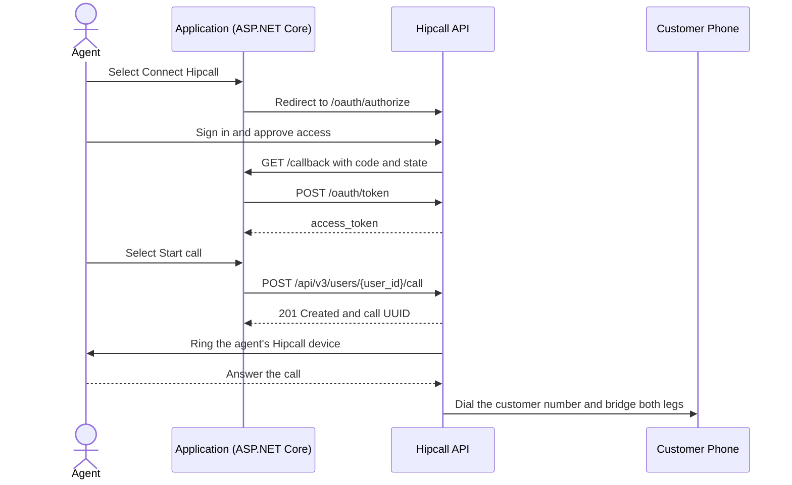

## Overview

Teams working in a CRM or order management tool do not want to switch to the Hipcall dashboard or dial phone numbers by hand every time they call a customer. Once a user connects their Hipcall account through OAuth2, your application can start outbound calls from a single button on the screen they already have open.

This article shows how to obtain an `access_token` through OAuth2 in ASP.NET Core Minimal API and start a click-to-call outbound call by calling `POST /api/v3/users/{user_id}/call`.



## Before you start

You need:

- .NET 8 SDK (`dotnet --version` must print 8.0 or higher).
- A Hipcall plan that includes API access.
- A Hipcall OAuth2 application with a Client ID, a Client Secret, and a Redirect URI, with the `communication` scope enabled. See [How to Authorise Users and Get Tokens with Hipcall OAuth2](/blog/how-to-authorise-users-and-get-tokens-with-hipcall-oauth2/) for how to request client credentials.
- The ID (`user_id`) of the Hipcall user who will place the call, with their Hipcall web, desktop, or mobile app signed in and online.
- A public HTTPS address for your `/callback` redirect URI. For local development, expose port 5080 with a tunnel such as ngrok:

```bash
ngrok http 5080
```

Keep your client credentials in environment variables:

```bash
export HIPCALL_CLIENT_ID="..."
export HIPCALL_CLIENT_SECRET="..."
export PUBLIC_URL="https://your-server.example.com"
```

On Windows PowerShell:

```powershell
$env:HIPCALL_CLIENT_ID = "..."
$env:HIPCALL_CLIENT_SECRET = "..."
$env:PUBLIC_URL = "https://your-server.example.com"
```

`HIPCALL_BASE_URL` is optional and defaults to `https://use.hipcall.com`.

## Step 1: Authorise with OAuth2 and get the access token

Redirect the user's browser to `/oauth/authorize` and include `communication` in the `scope` parameter so the token can start calls:

```http
GET https://use.hipcall.com/oauth/authorize
  ?response_type=code
  &client_id=YOUR_CLIENT_ID
  &redirect_uri=https%3A%2F%2Fyour-server.example.com%2Fcallback
  &scope=profile+email+offline_access+communication
  &state=5718F6D482AE78DF3322714ECAB6BD7E
```

After the user approves access, Hipcall redirects the browser back to `/callback?code=...&state=...`. Your server checks the `state` value and exchanges the `code` for an `access_token` at `POST /oauth/token`:

```csharp
using var tokenResponse = await http.PostAsync("/oauth/token", new FormUrlEncodedContent(
    new Dictionary<string, string>
    {
        ["grant_type"] = "authorization_code",
        ["code"] = code,
        ["client_id"] = clientId,
        ["client_secret"] = clientSecret,
        ["redirect_uri"] = redirectUri
    }));
```

## Step 2: Start an outbound call with one button

Once the token is stored, selecting the **Start call** button in your app sends a POST request to `/api/v3/users/{user_id}/call` with the Bearer token and a JSON body:

```csharp
var payload = JsonSerializer.Serialize(new
{
    callee_number = calleeNumber,
    ring_user_first = true,
    call_masking = true,
    call_masking_name = "Support Team"
});
using var request = new HttpRequestMessage(HttpMethod.Post, $"/api/v3/users/{userId}/call")
{
    Content = new StringContent(payload, Encoding.UTF8, "application/json")
};
request.Headers.Authorization = new AuthenticationHeaderValue("Bearer", savedToken);

using var response = await http.SendAsync(request);
```

When Hipcall accepts the request, it responds with `201 Created` and the UUID of the queued call:

```json
{
  "data": {
    "id": "19d354e6-2be8-4c4e-bd49-fd12545f71a4"
  }
}
```

### Call flow and parameter behaviour

- **What `201 Created` means:** A `201` status means the telephony layer accepted and queued the call request. It does not mean the customer answered or that the agent's device is reachable. To track whether the call connected and how long it lasted, subscribe to the `call.ended` webhook event or query `GET /api/v3/calls`.
- **`ring_user_first`:** When set to `true`, Hipcall rings the agent's own registered device first. As soon as the agent answers, Hipcall dials `callee_number` and bridges the two legs. When set to `false`, Hipcall attempts to connect the call without ringing the agent first, which drops immediately if the agent's device is offline.
- **`call_masking` and `call_masking_name`:** Setting `call_masking: true` hides the customer's phone number on the agent's Hipcall screen and displays `0000000000` instead. Passing `call_masking_name` (for example, `"Support Team"`) replaces those zeros with a readable label. The customer sees the company's outbound number rather than the agent's personal number, while the real E.164 phone numbers are preserved in the call records (`GET /api/v3/calls`) for reporting and billing.
- **`number_id` (optional):** Chooses which registered company number (`GET /api/v3/numbers`) is used as the outbound caller ID. When omitted, Hipcall uses the default number configured in the user's profile.

## The full script

Create a new web project and replace `Program.cs` with the code below:

```bash
dotnet new web -n Hipcall.ClickToCall
```

```csharp
using System.Collections.Concurrent;
using System.Net.Http.Headers;
using System.Security.Cryptography;
using System.Text;
using System.Text.Json;

static string Env(string name) =>
    Environment.GetEnvironmentVariable(name)
    ?? throw new InvalidOperationException($"{name} is not set.");

var baseUrl = Environment.GetEnvironmentVariable("HIPCALL_BASE_URL") ?? "https://use.hipcall.com";
var clientId = Env("HIPCALL_CLIENT_ID");
var clientSecret = Env("HIPCALL_CLIENT_SECRET");
var publicUrl = Env("PUBLIC_URL").TrimEnd('/');
var redirectUri = $"{publicUrl}/callback";
const string scope = "profile+email+offline_access+communication";

var builder = WebApplication.CreateBuilder(args);
builder.WebHost.ConfigureKestrel(options => options.ListenAnyIP(5080));
var app = builder.Build();

var http = new HttpClient { BaseAddress = new Uri(baseUrl) };
var pendingStates = new ConcurrentDictionary<string, bool>();
string? savedToken = null;

app.MapGet("/", () => Results.Content("<a href=\"/login\">Connect Hipcall</a>", "text/html"));

app.MapGet("/login", () =>
{
    var state = Convert.ToHexString(RandomNumberGenerator.GetBytes(16));
    pendingStates[state] = true;

    return Results.Redirect($"{baseUrl}/oauth/authorize?response_type=code"
        + $"&client_id={Uri.EscapeDataString(clientId)}"
        + $"&redirect_uri={Uri.EscapeDataString(redirectUri)}"
        + $"&scope={scope}&state={state}");
});

app.MapGet("/callback", async (string? code, string? state, string? error) =>
{
    if (error is not null)
    {
        return Results.BadRequest($"Hipcall returned an error: {error}");
    }

    if (code is null || state is null || !pendingStates.TryRemove(state, out _))
    {
        return Results.BadRequest("The code is missing or the state is unknown.");
    }

    using var tokenResponse = await http.PostAsync("/oauth/token", new FormUrlEncodedContent(
        new Dictionary<string, string>
        {
            ["grant_type"] = "authorization_code",
            ["code"] = code,
            ["client_id"] = clientId,
            ["client_secret"] = clientSecret,
            ["redirect_uri"] = redirectUri
        }));
    var tokenBody = await tokenResponse.Content.ReadAsStringAsync();
    if (!tokenResponse.IsSuccessStatusCode)
    {
        return Results.Content(tokenBody, "application/json", statusCode: (int)tokenResponse.StatusCode);
    }

    using var tokenJson = JsonDocument.Parse(tokenBody);
    savedToken = tokenJson.RootElement.GetProperty("access_token").GetString()!;
    var granted = tokenJson.RootElement.TryGetProperty("scope", out var scopeValue) ? scopeValue.GetString() : null;
    Console.WriteLine($"Granted scopes: {granted ?? "(not returned)"}");

    return Results.Content(
        "<form method=\"post\" action=\"/call\">"
        + "<input name=\"user_id\" placeholder=\"4200\" required /> "
        + "<input name=\"callee_number\" placeholder=\"+447700XXXXXX\" required /> "
        + "<button>Start call</button>"
        + "</form>",
        "text/html");
});

app.MapPost("/call", async (HttpRequest req) =>
{
    if (savedToken is null)
    {
        return Results.BadRequest("Connect Hipcall first.");
    }

    var form = await req.ReadFormAsync();
    var userId = form["user_id"].ToString();
    var calleeNumber = form["callee_number"].ToString();

    var payload = JsonSerializer.Serialize(new
    {
        callee_number = calleeNumber,
        ring_user_first = true,
        call_masking = true,
        call_masking_name = "Support Team"
    });
    using var request = new HttpRequestMessage(HttpMethod.Post, $"/api/v3/users/{userId}/call")
    {
        Content = new StringContent(payload, Encoding.UTF8, "application/json")
    };
    request.Headers.Authorization = new AuthenticationHeaderValue("Bearer", savedToken);

    using var response = await http.SendAsync(request);
    var body = await response.Content.ReadAsStringAsync();
    Console.WriteLine($"Call response ({(int)response.StatusCode}): {body}");

    return Results.Content(body, "application/json", statusCode: (int)response.StatusCode);
});

app.Run();
```

With the environment variables set, run the application:

```bash
dotnet run
```

Open your `PUBLIC_URL` in a browser, select **Connect Hipcall**, and approve access. Enter the user ID (for example `4200`) and destination phone number (`+447700XXXXXX`), then select **Start call**. The agent's Hipcall app rings first, and Hipcall dials the customer once the agent answers. The console logs:

```text
Granted scopes: profile email offline_access communication
Call response (201): {"data":{"id":"19d354e6-2be8-4c4e-bd49-fd12545f71a4"}}
```

## When it fails

### 422 Unprocessable Entity: Missing required field

If `callee_number` or `ring_user_first` is missing or blank, the API returns `422`:

```json
{
  "errors": {
    "callee_number": ["can't be blank"]
  }
}
```

Make sure the request body includes both `callee_number` (in E.164 format) and `ring_user_first` (`true` or `false`).

### 404 Not Found: Unknown user_id

If the `user_id` in the URL does not belong to a user in the connected Hipcall account, the API returns `404`:

```json
{
  "errors": {
    "user_id": ["No result for user_id: 21212212"]
  }
}
```

Call `GET /api/v3/users` to list the users in the account and pass an active user's `id`.

### 403 Forbidden: insufficient_scope

If the OAuth2 token does not have permission to place calls, the API returns `403`. Check the `Granted scopes` line in the console to confirm that `communication` is present. If it is missing, ask the Hipcall team to enable the scope for your OAuth application and sign in again.

### The API returns 201 but no phone rings

If the agent's Hipcall app is closed or their phone is in flight mode, the API still returns `201 Created` because the HTTP response confirms that the call was queued with the telephony layer. Make sure the agent's Hipcall web, desktop, or mobile app is open before placing a call, and keep `ring_user_first` set to `true`.

## Parameter reference

### Start outbound call (`POST /api/v3/users/{user_id}/call`)

| Parameter | Location | Type | Required | Description |
|---|---|---|---|---|
| `user_id` | path | integer | yes | The ID of the Hipcall user whose registered device will place the call. |
| `callee_number` | body | string | yes | The destination phone number in E.164 format (for example `+447700XXXXXX`). |
| `ring_user_first` | body | boolean | yes | When `true`, Hipcall rings the agent's device first and dials the customer after the agent answers. |
| `number_id` | body | integer | no | The ID of the company outbound number to dial from. Defaults to the user's profile default number when omitted. |
| `call_masking` | body | boolean | no | When `true`, hides the customer's number on the agent's Hipcall screen (`0000000000`). |
| `call_masking_name` | body | string | no | Label shown on the agent's screen instead of zeros when `call_masking` is enabled (for example `"Support Team"`). |

## Next steps

- Receive `call.ended` events with call duration and hangup details by adding the webhook setup from [How to Set Up Webhooks Through the OAuth2 API](/blog/how-to-set-up-a-hipcall-webhook-through-oauth2/).
- Read the full OAuth2 flow in [How to Authorise Users and Get Tokens with Hipcall OAuth2](/blog/how-to-authorise-users-and-get-tokens-with-hipcall-oauth2/).
- Browse all endpoints in the [Hipcall API Reference](https://use.hipcall.com/api-docs/).
- Ask questions in the [Hipcall Community](https://community.hipcall.com/).

