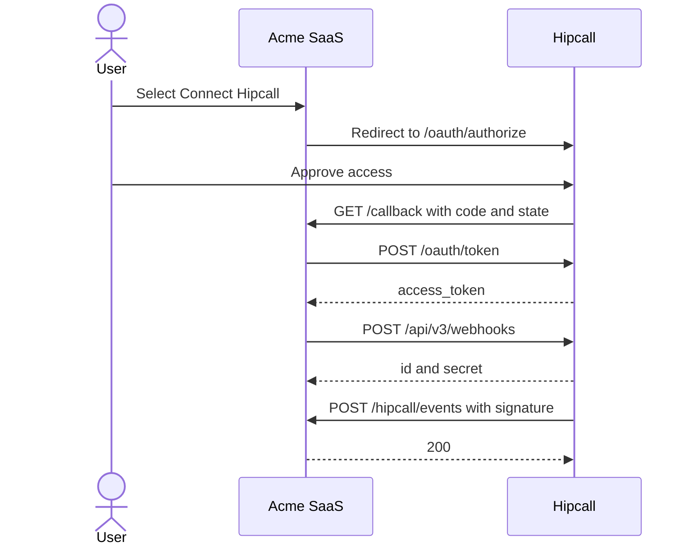

## Overview

Acme SaaS is a made-up integrator that wants to know when its customers' calls end. Setting this up by hand asks too much of the customer: open the Hipcall panel, create a webhook, copy the URL from Acme SaaS, then copy the signing secret back. With OAuth2 and the Webhook API, the customer selects one button and Acme SaaS creates the webhook itself.

This article builds that flow with ASP.NET Core Minimal API. The app sends the user to Hipcall to approve access, exchanges the code for a token, creates a `call.ended` webhook, saves the signing secret, verifies every incoming request, and can ask Hipcall for a test event.



## Before you start

You need:

- .NET 8 SDK. `dotnet --version` must print 8.0 or higher.
- An OAuth application with a client ID, a client secret, and a redirect URI. It must be allowed to request `webhooks:write` and `communication:read`. Creating a webhook needs `webhooks:write`. Subscribing to `call.ended` also needs a scope that the event accepts, and `communication:read` is one of them.
- A Hipcall user with the `settings::developer` permission to approve the access.
- A Hipcall plan that includes webhooks.
- A free webhook slot. Each account can have up to 3 webhooks by default, and the limit counts every webhook in the account.
- A public HTTPS address. Hipcall does not send to plain HTTP. For local work, expose port 5080 with a tunnel such as ngrok:

```bash
ngrok http 5080
```

The app builds the redirect URI and the webhook URL from this one address. Register `https://your-server.example.com/callback` as the redirect URI of the OAuth application.

Keep the client secret in an environment variable, never in your code:

```bash
export HIPCALL_CLIENT_ID="..."
export HIPCALL_CLIENT_SECRET="..."
export PUBLIC_URL="https://your-server.example.com"
```

On Windows PowerShell:

```powershell
$env:HIPCALL_CLIENT_ID = "..."
$env:HIPCALL_CLIENT_SECRET = "..."
$env:PUBLIC_URL = "https://your-server.example.com"
```

`HIPCALL_BASE_URL` is optional and defaults to `https://use.hipcall.com`.

## Step 1: Send the user to Hipcall

Redirect the browser to the authorize endpoint:

```http
GET https://use.hipcall.com/oauth/authorize
  ?response_type=code
  &client_id=YOUR_CLIENT_ID
  &redirect_uri=https%3A%2F%2Fyour-server.example.com%2Fcallback
  &scope=profile+email+offline_access+contacts:read+webhooks:read+webhooks:write+communication:read
  &state=5718F6D482AE78DF3322714ECAB6BD7E
```

`state` is a random value that the app remembers. Hipcall returns it unchanged, and the callback rejects any request whose state it does not know.

```csharp
app.MapGet("/login", () =>
{
    var state = Convert.ToHexString(RandomNumberGenerator.GetBytes(16));
    pendingStates[state] = true;

    return Results.Redirect($"{baseUrl}/oauth/authorize?response_type=code"
        + $"&client_id={Uri.EscapeDataString(clientId)}"
        + $"&redirect_uri={Uri.EscapeDataString(redirectUri)}"
        + $"&scope={scope}&state={state}");
});
```

The user signs in to Hipcall and approves the access. Hipcall then redirects the browser to `https://your-server.example.com/callback?code=...&state=...`.

## Step 2: Exchange the code for a token

Send the code to the token endpoint as a form body:

```csharp
using var tokenResponse = await http.PostAsync("/oauth/token", new FormUrlEncodedContent(
    new Dictionary<string, string>
    {
        ["grant_type"] = "authorization_code",
        ["code"] = code,
        ["client_id"] = clientId,
        ["client_secret"] = clientSecret,
        ["redirect_uri"] = redirectUri
    }));
```

A successful response is `200` with a body like this. The example shows the fields the app reads:

```json
{
  "access_token": "SFMyNTY.g2gD...",
  "token_type": "Bearer",
  "expires_in": 3599,
  "scope": "profile email contacts:read webhooks:write communication:read offline_access"
}
```

Read `scope` before you go on. It lists what Hipcall granted, and that can be less than the app asked for (see `403` under "When it fails"). The token expires after 3599 seconds.

## Step 3: Create the webhook

Call `POST /api/v3/webhooks` with the token. The body needs a name, your receiver URL, and the events to subscribe to:

```csharp
var payload = JsonSerializer.Serialize(new
{
    name = "Acme SaaS - Hangup Sync",
    url = receiverUrl,
    event_types = new[] { "call.ended" }
});
using var request = new HttpRequestMessage(HttpMethod.Post, "/api/v3/webhooks")
{
    Content = new StringContent(payload, Encoding.UTF8, "application/json")
};
request.Headers.Authorization = new AuthenticationHeaderValue("Bearer", accessToken);
using var response = await http.SendAsync(request);
```

A successful call returns a `2xx` status and this body. Fields such as `health` are left out here:

```json
{
  "data": {
    "id": "06a1bf55-9709-4403-bea5-37d6aa96c7ea",
    "name": "Acme SaaS - Hangup Sync",
    "state": "active",
    "secret": "whsec_XXXXXXXXXXXXXXXXXXXXXXXXXXXXXXXXXXXXXXXXXXX=",
    "url": "https://your-server.example.com/hipcall/events",
    "event_types": ["call.ended"],
    "include_recording_links": false,
    "previous_secret_expires_at": null
  }
}
```

The secret appears only in this response, and `GET /api/v3/webhooks/{id}` never returns it. Save `data.id` and `data.secret` now. If you lose the secret, create a new one with `POST /api/v3/webhooks/{id}/rotate-secret`. The old secret keeps working for 24 hours.

The example app writes both values to `webhook.json`, together with the access token. Treat that file as a secret and keep it out of version control. In production, store it encrypted, one record per customer.

## Step 4: Verify the signature

Every request from Hipcall follows the [Standard Webhooks](https://www.standardwebhooks.com) specification. These are the headers of a `webhook.test` delivery from our test, shortened:

```http
POST /hipcall/events HTTP/1.1
content-type: application/json
user-agent: Hipcall-Webhooks/1.0
webhook-id: evt_qn5a3svvwkx7ep3p5w5dzit4a4
webhook-timestamp: 1793176960
webhook-signature: v1,puuxXYjVf14o... v1,Sj1bLEjN/rj+...
```

The header holds two signatures because the secret of that webhook had been rotated about two minutes earlier. For 24 hours after a rotation, every request carries one signature for each valid secret.

To verify a request:

1. Read the raw body bytes. Do not parse and serialize the JSON again, because any change breaks the signature.
2. Build the signed text: `{webhook-id}.{webhook-timestamp}.{body}`.
3. Compute an HMAC-SHA256 of that text. The key is the base64-decoded part of the secret after `whsec_`.
4. Encode the result in base64 and compare it with each `v1,` value in `webhook-signature` using a constant-time comparison. Accept the request if any value matches.
5. Reject the request if `webhook-timestamp` is more than 5 minutes away from your clock.

Answer `401` when the check fails and `200` when the event is handled. Hipcall counts any `2xx` as delivered. For duplicate deliveries, event order, and retries, read {{ article#86a541e5-f388-4f6b-9151-6502c1b9f6f6 }}.

The body always has the same four fields. This is the test event:

```json
{
  "id": "evt_qn5a3svvwkx7ep3p5w5dzit4a4",
  "type": "webhook.test",
  "timestamp": "2026-10-28T08:42:39Z",
  "data": {
    "endpoint_id": "357ffdcc-0fb3-4ae4-ac40-3e12a79888cb",
    "message": "Hipcall webhook test"
  }
}
```

This is the full `call.ended` event body:

```json
{
  "id": "evt_v7hpribzapcoppnlhrrhggg2ze",
  "type": "call.ended",
  "timestamp": "2026-10-22T11:54:39Z",
  "data": {
    "uuid": "8bd0a813-605b-4943-a30a-ed780f25777c",
    "direction": "inbound",
    "caller_number": "+447700XXXXXX",
    "callee_number": "+442079XXXXXX",
    "caller_id": null,
    "caller_type": "contact",
    "callee_id": 101,
    "callee_type": "user",
    "contact_id": 1050,
    "deal_id": null,
    "company_id": null,
    "user_id": 101,
    "number_id": 10,
    "channel_id": 10,
    "channel_type": "number",
    "started_at": "2026-10-22T11:54:07Z",
    "answered_at": "2026-10-22T11:54:12Z",
    "bridged_at": "2026-10-22T11:54:12Z",
    "ended_at": "2026-10-22T11:54:39Z",
    "call_duration": 32,
    "first_touch_duration": 27,
    "team_touch_at": null,
    "credited": false,
    "hangup_by": "contact",
    "missing_call": false,
    "missing_call_reason": null,
    "callback_time": null,
    "callback_user_id": null,
    "callback_cdr_uuid": null,
    "voicemail_id": null,
    "voicemail_type": null,
    "voicemail_url": null,
    "has_recording": false,
    "record_url": null,
    "call_flow": [
      {
        "action": "hangup",
        "detail": { "hangup_by": "contact" },
        "timestamp": 1792657639
      },
      {
        "action": "bridge",
        "detail": { "id": 101, "type": "user" },
        "timestamp": 1792657612
      },
      {
        "action": "init",
        "detail": { "id": 1050, "type": "contact" },
        "timestamp": 1792657607
      }
    ]
  }
}
```

`hangup_by` is `contact` or `user`. `call_duration` is in seconds.

## Step 5: Send a test event

`POST /api/v3/webhooks/{id}/test` makes Hipcall send a signed `webhook.test` event to your URL. The body is empty, and the webhook does not need to subscribe to `webhook.test`.

```csharp
using var request = new HttpRequestMessage(HttpMethod.Post, $"/api/v3/webhooks/{saved.Id}/test")
{
    Content = new StringContent("")
};
request.Headers.Authorization = new AuthenticationHeaderValue("Bearer", saved.AccessToken);
using var response = await http.SendAsync(request);
```

The response shows that Hipcall queued the event. Fields such as `payload` are left out here:

```json
{
  "data": {
    "id": 48,
    "status": "pending",
    "event_type": "webhook.test",
    "attempts": [],
    "attempt_count": 0
  }
}
```

The `id` is the delivery ID. `GET /api/v3/webhooks/{id}/deliveries/48` shows whether your server answered `200`. The receiver prints `Test event received.`

## The full script

The web project template turns on implicit usings, so the `using` lines below are all you need. Create the project and replace `Program.cs` with the code:

```bash
dotnet new web -n Hipcall.OAuthWebhook
```

```csharp
using System.Collections.Concurrent;
using System.Net.Http.Headers;
using System.Security.Cryptography;
using System.Text;
using System.Text.Json;

static string Env(string name) =>
    Environment.GetEnvironmentVariable(name)
    ?? throw new InvalidOperationException($"{name} is not set.");

var baseUrl = Environment.GetEnvironmentVariable("HIPCALL_BASE_URL") ?? "https://use.hipcall.com";
var clientId = Env("HIPCALL_CLIENT_ID");
var clientSecret = Env("HIPCALL_CLIENT_SECRET");
var publicUrl = Env("PUBLIC_URL").TrimEnd('/');
var redirectUri = $"{publicUrl}/callback";
var receiverUrl = $"{publicUrl}/hipcall/events";
const string scope = "profile+email+offline_access+contacts:read+webhooks:read+webhooks:write+communication:read";
const string storePath = "webhook.json";

var builder = WebApplication.CreateBuilder(args);
builder.WebHost.ConfigureKestrel(options => options.ListenAnyIP(5080));
var app = builder.Build();

var http = new HttpClient { BaseAddress = new Uri(baseUrl) };
var pendingStates = new ConcurrentDictionary<string, bool>();

app.MapGet("/", () => Results.Content("<a href=\"/login\">Connect Hipcall</a>", "text/html"));

app.MapGet("/login", () =>
{
    var state = Convert.ToHexString(RandomNumberGenerator.GetBytes(16));
    pendingStates[state] = true;

    return Results.Redirect($"{baseUrl}/oauth/authorize?response_type=code"
        + $"&client_id={Uri.EscapeDataString(clientId)}"
        + $"&redirect_uri={Uri.EscapeDataString(redirectUri)}"
        + $"&scope={scope}&state={state}");
});

app.MapGet("/callback", async (string? code, string? state, string? error) =>
{
    if (error is not null)
    {
        return Results.BadRequest($"Hipcall returned an error: {error}");
    }

    if (code is null || state is null || !pendingStates.TryRemove(state, out _))
    {
        return Results.BadRequest("The code is missing or the state is unknown.");
    }

    using var tokenResponse = await http.PostAsync("/oauth/token", new FormUrlEncodedContent(
        new Dictionary<string, string>
        {
            ["grant_type"] = "authorization_code",
            ["code"] = code,
            ["client_id"] = clientId,
            ["client_secret"] = clientSecret,
            ["redirect_uri"] = redirectUri
        }));
    var tokenBody = await tokenResponse.Content.ReadAsStringAsync();
    if (!tokenResponse.IsSuccessStatusCode)
    {
        return Results.Content(tokenBody, "application/json", statusCode: (int)tokenResponse.StatusCode);
    }

    using var tokenJson = JsonDocument.Parse(tokenBody);
    var accessToken = tokenJson.RootElement.GetProperty("access_token").GetString()!;
    var granted = tokenJson.RootElement.TryGetProperty("scope", out var scopeValue) ? scopeValue.GetString() : null;
    Console.WriteLine($"Granted scopes: {granted ?? "(not returned)"}");

    var payload = JsonSerializer.Serialize(new
    {
        name = "Acme SaaS - Hangup Sync",
        url = receiverUrl,
        event_types = new[] { "call.ended" }
    });
    using var request = new HttpRequestMessage(HttpMethod.Post, "/api/v3/webhooks")
    {
        Content = new StringContent(payload, Encoding.UTF8, "application/json")
    };
    request.Headers.Authorization = new AuthenticationHeaderValue("Bearer", accessToken);

    using var response = await http.SendAsync(request);
    var body = await response.Content.ReadAsStringAsync();
    if (!response.IsSuccessStatusCode)
    {
        return Results.Content(body, "application/json", statusCode: (int)response.StatusCode);
    }

    using var created = JsonDocument.Parse(body);
    var data = created.RootElement.GetProperty("data");
    var saved = new SavedWebhook(
        data.GetProperty("id").GetString()!,
        data.GetProperty("secret").GetString()!,
        accessToken);
    await File.WriteAllTextAsync(storePath, JsonSerializer.Serialize(saved));

    return Results.Content(
        $"Webhook {saved.Id} created."
        + "<form method=\"post\" action=\"/trigger-test\"><button>Send test event</button></form>",
        "text/html");
});

app.MapPost("/trigger-test", async () =>
{
    var saved = LoadWebhook();
    if (saved is null)
    {
        return Results.BadRequest("No webhook is saved yet. Connect Hipcall first.");
    }

    using var request = new HttpRequestMessage(HttpMethod.Post, $"/api/v3/webhooks/{saved.Id}/test")
    {
        Content = new StringContent("")
    };
    request.Headers.Authorization = new AuthenticationHeaderValue("Bearer", saved.AccessToken);

    using var response = await http.SendAsync(request);
    var body = await response.Content.ReadAsStringAsync();
    return Results.Content(body, "application/json", statusCode: (int)response.StatusCode);
});

app.MapPost("/hipcall/events", async (HttpRequest request) =>
{
    using var buffer = new MemoryStream();
    await request.Body.CopyToAsync(buffer);
    var rawBody = buffer.ToArray();

    var saved = LoadWebhook();
    if (saved is null)
    {
        return Results.StatusCode(StatusCodes.Status503ServiceUnavailable);
    }

    var valid = IsValidSignature(
        saved.Secret,
        request.Headers["webhook-id"].ToString(),
        request.Headers["webhook-timestamp"].ToString(),
        rawBody,
        request.Headers["webhook-signature"].ToString());
    if (!valid)
    {
        return Results.Unauthorized();
    }

    using var doc = JsonDocument.Parse(rawBody);
    var type = Field(doc.RootElement, "type");
    var data = doc.RootElement.TryGetProperty("data", out var dataValue) ? dataValue : default;

    if (type == "webhook.test")
    {
        Console.WriteLine("Test event received.");
    }
    else if (type == "call.ended")
    {
        Console.WriteLine($"call.ended {Field(data, "uuid")}: {Mask(Field(data, "caller_number"))} -> "
            + $"{Mask(Field(data, "callee_number"))}, {Field(data, "call_duration")} s, "
            + $"hung up by {Field(data, "hangup_by")}");
    }
    else
    {
        Console.WriteLine($"Ignored {type}");
    }

    return Results.Ok();
});

app.Run();

SavedWebhook? LoadWebhook() =>
    File.Exists(storePath)
        ? JsonSerializer.Deserialize<SavedWebhook>(File.ReadAllText(storePath))
        : null;

static string Mask(string value) =>
    value.Length > 6 ? string.Concat(value.AsSpan(0, 6), "XXXXXX") : value;

static string Field(JsonElement element, string name) =>
    element.ValueKind == JsonValueKind.Object
    && element.TryGetProperty(name, out var value)
    && value.ValueKind != JsonValueKind.Null
        ? value.ToString()
        : "-";

static bool IsValidSignature(string secret, string id, string timestamp, byte[] body, string signatureHeader)
{
    if (id.Length == 0 || !long.TryParse(timestamp, out var seconds))
    {
        return false;
    }

    var age = DateTimeOffset.UtcNow - DateTimeOffset.FromUnixTimeSeconds(seconds);
    if (age.Duration() > TimeSpan.FromMinutes(5))
    {
        return false;
    }

    byte[] key;
    try
    {
        key = Convert.FromBase64String(secret.StartsWith("whsec_") ? secret["whsec_".Length..] : secret);
    }
    catch (FormatException)
    {
        return false;
    }

    var signedText = Encoding.UTF8.GetBytes($"{id}.{timestamp}.").Concat(body).ToArray();
    var expected = HMACSHA256.HashData(key, signedText);

    foreach (var part in signatureHeader.Split(' ', StringSplitOptions.RemoveEmptyEntries))
    {
        var pieces = part.Split(',', 2);
        if (pieces.Length != 2 || pieces[0] != "v1")
        {
            continue;
        }

        try
        {
            if (CryptographicOperations.FixedTimeEquals(Convert.FromBase64String(pieces[1]), expected))
            {
                return true;
            }
        }
        catch (FormatException)
        {
        }
    }

    return false;
}

record SavedWebhook(string Id, string Secret, string AccessToken);
```

Start the app with the environment variables set, and keep the tunnel running:

```bash
dotnet run
```

Open the public address, select Connect Hipcall, and approve the access. Then select Send test event. The console shows one line for each step, and one more line for every `call.ended` event:

```text
Granted scopes: profile email contacts:read webhooks:write communication:read offline_access
Test event received.
call.ended 8bd0a813-605b-4943-a30a-ed780f25777c: +447700XXXXXX -> +442079XXXXXX, 32 s, hung up by contact
```

After the webhook is saved, you can see a rejected request by sending one with a wrong signature. The app answers `401` with an empty body:

```bash
curl -i -X POST http://localhost:5080/hipcall/events \
  -H "content-type: application/json" \
  -H "webhook-id: evt_local_test" \
  -H "webhook-timestamp: $(date +%s)" \
  -H "webhook-signature: v1,AAAA" \
  -d '{"id":"evt_local_test","type":"webhook.test","timestamp":"2026-10-22T08:00:00Z","data":{}}'
```

## When it fails

### 403: insufficient_scope

```json
{
  "error": "insufficient_scope",
  "errors": {
    "detail": "Forbidden",
    "required_scope": "webhooks:write"
  }
}
```

The token does not carry `webhooks:write`. Look at the `granted scopes` line in the console. In our first test, the token came back with `profile email contacts:read communication:read offline_access`, although the authorize URL asked for `webhooks:write`. Hipcall granted the scope only after it was enabled for the OAuth application. Enable it, then connect again so the app gets a new token.

### 422: webhook_limit_reached

```json
{
  "error": "webhook_limit_reached",
  "errors": {
    "detail": "This account has reached its webhook limit."
  }
}
```

The account already has its maximum number of webhooks. Open Settings > Developer > Webhooks, delete one you no longer use, and connect again. A token from OAuth lists only the webhooks that its own application created, so a webhook made in the panel or with an API token does not show up in `GET /api/v3/webhooks`.

If the plan does not include webhooks, the API answers with the error code `api_feature_missing` instead.

### Test event: webhook_not_active

```json
{
  "error": "webhook_not_active",
  "errors": {
    "detail": "Only an active webhook can be sent a test event."
  }
}
```

The reference lists the status as `422` or `400`. A paused webhook has the state `passive`. Send `{"state": "active"}` with `PATCH /api/v3/webhooks/{id}` to turn it on again, then repeat the test.

### Test event: 409 webhook_test_pending

Only one test event can be on its way at a time. Wait until the first one has been delivered, then send the next.

### The delivery shows 404 and an ngrok message

The Deliveries tab of the webhook shows the status `404` and this response body when the tunnel is not running:

```text
The endpoint your-server.ngrok-free.dev is offline.

ERR_NGROK_3200
```

The `404` comes from ngrok, not from your code. Start the tunnel with the same address as `PUBLIC_URL`. Hipcall retries a failed delivery up to 10 times over about 3 days, so the event still arrives when the tunnel comes back.

### Your receiver answers 401

The signature check failed. Check these things:

- `webhook.json` holds the secret of this webhook. A secret from an older webhook does not match.
- The code reads the raw body and does not change it.
- Your clock is within 5 minutes of the real time.

## Parameter reference

### Authorize request

| Parameter | Type | Required | Description |
|---|---|---|---|
| `response_type` | string | yes | Always `code`. |
| `client_id` | string | yes | The client ID of your OAuth application. |
| `redirect_uri` | string | yes | Where Hipcall sends the user back. It must match the address registered for the application. |
| `scope` | string | yes | Scopes separated by `+`. See the table below. |
| `state` | string | yes | A random value. Hipcall returns it unchanged. |

### Token request

Send these fields as `application/x-www-form-urlencoded` to `POST /oauth/token`.

| Parameter | Type | Required | Description |
|---|---|---|---|
| `grant_type` | string | yes | Always `authorization_code`. |
| `code` | string | yes | The code from the callback. |
| `client_id` | string | yes | The client ID of your OAuth application. |
| `client_secret` | string | yes | The client secret of your OAuth application. |
| `redirect_uri` | string | yes | The same value as in the authorize request. |

### Create webhook body

| Field | Type | Description |
|---|---|---|
| `name` | string | The name that appears in the webhook list. |
| `url` | string | Your HTTPS receiver address. It must be reachable from the public internet. |
| `event_types` | array of string | The events to subscribe to, for example `["call.ended"]`. |

### Scopes

| Scope | What it allows |
|---|---|
| `webhooks:write` | Create, change, and delete webhooks, send test events, and rotate secrets. |
| `webhooks:read` | List and read webhooks and their deliveries. `webhooks:write` also allows this. |
| `communication:read` | Subscribe to call events such as `call.ended`. `communication` also works. |

The authorize URL in this article also asks for `profile`, `email`, `contacts:read`, and `offline_access`. The webhook endpoints in the reference do not require them.

## Next steps

- Request a new token before the old one expires. The example saves only the first token, so a test event after about an hour needs a new login.
- Store the webhook ID, secret, and token of each customer in a database, one webhook for each customer.
- Store incoming events in your database (such as PostgreSQL, SQL Server, or SQLite), deduplicating records by call uuid.
- Ask questions in the [Hipcall Community](https://community.hipcall.com/).
