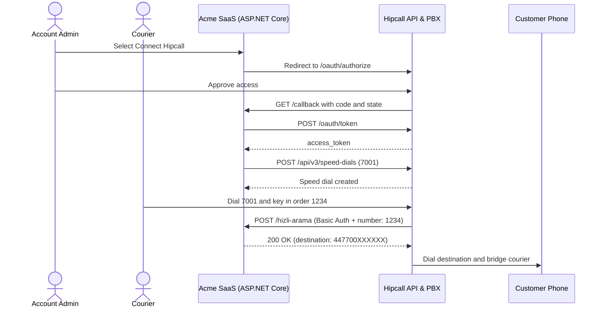

## Overview

Acme SaaS is a made-up delivery platform whose couriers need to call customers about their orders. Under data protection rules such as GDPR, couriers should not see a customer's personal phone number. Hipcall's speed dial feature solves this: the courier dials the speed dial extension (`7001`) and keys in the order number (`1234`). Hipcall posts those digits to Acme SaaS's web service, the service replies with the customer's phone number, and Hipcall bridges the call without ever exposing the number to the courier.

Asking every customer to open the Hipcall dashboard, create a speed dial extension by hand, paste the web service URL, and type in Basic Auth credentials adds friction. With OAuth2 and the Speed Dial API, the customer selects one button and Acme SaaS creates extension `7001` itself.

This article builds that flow with ASP.NET Core Minimal API. The app sends the user to Hipcall to approve access, exchanges the code for a token, creates the `7001` speed dial record via `POST /api/v3/speed-dials`, and answers incoming lookup requests at `/hizli-arama` when a courier keys in an order number.



## Before you start

You need:

- .NET 8 SDK (`dotnet --version` must print 8.0 or higher).
- A Hipcall plan that includes API access.
- A Hipcall OAuth2 application with a Client ID, a Client Secret, and a Redirect URI, allowed to request `communication_settings:write`. See [How to Authorise Users and Get Tokens with Hipcall OAuth2](/blog/how-to-authorise-users-and-get-tokens-with-hipcall-oauth2/) for how to request client credentials.
- A Hipcall user with the `communication::settings` permission to approve access.
- A free extension number (`7001` in this example) that is not already assigned to another user, team, greeting, or speed dial in the account.
- A public HTTPS address. Hipcall checks that `web_service_url` starts with `https://` and is reachable from the public internet when you create the speed dial. For local development, expose port 5080 with a tunnel such as ngrok:

```bash
ngrok http 5080
```

Register `https://your-server.example.com/callback` as the redirect URI of your OAuth application. Keep secrets in environment variables rather than in your source code:

```bash
export HIPCALL_CLIENT_ID="..."
export HIPCALL_CLIENT_SECRET="..."
export PUBLIC_URL="https://your-server.example.com"
export WEB_SERVICE_PASSWORD="..."
```

On Windows PowerShell:

```powershell
$env:HIPCALL_CLIENT_ID = "..."
$env:HIPCALL_CLIENT_SECRET = "..."
$env:PUBLIC_URL = "https://your-server.example.com"
$env:WEB_SERVICE_PASSWORD = "..."
```

`HIPCALL_BASE_URL` is optional and defaults to `https://use.hipcall.com`.

## Step 1: Send the user to Hipcall and get a token

Redirect the browser to `/oauth/authorize` and include `communication_settings:write` in the `scope` parameter:

```http
GET https://use.hipcall.com/oauth/authorize
  ?response_type=code
  &client_id=YOUR_CLIENT_ID
  &redirect_uri=https%3A%2F%2Fyour-server.example.com%2Fcallback
  &scope=profile+email+offline_access+communication_settings:write
  &state=5718F6D482AE78DF3322714ECAB6BD7E
```

Once the user signs in and approves access, Hipcall redirects the browser to `/callback?code=...&state=...`. Your callback endpoint checks the `state` parameter and exchanges the `code` for an `access_token` at `POST /oauth/token`:

```csharp
using var tokenResponse = await http.PostAsync("/oauth/token", new FormUrlEncodedContent(
    new Dictionary<string, string>
    {
        ["grant_type"] = "authorization_code",
        ["code"] = code,
        ["client_id"] = clientId,
        ["client_secret"] = clientSecret,
        ["redirect_uri"] = redirectUri
    }));
```

Check the `scope` field in the token response before continuing to confirm that Hipcall granted `communication_settings:write`.

## Step 2: Create the speed dial

Call `POST /api/v3/speed-dials` with the `access_token`. The body sets the extension number (`extension_number`), display name (`name`), your HTTPS listener address (`web_service_url`), and Basic Auth credentials:

```csharp
var payload = JsonSerializer.Serialize(new
{
    extension_number = "7001",
    name = "Order status",
    web_service_auth = true,
    web_service_password = webServicePassword,
    web_service_url = webServiceUrl,
    web_service_username = webServiceUsername
});
using var request = new HttpRequestMessage(HttpMethod.Post, "/api/v3/speed-dials")
{
    Content = new StringContent(payload, Encoding.UTF8, "application/json")
};
request.Headers.Authorization = new AuthenticationHeaderValue("Bearer", accessToken);
using var response = await http.SendAsync(request);
```

A successful request returns a `2xx` status code and the created record:

```json
{
  "data": {
    "id": "dd8fad9f-2689-48cc-8e34-67e182e6cc51",
    "name": "Order status",
    "state": "active",
    "inserted_at": "2026-11-03T08:11:43",
    "updated_at": "2026-11-03T08:11:43",
    "extension_number": "7001",
    "web_service_url": "https://your-server.example.com/hizli-arama",
    "web_service_auth": true,
    "web_service_username": "hipcall"
  }
}
```

Keep three rules in mind for this endpoint:

- **`web_service_password` is never returned:** The password field is write-only. Hipcall omits it from the creation response and from `GET /api/v3/speed-dials` responses.
- **Basic Auth requirements:** When `web_service_auth` is `true`, both `web_service_username` and `web_service_password` must be provided.
- **Default state and greetings:** When `state` is omitted, the speed dial is created as `active` and plays the account's default greeting and error prompts. You can pause or resume it later by sending `{"state": "passive"}` or `{"state": "active"}` to `PATCH /api/v3/speed-dials/{id}`.

### Route a phone number to extension 7001

The Hipcall API does not have an endpoint to route an external phone number to a speed dial extension. For inbound calls from couriers on an external line to reach `7001`, display a reminder in your UI right after `POST /api/v3/speed-dials` succeeds:

> Your speed dial (extension 7001) has been created through the API. To route inbound calls to it, open **Settings > Phone System > Phone Numbers** in the Hipcall dashboard, select your number, and set the business-hours target under **Working Hours** to extension **7001**.

## Step 3: Return the customer phone number for an order code

When a courier dials `7001`, hears the prompt, and keys in an order code (for example `1234`), Hipcall sends an HTTP POST request to your `web_service_url` (`/hizli-arama`):

```json
{
  "timestamp": 1791891730,
  "number": "1234",
  "uuid": "e785a112-4c9b-41d0-9b1e-1029384787e5",
  "user_id": null,
  "speed_dial_id": 19
}
```

The `number` field holds the DTMF digits keyed in by the caller. Because `web_service_auth` is `true`, Hipcall includes an `Authorization: Basic <Base64>` header.

Your listener endpoint (`/hizli-arama`) needs to:

1. Decode the Base64 credentials in the `Authorization` header and verify the username and password using a constant-time comparison (`CryptographicOperations.FixedTimeEquals`). Return `401` if the check fails.
2. Read the `number` field from the JSON body and look up the customer phone number for that order code.
3. Reply within **3 seconds** with HTTP `200` and a JSON body containing the digits-only `destination` number (including country code, without a leading `+`):

```json
{
  "destination": "447700XXXXXX"
}
```

Hipcall then dials `destination` and bridges the courier with the customer without revealing the phone number.

## The full script

Create a new web project and replace `Program.cs` with the code below:

```bash
dotnet new web -n Hipcall.SpeedDial
```

```csharp
using System.Collections.Concurrent;
using System.Net.Http.Headers;
using System.Security.Cryptography;
using System.Text;
using System.Text.Json;

static string Env(string name) =>
    Environment.GetEnvironmentVariable(name)
    ?? throw new InvalidOperationException($"{name} is not set.");

var baseUrl = Environment.GetEnvironmentVariable("HIPCALL_BASE_URL") ?? "https://use.hipcall.com";
var clientId = Env("HIPCALL_CLIENT_ID");
var clientSecret = Env("HIPCALL_CLIENT_SECRET");
var publicUrl = Env("PUBLIC_URL").TrimEnd('/');
var webServiceUsername = Environment.GetEnvironmentVariable("WEB_SERVICE_USERNAME") ?? "hipcall";
var webServicePassword = Env("WEB_SERVICE_PASSWORD");
var redirectUri = $"{publicUrl}/callback";
var webServiceUrl = $"{publicUrl}/hizli-arama";
const string scope = "profile+email+offline_access+communication_settings:write";

var orders = new Dictionary<string, string>
{
    ["1234"] = "447700XXXXXX"
};

var builder = WebApplication.CreateBuilder(args);
builder.WebHost.ConfigureKestrel(options => options.ListenAnyIP(5080));
var app = builder.Build();

var http = new HttpClient { BaseAddress = new Uri(baseUrl) };
var pendingStates = new ConcurrentDictionary<string, bool>();

app.MapGet("/", () => Results.Content("<a href=\"/login\">Connect Hipcall</a>", "text/html"));

app.MapGet("/login", () =>
{
    var state = Convert.ToHexString(RandomNumberGenerator.GetBytes(16));
    pendingStates[state] = true;

    return Results.Redirect($"{baseUrl}/oauth/authorize?response_type=code"
        + $"&client_id={Uri.EscapeDataString(clientId)}"
        + $"&redirect_uri={Uri.EscapeDataString(redirectUri)}"
        + $"&scope={scope}&state={state}");
});

app.MapGet("/callback", async (string? code, string? state, string? error) =>
{
    if (error is not null)
    {
        return Results.BadRequest($"Hipcall returned an error: {error}");
    }

    if (code is null || state is null || !pendingStates.TryRemove(state, out _))
    {
        return Results.BadRequest("The code is missing or the state is unknown.");
    }

    using var tokenResponse = await http.PostAsync("/oauth/token", new FormUrlEncodedContent(
        new Dictionary<string, string>
        {
            ["grant_type"] = "authorization_code",
            ["code"] = code,
            ["client_id"] = clientId,
            ["client_secret"] = clientSecret,
            ["redirect_uri"] = redirectUri
        }));
    var tokenBody = await tokenResponse.Content.ReadAsStringAsync();
    if (!tokenResponse.IsSuccessStatusCode)
    {
        return Results.Content(tokenBody, "application/json", statusCode: (int)tokenResponse.StatusCode);
    }

    using var tokenJson = JsonDocument.Parse(tokenBody);
    var accessToken = tokenJson.RootElement.GetProperty("access_token").GetString()!;
    var granted = tokenJson.RootElement.TryGetProperty("scope", out var scopeValue) ? scopeValue.GetString() : null;
    Console.WriteLine($"Granted scopes: {granted ?? "(not returned)"}");

    var payload = JsonSerializer.Serialize(new
    {
        extension_number = "7001",
        name = "Order status",
        web_service_auth = true,
        web_service_password = webServicePassword,
        web_service_url = webServiceUrl,
        web_service_username = webServiceUsername
    });
    using var request = new HttpRequestMessage(HttpMethod.Post, "/api/v3/speed-dials")
    {
        Content = new StringContent(payload, Encoding.UTF8, "application/json")
    };
    request.Headers.Authorization = new AuthenticationHeaderValue("Bearer", accessToken);

    using var response = await http.SendAsync(request);
    var body = await response.Content.ReadAsStringAsync();
    if (!response.IsSuccessStatusCode)
    {
        return Results.Content(body, "application/json", statusCode: (int)response.StatusCode);
    }

    using var created = JsonDocument.Parse(body);
    var id = created.RootElement.GetProperty("data").GetProperty("id").GetString();
    Console.WriteLine($"Speed dial 7001 created: {id}");

    return Results.Content(
        "<p>Your speed dial (extension 7001) has been created through the API. "
        + "To route calls to it, open <b>Settings -&gt; Phone Numbers</b> in the Hipcall dashboard "
        + "and set your number's business-hours target to extension <b>7001</b>.</p>",
        "text/html; charset=utf-8");
});

app.MapPost("/hizli-arama", async (HttpRequest request) =>
{
    if (!IsValidBasicAuth(request.Headers.Authorization.ToString(), webServiceUsername, webServicePassword))
    {
        return Results.Unauthorized();
    }

    using var doc = await JsonDocument.ParseAsync(request.Body);
    var orderNumber = doc.RootElement.TryGetProperty("number", out var numProp) ? numProp.GetString() : null;
    if (orderNumber is null || !orders.TryGetValue(orderNumber, out var destination))
    {
        Console.WriteLine($"Order not found: {orderNumber ?? "(empty)"}");
        return Results.NotFound();
    }

    Console.WriteLine($"Order {orderNumber} routed to {Mask(destination)}");
    return Results.Ok(new { destination });
});

app.Run();

static string Mask(string value) =>
    value.Length > 6 ? string.Concat(value.AsSpan(0, 6), "XXXXXX") : value;

static bool IsValidBasicAuth(string header, string expectedUser, string expectedPass)
{
    if (!header.StartsWith("Basic ", StringComparison.OrdinalIgnoreCase))
    {
        return false;
    }

    byte[] raw;
    try
    {
        raw = Convert.FromBase64String(header["Basic ".Length..].Trim());
    }
    catch (FormatException)
    {
        return false;
    }

    var parts = Encoding.UTF8.GetString(raw).Split(':', 2);
    if (parts.Length != 2)
    {
        return false;
    }

    var userOk = CryptographicOperations.FixedTimeEquals(
        Encoding.UTF8.GetBytes(parts[0]),
        Encoding.UTF8.GetBytes(expectedUser));
    var passOk = CryptographicOperations.FixedTimeEquals(
        Encoding.UTF8.GetBytes(parts[1]),
        Encoding.UTF8.GetBytes(expectedPass));

    return userOk && passOk;
}
```

With the environment variables set and your tunnel running, start the application:

```bash
dotnet run
```

Open your `PUBLIC_URL`, select **Connect Hipcall**, and approve access. Once extension `7001` is created, test the `/hizli-arama` endpoint locally with `curl`:

```bash
curl -i -X POST http://localhost:5080/hizli-arama \
  -u "hipcall:$WEB_SERVICE_PASSWORD" \
  -H "content-type: application/json" \
  -d '{"timestamp":1791891730,"number":"1234","uuid":"e785a112-4c9b-41d0-9b1e-1029384787e5","user_id":null,"speed_dial_id":19}'
```

The server answers `200 OK` with the destination number and logs:

```text
Granted scopes: profile email offline_access communication_settings:write
Speed dial 7001 created: dd8fad9f-2689-48cc-8e34-67e182e6cc51
Order 1234 routed to 447700XXXXXX
```

## When it fails

### 403 Forbidden: insufficient_scope

```json
{
  "error": "insufficient_scope",
  "errors": {
    "detail": "Forbidden",
    "required_scope": "communication_settings:write"
  }
}
```

The token does not carry `communication_settings:write`. Check the `Granted scopes` line in the console. Even when your authorise URL asks for `communication_settings:write`, Hipcall only includes it in the token after that scope has been enabled for your OAuth application on Hipcall's side. Ask the Hipcall team to enable `communication_settings:write` (and `communication_settings:read` if you list speed dials) for your client ID, then sign in again. Also confirm that the approving Hipcall user holds the `communication::settings` permission.

### 422 Unprocessable Entity: Extension conflict or invalid URL

If `POST /api/v3/speed-dials` returns `422`, check three common causes:

- **Extension number already in use:** The `extension_number` (`7001`) is already assigned to another speed dial, user, team, or greeting in the account. Query `GET /api/v3/speed-dials` or `GET /api/v3/extensions` and pick a free number.
- **`web_service_url` is not reachable:** Hipcall verifies that `web_service_url` starts with `https://` and is publicly reachable when saving the record. Make sure your ngrok tunnel is running.
- **Missing Basic Auth credentials:** When `web_service_auth` is `true`, both `web_service_username` and `web_service_password` are required.

### Hipcall plays the error prompt and drops the call

If Hipcall plays the error greeting and hangs up after the courier keys in the order number, one of the following happened:

- Your web service took longer than **3 seconds** to respond.
- Your web service returned a status code other than `200 OK` (such as `401`, `404`, or `500`).
- The Basic Auth username or password did not match what your server expected.
- The `destination` field in the JSON response was not a dialable phone number.

## Parameter reference

### Create speed dial body (`POST /api/v3/speed-dials`)

| Field | Type | Required | Description |
|---|---|---|---|
| `extension_number` | string | yes | A free extension number to assign to the speed dial (for example `"7001"`). |
| `name` | string | yes | Display name in the speed dial list (for example `"Order status"`). |
| `web_service_url` | string | yes | Public HTTPS URL where Hipcall posts the dialled digits. |
| `web_service_auth` | boolean | yes | When `true`, Hipcall sends Basic Auth credentials with every request. |
| `web_service_username` | string | conditional | Required when `web_service_auth` is `true`. Basic Auth username. |
| `web_service_password` | string | conditional | Required when `web_service_auth` is `true`. Write-only; never returned in API responses. |
| `state` | string | no | `"active"` (default) or `"passive"`. |

### Incoming web service request (`POST /hizli-arama`) and response

| Field | Direction | Type | Description |
|---|---|---|---|
| `timestamp` | Request | integer | Unix timestamp when the request was sent. |
| `number` | Request | string | DTMF digits keyed in by the caller (the order code). |
| `uuid` | Request | string | Unique identifier (UUID) of the call. |
| `user_id` | Request | integer / null | ID of the Hipcall user who placed the call, or `null` for external inbound calls. |
| `speed_dial_id` | Request | integer | ID of the speed dial record that was triggered. |
| `destination` | Response | string | Target phone number for Hipcall to dial (for example `"447700XXXXXX"`). |

### Scopes

| Scope | What it allows |
|---|---|
| `communication_settings:write` | Create (`POST /api/v3/speed-dials`) and update (`PATCH /api/v3/speed-dials/{id}`) speed dials. |
| `communication_settings:read` | List (`GET /api/v3/speed-dials`) and read (`GET /api/v3/speed-dials/{id}`) speed dials. `communication_settings:write` also allows this. |

## Next steps

- Receive `call.ended` events when speed dial calls finish by adding the webhook setup from [How to Set Up Webhooks Through the OAuth2 API](/blog/how-to-set-up-a-hipcall-webhook-through-oauth2/).
- Place outbound calls from a button in your app with [How to Start Click-to-Call Outbound Calls with OAuth2](/blog/how-to-start-click-to-call-outbound-calls-with-oauth2/).
- Browse all endpoints in the [Hipcall API Reference](https://use.hipcall.com/api-docs/).
- Ask questions in the [Hipcall Community](https://community.hipcall.com/).
