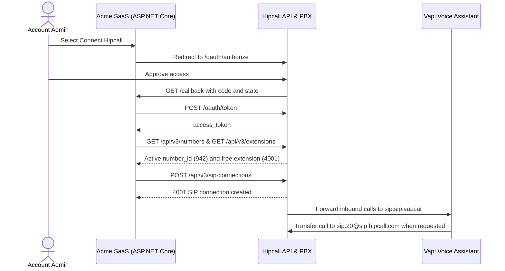

## Overview

Acme SaaS is a made-up integrator that connects a Vapi voice AI assistant to its customers' Hipcall phone lines. Incoming calls are answered by the Vapi assistant first, and when a caller asks to speak to a person, Vapi transfers the call over SIP back to a Hipcall extension (such as extension `20`).

Asking every customer to open the Hipcall dashboard, create a SIP connection by hand, pick an active number, find an unused extension, and copy termination credentials across is error-prone. With OAuth2 and the SIP Connections API, the customer selects one button and Acme SaaS looks up the active phone number, finds a free extension, and creates the Vapi SIP connection automatically.

This article walks through setting up the assistant, BYO SIP trunk number, and call transfer tool in Vapi, then building the one-click `POST /api/v3/sip-connections` flow with ASP.NET Core Minimal API.



## Before you start

You need:

- .NET 8 SDK (`dotnet --version` must print 8.0 or higher).
- A [Vapi](https://dashboard.vapi.ai) account.
- A Hipcall plan that includes API access and SIP connections, with at least one active phone number (`state: "active"`).
- A Hipcall OAuth2 application with a Client ID, a Client Secret, and a Redirect URI, allowed to request `communication_settings:read` and `communication_settings:write`. See [How to Authorise Users and Get Tokens with Hipcall OAuth2](/blog/how-to-authorise-users-and-get-tokens-with-hipcall-oauth2/) for how to request client credentials.
- A Hipcall user with the `communication::settings` permission to approve access.
- A public HTTPS address for your `/callback` redirect URI. For local development, expose port 5000 with a tunnel such as ngrok:

```bash
ngrok http 5000
```

Keep your client credentials and SIP credentials in environment variables:

```bash
export HIPCALL_CLIENT_ID="..."
export HIPCALL_CLIENT_SECRET="..."
export PUBLIC_URL="https://your-server.example.com"
export SIP_USERNAME="442079XXXXXX"
export SIP_PASSWORD="..."
export TERMINATION_AUTH_PASSWORD="..."
```

On Windows PowerShell:

```powershell
$env:HIPCALL_CLIENT_ID = "..."
$env:HIPCALL_CLIENT_SECRET = "..."
$env:PUBLIC_URL = "https://your-server.example.com"
$env:SIP_USERNAME = "442079XXXXXX"
$env:SIP_PASSWORD = "..."
$env:TERMINATION_AUTH_PASSWORD = "..."
```

`SIP_PASSWORD` and `TERMINATION_AUTH_PASSWORD` are the connection password of your phone number under **Settings > Phone System > Phone Numbers > Connection Settings** in the Hipcall dashboard. `HIPCALL_BASE_URL` is optional and defaults to `https://use.hipcall.com`.

## Step 1: Set up the assistant and BYO SIP trunk number in Vapi

Before Hipcall sends calls to Vapi, create three records in the Vapi dashboard:

1. **Create an assistant (Assistants > Create Assistant):** Select **Create Assistant** in Vapi and write the system prompt that tells the assistant how to greet callers and answer their questions.
2. **Add a SIP trunk (Integrations > SIP Trunk):** Open **Integrations** from the left menu, find **SIP Trunk**, select **Add New SIP Trunk**, and open **Configure**. Enter a name and the IP address of the Hipcall SIP server (`31.192.211.146`), leave the remaining settings untouched, and select **Save**. This creates a SIP Trunk Credential in Vapi.
3. **Add the phone number (Phone Numbers > Create Phone Number):** Open **Phone Numbers**, select **Create Phone Number**, and switch to the **BYO SIP Trunk Number** tab:
   - Enter your Hipcall phone number (`+442079XXXXXX`).
   - Enable **Allow Non-E164**.
   - Select the **SIP Trunk Credential** you created in the previous step and save.
   - Scroll down to the assistant assignment section and select the assistant you created in step 1.

## Step 2: Connect with OAuth2 and find an active number and free extension

Redirect the browser to `/oauth/authorize` and include `communication_settings:read` and `communication_settings:write` in the `scope` parameter:

```http
GET https://use.hipcall.com/oauth/authorize
  ?response_type=code
  &client_id=YOUR_CLIENT_ID
  &redirect_uri=https%3A%2F%2Fyour-server.example.com%2Fcallback
  &scope=profile+email+offline_access+communication_settings:read+communication_settings:write
  &state=5718F6D482AE78DF3322714ECAB6BD7E
```

After `/callback` exchanges the `code` for an `access_token` at `POST /oauth/token`, your server fetches the two values needed to create the SIP connection:

1. **Active phone number (`GET /api/v3/numbers?limit=100`):** Lists the phone numbers in the account and picks the first one with `state: "active"`, reading both its integer `id` (for example `942`) and its E.164 `number` string (`"+442079XXXXXX"`).
2. **Unused extension number (`GET /api/v3/extensions?limit=100` and `GET /api/v3/sip-connections?limit=100`):** Collects every extension number already in use in the account and picks the first free number starting from `"4001"`.

## Step 3: Create the SIP connection through the API

The SIP connection uses the following configuration values:

```json
{
  "VapiTerminationUri": "sip:sip.vapi.ai",
  "SipUsername": "442079XXXXXX",
  "SipPassword": "...",
  "TerminationAuthPassword": "..."
}
```

- **`vapiTerminationUri` (`termination_uri`):** A fixed value for Vapi that is always set to `"sip:sip.vapi.ai"`.
- **`sipUsername` (`username`) and `termination_auth_username`:** Both fields use your Hipcall phone number assigned to Vapi. `termination_auth_username` must start with `+` (`"+442079XXXXXX"`), whereas `username` does not include the leading `+` (`"442079XXXXXX"`).
- **`sipPassword` and `terminationAuthPassword`:** The connection password of your phone number from the Hipcall dashboard.

Send a POST request to `/api/v3/sip-connections` with the values collected in step 2:

```csharp
var sipPayload = JsonSerializer.Serialize(new
{
    extension_number = freeExtension,
    name = "Vapi SIP Integration",
    number_id = activeNumberId.Value,
    termination_uri = vapiTerminationUri,
    username = sipUsername,
    password = sipPassword,
    termination_auth_enabled = true,
    termination_auth_username = activePhoneNumber,
    termination_auth_password = terminationAuthPassword
});
using var sipRequest = new HttpRequestMessage(HttpMethod.Post, "/api/v3/sip-connections")
{
    Content = new StringContent(sipPayload, Encoding.UTF8, "application/json")
};
sipRequest.Headers.Authorization = new AuthenticationHeaderValue("Bearer", accessToken);
using var sipResponse = await http.SendAsync(sipRequest);
```

A successful request returns `201 Created` and the created SIP connection record:

```json
{
  "data": {
    "id": 301,
    "name": "Vapi SIP Integration",
    "number": {
      "id": 942,
      "number": "+442079XXXXXX",
      "country": "GB"
    },
    "username": "442079XXXXXX",
    "realm": "sipcs.hipcall.com",
    "inserted_at": "2026-11-04T13:23:38",
    "updated_at": "2026-11-04T13:23:38",
    "extension_number": "4001",
    "created_by_user_id": 4200,
    "termination_uri": "sip:sip.vapi.ai",
    "number_id": 942,
    "termination_auth_enabled": true,
    "termination_auth_username": "+442079XXXXXX"
  }
}
```

### Authentication and phone routing rules

- **Inbound and termination credentials:** The `username`, `termination_auth_username` (`+442079XXXXXX`), and password values must match your Inbound SIP (BYO SIP Trunk) settings in Vapi. In the REST API schema, `username` must match `^[A-Za-z0-9._-]{3,64}$` (without a leading `+`), and `password` must be between 12 and 128 characters (if omitted, Hipcall generates a 16-character password automatically).
- **Password visibility:** Hipcall stores SIP passwords as a digest and only returns the plain-text `password` once in the `POST /api/v3/sip-connections` or `POST /api/v3/sip-connections/{id}/reset-password` response. Subsequent `GET /api/v3/sip-connections` requests never include `password` or `termination_auth_password`.
- **Route the phone number to extension 4001:** To send incoming calls on your external number to Vapi, open **Settings > Phone System > Phone Numbers** in the Hipcall dashboard, select your number, open **Working Hours**, and set the business-hours target to the new SIP extension (**4001**).

## Step 4: Transfer calls from Vapi back to a Hipcall extension

To let the Vapi assistant transfer a live call back to a human agent or team extension in Hipcall (such as extension `20`), configure a Transfer Call tool in Vapi:

1. **Create a Transfer Call tool (Tools > Create Tool):** Open **Tools** in Vapi's left menu, select **Create Tool**, and choose **Transfer Call**.
2. **Add the SIP destination (Add Destination > SIP):** Give the tool a name, select **Add Destination**, choose **SIP**, and enter the target Hipcall extension URI:

```text
sip:20@sip.hipcall.com
```

Replace `20` with the extension number you want to transfer calls to. Write a clear **Description** explaining when the assistant should invoke the transfer (for example, when the caller asks to speak to an agent), then select **Publish**.

3. **Attach the tool to your assistant:** Return to **Assistants**, open the **Tools** tab at the top of your assistant, and add the Transfer Call tool you created. Update the assistant's main system prompt so it knows when to trigger the tool.
4. **Set the fallback number and publish:** At the bottom of the assistant's **Advanced** tab, enter a fallback phone number to dial as a last resort if no transfer destination answers, then select **Publish**.

## The full script

Create a new web project and replace `Program.cs` with the code below:

```bash
dotnet new web -n Hipcall.SipConnection
```

```csharp
using System.Collections.Concurrent;
using System.Net;
using System.Net.Http.Headers;
using System.Security.Cryptography;
using System.Text;
using System.Text.Json;

static string Env(string name) =>
    Environment.GetEnvironmentVariable(name)
    ?? throw new InvalidOperationException($"{name} is not set.");

var baseUrl = Environment.GetEnvironmentVariable("HIPCALL_BASE_URL") ?? "https://use.hipcall.com";
var clientId = Env("HIPCALL_CLIENT_ID");
var clientSecret = Env("HIPCALL_CLIENT_SECRET");
var publicUrl = Env("PUBLIC_URL").TrimEnd('/');
var redirectUri = $"{publicUrl}/callback";
var vapiTerminationUri = Environment.GetEnvironmentVariable("VAPI_TERMINATION_URI") ?? "sip:sip.vapi.ai";
var sipUsername = Env("SIP_USERNAME").TrimStart('+');
var sipPassword = Env("SIP_PASSWORD");
var terminationAuthPassword = Environment.GetEnvironmentVariable("TERMINATION_AUTH_PASSWORD") ?? sipPassword;
const string scope = "profile+email+offline_access+communication_settings:read+communication_settings:write";

var builder = WebApplication.CreateBuilder(args);
builder.WebHost.ConfigureKestrel(options => options.ListenAnyIP(5000));
var app = builder.Build();

var http = new HttpClient { BaseAddress = new Uri(baseUrl) };
http.DefaultRequestHeaders.Accept.Add(new MediaTypeWithQualityHeaderValue("application/json"));
var pendingStates = new ConcurrentDictionary<string, bool>();

app.MapGet("/", () => Results.Content("<a href=\"/login\">Connect Hipcall and Set Up Vapi SIP</a>", "text/html"));

app.MapGet("/login", () =>
{
    var state = Convert.ToHexString(RandomNumberGenerator.GetBytes(16));
    pendingStates[state] = true;

    return Results.Redirect($"{baseUrl}/oauth/authorize?response_type=code"
        + $"&client_id={Uri.EscapeDataString(clientId)}"
        + $"&redirect_uri={Uri.EscapeDataString(redirectUri)}"
        + $"&scope={scope}&state={state}");
});

app.MapGet("/callback", async (string? code, string? state, string? error) =>
{
    if (error is not null)
    {
        return Results.BadRequest($"Hipcall returned an error: {error}");
    }

    if (code is null || state is null || !pendingStates.TryRemove(state, out _))
    {
        return Results.BadRequest("The code is missing or the state is unknown.");
    }

    using var tokenResponse = await http.PostAsync("/oauth/token", new FormUrlEncodedContent(
        new Dictionary<string, string>
        {
            ["grant_type"] = "authorization_code",
            ["code"] = code,
            ["client_id"] = clientId,
            ["client_secret"] = clientSecret,
            ["redirect_uri"] = redirectUri
        }));
    var tokenBody = await tokenResponse.Content.ReadAsStringAsync();
    if (!tokenResponse.IsSuccessStatusCode)
    {
        return Results.Content(tokenBody, "application/json", statusCode: (int)tokenResponse.StatusCode);
    }

    using var tokenJson = JsonDocument.Parse(tokenBody);
    var accessToken = tokenJson.RootElement.GetProperty("access_token").GetString()!;
    var granted = tokenJson.RootElement.TryGetProperty("scope", out var scopeValue) ? scopeValue.GetString() : null;
    Console.WriteLine($"Granted scopes: {granted ?? "(not returned)"}");

    using var numbersRequest = new HttpRequestMessage(HttpMethod.Get, "/api/v3/numbers?limit=100");
    numbersRequest.Headers.Authorization = new AuthenticationHeaderValue("Bearer", accessToken);
    using var numbersResponse = await http.SendAsync(numbersRequest);
    var numbersBody = await numbersResponse.Content.ReadAsStringAsync();
    if (!numbersResponse.IsSuccessStatusCode)
    {
        return Results.Content(numbersBody, "application/json", statusCode: (int)numbersResponse.StatusCode);
    }

    int? activeNumberId = null;
    string? activePhoneNumber = null;
    using (var numbersDoc = JsonDocument.Parse(numbersBody))
    {
        foreach (var item in numbersDoc.RootElement.GetProperty("data").EnumerateArray())
        {
            if (item.TryGetProperty("state", out var st) && st.GetString() == "active")
            {
                activeNumberId = item.GetProperty("id").GetInt32();
                activePhoneNumber = item.GetProperty("number").GetString();
                break;
            }
        }
    }

    if (activeNumberId is null || activePhoneNumber is null)
    {
        return Results.UnprocessableEntity("No active phone number found in the Hipcall account.");
    }

    var usedExtensions = new HashSet<string>(StringComparer.OrdinalIgnoreCase);

    using var extensionsRequest = new HttpRequestMessage(HttpMethod.Get, "/api/v3/extensions?limit=100");
    extensionsRequest.Headers.Authorization = new AuthenticationHeaderValue("Bearer", accessToken);
    using var extensionsResponse = await http.SendAsync(extensionsRequest);
    var extensionsBody = await extensionsResponse.Content.ReadAsStringAsync();
    if (!extensionsResponse.IsSuccessStatusCode)
    {
        return Results.Content(extensionsBody, "application/json", statusCode: (int)extensionsResponse.StatusCode);
    }

    using (var extensionsDoc = JsonDocument.Parse(extensionsBody))
    {
        foreach (var item in extensionsDoc.RootElement.GetProperty("data").EnumerateArray())
        {
            if (item.TryGetProperty("number", out var numProp))
            {
                usedExtensions.Add(numProp.ToString());
            }
        }
    }

    using var existingSipRequest = new HttpRequestMessage(HttpMethod.Get, "/api/v3/sip-connections?limit=100");
    existingSipRequest.Headers.Authorization = new AuthenticationHeaderValue("Bearer", accessToken);
    using var existingSipResponse = await http.SendAsync(existingSipRequest);
    if (existingSipResponse.IsSuccessStatusCode)
    {
        using var existingSipDoc = JsonDocument.Parse(await existingSipResponse.Content.ReadAsStringAsync());
        foreach (var item in existingSipDoc.RootElement.GetProperty("data").EnumerateArray())
        {
            if (item.TryGetProperty("extension_number", out var extProp) && extProp.ValueKind != JsonValueKind.Null)
            {
                usedExtensions.Add(extProp.ToString());
            }
        }
    }

    var candidate = 4001;
    while (usedExtensions.Contains(candidate.ToString()))
    {
        candidate++;
    }
    var freeExtension = candidate.ToString();

    var sipPayload = JsonSerializer.Serialize(new
    {
        extension_number = freeExtension,
        name = "Vapi SIP Integration",
        number_id = activeNumberId.Value,
        termination_uri = vapiTerminationUri,
        username = sipUsername,
        password = sipPassword,
        termination_auth_enabled = true,
        termination_auth_username = activePhoneNumber,
        termination_auth_password = terminationAuthPassword
    });

    using var sipRequest = new HttpRequestMessage(HttpMethod.Post, "/api/v3/sip-connections")
    {
        Content = new StringContent(sipPayload, Encoding.UTF8, "application/json")
    };
    sipRequest.Headers.Authorization = new AuthenticationHeaderValue("Bearer", accessToken);

    using var sipResponse = await http.SendAsync(sipRequest);
    var sipBody = await sipResponse.Content.ReadAsStringAsync();
    Console.WriteLine($"SIP connection response ({(int)sipResponse.StatusCode}): {sipBody}");

    return Results.Content(sipBody, "application/json", statusCode: (int)sipResponse.StatusCode);
});

app.Run();
```

With the environment variables set, run the application:

```bash
dotnet run
```

Open your `PUBLIC_URL`, select **Connect Hipcall and Set Up Vapi SIP**, and approve access. The console logs:

```text
Granted scopes: profile email offline_access communication_settings:read communication_settings:write
SIP connection response (201): {"data":{"id":301,"name":"Vapi SIP Integration","extension_number":"4001","termination_uri":"sip:sip.vapi.ai","number_id":942,"termination_auth_enabled":true,"termination_auth_username":"+442079XXXXXX"}}
```

## When it fails

### 422 Unprocessable Entity: Validation errors

If `POST /api/v3/sip-connections` returns `422`, check the field name in the `errors` object:

```json
{
  "errors": {
    "extension_number": [
      "has already been taken"
    ],
    "termination_auth_password": [
      "is required when termination authentication is enabled"
    ],
    "password": [
      "String length is smaller than minLength: 12"
    ],
    "username": [
      "Invalid format. Expected ~r/^[A-Za-z0-9._-]{3,64}$/"
    ]
  }
}
```

- **`extension_number: has already been taken`:** The extension number is already assigned to another record in the account. Because `GET /api/v3/extensions` returns 10 items by default, query both `/api/v3/extensions?limit=100` and `/api/v3/sip-connections?limit=100` when checking used extensions.
- **`termination_auth_password: is required when termination authentication is enabled`:** When `termination_auth_enabled` is `true`, you must include both `termination_auth_username` and `termination_auth_password`.
- **`username: Invalid format`:** The REST API does not allow a leading `+` in `username` (`^[A-Za-z0-9._-]{3,64}$`). Strip the `+` when passing a phone number in `username` (`"442079XXXXXX"`), while keeping the `+` in `termination_auth_username` (`"+442079XXXXXX"`).
- **`password: String length is smaller than minLength: 12`:** The `password` field must be between 12 and 128 characters.

### 403 Forbidden: insufficient_scope

```json
{
  "error": "insufficient_scope",
  "errors": {
    "detail": "Forbidden",
    "required_scope": "communication_settings:write"
  }
}
```

The token is missing `communication_settings:write` or the approving user does not hold the `communication::settings` permission. Ask the Hipcall team to enable `communication_settings:read` and `communication_settings:write` for your OAuth application and connect again.

## Parameter reference

### Create SIP connection body (`POST /api/v3/sip-connections`)

| Field | Type | Required | Description |
|---|---|---|---|
| `extension_number` | string | yes | Free extension number to assign to the SIP connection (for example `"4001"`). |
| `name` | string | yes | Display name in the SIP connections list. |
| `number_id` | integer | yes | ID of an active (`state: "active"`) phone number from `GET /api/v3/numbers`. |
| `termination_uri` | string | yes | Destination SIP URI where calls are sent (for Vapi, `"sip:sip.vapi.ai"`). |
| `username` | string | yes | Inbound SIP authentication username (`^[A-Za-z0-9._-]{3,64}$`). |
| `password` | string | no | Inbound SIP password (12 to 128 characters). If omitted, Hipcall generates a 16-character password and returns it once. |
| `termination_auth_enabled` | boolean | no | Enables authentication when sending calls to the termination URI. |
| `termination_auth_username` | string | conditional | Required when `termination_auth_enabled` is `true`. The phone number in E.164 format (`"+442079XXXXXX"`). |
| `termination_auth_password` | string | conditional | Required when `termination_auth_enabled` is `true`. The phone number's connection password. |

### Scopes

| Scope | What it allows |
|---|---|
| `communication_settings:write` | Create (`POST /api/v3/sip-connections`), update (`PATCH /api/v3/sip-connections/{id}`), and reset passwords (`POST /api/v3/sip-connections/{id}/reset-password`) for SIP connections. |
| `communication_settings:read` | List (`GET /api/v3/sip-connections`) and read (`GET /api/v3/sip-connections/{id}`) SIP connections. |

## Next steps

- Receive `call.ended` events when Vapi calls finish by adding the webhook setup from [How to Set Up Webhooks Through the OAuth2 API](/blog/how-to-set-up-a-hipcall-webhook-through-oauth2/).
- Route order-code calls through your own lookup service with [How to Set Up Speed Dial Through the OAuth2 API](/blog/how-to-set-up-a-hipcall-speed-dial-through-oauth2/).
- Browse all endpoints in the [Hipcall API Reference](https://use.hipcall.com/api-docs/).
- Ask questions in the [Hipcall Community](https://community.hipcall.com/).

