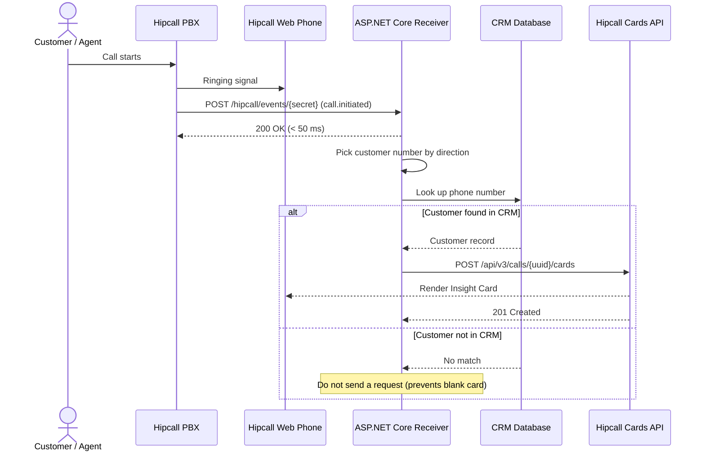

## Overview

When a customer rings your support line or an agent places an outbound call, searching for the phone number in a separate CRM tab costs seconds while the caller is waiting. Hipcall Insight Card pushes the caller's name, company, account balance, and latest order status from your CRM straight onto the Hipcall Web Phone while the phone is still ringing.

This guide builds an ASP.NET Core Minimal API receiver that accepts the `call.initiated` webhook, picks the customer number based on call direction, and sends an Insight Card to `POST /api/v3/calls/{uuid}/cards`.



## Before you start

You need:

- .NET 8 SDK (`dotnet --version` must print 8.0 or higher).
- A Hipcall plan that includes API access and an API key (`HIPCALL_API_TOKEN`) created under `Settings > Developer > API Keys (Ayarlar > Geliştirici > API Anahtarları)`.
- A webhook registered under `Settings > Developer > Webhooks (Ayarlar > Geliştirici > Web kancaları)` subscribed to `call.initiated`.
- A public HTTPS address for local development. Expose port 5000 with ngrok:

```bash
ngrok http 5000
```

Store your API token and webhook URL secret in environment variables:

```bash
export HIPCALL_API_TOKEN="..."
export HIPCALL_WEBHOOK_SECRET="..."
```

On Windows PowerShell:

```powershell
$env:HIPCALL_API_TOKEN = "..."
$env:HIPCALL_WEBHOOK_SECRET = "..."
```

`HIPCALL_BASE_URL` is optional and defaults to `https://use.hipcall.com`.

## Step 1: Catch the call start event from the webhook

When a call starts, Hipcall sends a `POST` request to your webhook URL:

```json
{
  "event": "call.initiated",
  "timestamp": "2026-11-05T12:25:10Z",
  "data": {
    "uuid": "735e2b8e-XXXX-XXXX-XXXX-XXXXXXXXXXXX",
    "direction": "inbound",
    "caller_number": "+447700XXXXXX",
    "callee_number": "+442079XXXXXX",
    "started_at": "2026-11-05T12:25:10Z",
    "user_id": 4200
  }
}
```

Two fields in `data` drive the Insight Card lookup:

1. **Call identifier (`data.uuid`):** Pass this `uuid` in the path of `POST /api/v3/calls/{uuid}/cards`.
2. **Call direction (`data.direction`):** The customer's phone number sits in a different field depending on direction:
   - When `direction` is `"inbound"`, an external caller is dialling in, so the customer number is `data.caller_number`.
   - When `direction` is `"outbound"`, an agent is dialling out, so the customer number is `data.callee_number`.

```csharp
var targetPhoneNumber = string.Equals(data.Direction, "inbound", StringComparison.OrdinalIgnoreCase)
    ? data.CallerNumber
    : data.CalleeNumber;
```

Do not block the webhook request while querying your database or calling the Hipcall API. Hand the work off to `Task.Run` and return `200 OK` to Hipcall in under 50 milliseconds.

## Step 2: Send an Insight Card to the active call

When the phone number matches a customer in your CRM, send a `POST` request with a `"card"` array to `/api/v3/calls/{uuid}/cards`:

```csharp
var jsonOptions = new JsonSerializerOptions
{
    PropertyNamingPolicy = JsonNamingPolicy.SnakeCaseLower,
    DefaultIgnoreCondition = JsonIgnoreCondition.WhenWritingNull,
    PropertyNameCaseInsensitive = true
};

var cardPayload = new InsightCardRoot
{
    Card =
    [
        new InsightCardItem
        {
            Type = "title",
            Text = "Acme CRM",
            Link = "https://crm.example.com/customers/1234"
        },
        new InsightCardItem
        {
            Type = "shortText",
            Label = "Customer Name",
            Text = "Alex M.",
            Link = "https://crm.example.com/contact/1234",
            Ios = "acmecrm://contact/id=1234",
            Android = "acmecrm://contact/id=1234"
        },
        new InsightCardItem
        {
            Type = "shortText",
            Label = "Company",
            Text = "Tech Ltd"
        },
        new InsightCardItem
        {
            Type = "shortText",
            Label = "Tier / Balance",
            Text = "VIP - GBP 0.00 Due"
        },
        new InsightCardItem
        {
            Type = "user",
            Label = "Account Owner",
            UserId = 4200
        }
    ]
};

var json = JsonSerializer.Serialize(cardPayload, jsonOptions);
using var content = new StringContent(json, Encoding.UTF8, "application/json");
using var response = await http.PostAsync($"/api/v3/calls/{Uri.EscapeDataString(callData.Uuid)}/cards", content);
```

A successful request returns `201 Created` (or `200 OK`) with the saved card:

```json
{
  "data": {
    "call_id": "735e2b8e-XXXX-XXXX-XXXX-XXXXXXXXXXXX",
    "card": [
      {
        "link": "https://crm.example.com/customers/1234",
        "text": "Acme CRM",
        "type": "title"
      },
      {
        "android": "acmecrm://contact/id=1234",
        "ios": "acmecrm://contact/id=1234",
        "label": "Customer Name",
        "link": "https://crm.example.com/contact/1234",
        "text": "Alex M.",
        "type": "shortText"
      },
      {
        "label": "Company",
        "text": "Tech Ltd",
        "type": "shortText"
      },
      {
        "label": "Tier / Balance",
        "text": "VIP - GBP 0.00 Due",
        "type": "shortText"
      },
      {
        "label": "Account Owner",
        "type": "user",
        "user_id": 4200
      }
    ]
  }
}
```

### Card layout and timing rules

- **Never send an empty card when a caller is not in your CRM:** The API accepts `{"card": []}`, which renders an empty grey box in the Web Phone. When a phone number is not found in your CRM, exit without calling `POST /api/v3/calls/{uuid}/cards`.
- **One card per call:** If you send a second `POST /api/v3/calls/{uuid}/cards` request for the same call, the API returns `200 OK`, but the Web Phone keeps the first card on screen and does not stack a second card. Put all customer rows into a single request.
- **Keep cards between 4 and 6 rows:** Including the `title` row, 4 to 6 rows (with 30 to 40 characters per value) fit above the keypad without pushing call controls out of view.
- **Stay within a 2-second CRM lookup budget:** Calls typically ring for 5 to 15 seconds. Finishing your CRM query within 2 seconds keeps total delivery time around 2.5 seconds, so the Insight Card is already visible when the agent answers.
- **Mobile deep links (`ios` and `android`):** The browser Web Phone ignores `ios` and `android` and opens `link` in a new tab. When an agent answers on the Hipcall iOS or Android app, tapping the row opens the native CRM app via the custom URI scheme.

## Step 3: Read the card back

To verify that a card has been stored for a call, send a `GET` request to `/api/v3/calls/{uuid}/cards`:

```csharp
using var getResponse = await http.GetAsync($"/api/v3/calls/{Uri.EscapeDataString(callUuid)}/cards");
var getBody = await getResponse.Content.ReadAsStringAsync();
```

A successful response returns `200 OK` and the stored `"card"` array:

```json
{
  "data": {
    "call_id": "735e2b8e-XXXX-XXXX-XXXX-XXXXXXXXXXXX",
    "card": [
      {
        "link": "https://crm.example.com/customers/1234",
        "text": "Acme CRM",
        "type": "title"
      },
      {
        "label": "Company",
        "text": "Tech Ltd",
        "type": "shortText"
      }
    ]
  }
}
```

If a number is not in your own CRM, you can query `GET /api/v3/lookup/by_phone?phone=+447700XXXXXX` as a fallback and build a card from the returned `contacts` and `companies` arrays when the caller is saved in the Hipcall address book.

## The full script

Create a new web project and replace `Program.cs` with the code below:

```bash
dotnet new web -n Hipcall.InsightCard
```

```csharp
using System.Net.Http.Headers;
using System.Security.Cryptography;
using System.Text;
using System.Text.Json;
using System.Text.Json.Serialization;

static string Env(string name) =>
    Environment.GetEnvironmentVariable(name)
    ?? throw new InvalidOperationException($"{name} is not set.");

var baseUrl = (Environment.GetEnvironmentVariable("HIPCALL_BASE_URL") ?? "https://use.hipcall.com").TrimEnd('/');
var webhookSecret = Env("HIPCALL_WEBHOOK_SECRET");
var apiToken = Env("HIPCALL_API_TOKEN");

var jsonOptions = new JsonSerializerOptions
{
    PropertyNamingPolicy = JsonNamingPolicy.SnakeCaseLower,
    DefaultIgnoreCondition = JsonIgnoreCondition.WhenWritingNull,
    PropertyNameCaseInsensitive = true
};

var http = new HttpClient { BaseAddress = new Uri(baseUrl) };
http.DefaultRequestHeaders.Accept.Add(new MediaTypeWithQualityHeaderValue("application/json"));
http.DefaultRequestHeaders.Authorization = new AuthenticationHeaderValue("Bearer", apiToken);

var builder = WebApplication.CreateBuilder(args);
builder.WebHost.ConfigureKestrel(options => options.ListenAnyIP(5000));
var app = builder.Build();

app.MapPost("/hipcall/events/{secret}", async (string secret, HttpRequest request) =>
{
    var expectedBytes = Encoding.UTF8.GetBytes(webhookSecret);
    var providedBytes = Encoding.UTF8.GetBytes(secret);
    if (expectedBytes.Length != providedBytes.Length ||
        !CryptographicOperations.FixedTimeEquals(expectedBytes, providedBytes))
    {
        return Results.Unauthorized();
    }

    HipcallWebhookPayload? payload;
    try
    {
        payload = await JsonSerializer.DeserializeAsync<HipcallWebhookPayload>(
            request.Body,
            jsonOptions,
            request.HttpContext.RequestAborted);
    }
    catch (JsonException)
    {
        return Results.BadRequest(new { error = "Invalid JSON payload." });
    }

    var eventName = payload?.Event ?? payload?.Type;
    if (payload?.Data is null || string.IsNullOrWhiteSpace(eventName))
    {
        return Results.BadRequest(new { error = "Missing event or data field." });
    }

    var isCallInitiated = string.Equals(eventName, "call.initiated", StringComparison.OrdinalIgnoreCase);

    if (!isCallInitiated)
    {
        return Results.Ok(new { status = "ignored", @event = eventName });
    }

    var data = payload.Data;
    var targetPhoneNumber = string.Equals(data.Direction, "inbound", StringComparison.OrdinalIgnoreCase)
        ? data.CallerNumber
        : data.CalleeNumber;

    _ = Task.Run(() => ProcessInsightCardAsync(data, targetPhoneNumber, http, jsonOptions));

    return Results.Ok(new { status = "accepted", call_uuid = data.Uuid });
});

app.Run();

static async Task ProcessInsightCardAsync(
    HipcallCallData callData,
    string? rawPhoneNumber,
    HttpClient http,
    JsonSerializerOptions jsonOptions)
{
    if (string.IsNullOrWhiteSpace(callData.Uuid) || string.IsNullOrWhiteSpace(rawPhoneNumber))
    {
        return;
    }

    var normalizedPhone = NormalizePhone(rawPhoneNumber);
    Console.WriteLine($"Call initiated. UUID: {callData.Uuid}, Direction: {callData.Direction}, Target: {normalizedPhone}");

    if (normalizedPhone == "+447700XXXXXX")
    {
        var cardPayload = new InsightCardRoot
        {
            Card =
            [
                new InsightCardItem
                {
                    Type = "title",
                    Text = "Acme CRM",
                    Link = "https://crm.example.com/customers/1234"
                },
                new InsightCardItem
                {
                    Type = "shortText",
                    Label = "Customer Name",
                    Text = "Alex M.",
                    Link = "https://crm.example.com/contact/1234",
                    Ios = "acmecrm://contact/id=1234",
                    Android = "acmecrm://contact/id=1234"
                },
                new InsightCardItem
                {
                    Type = "shortText",
                    Label = "Company",
                    Text = "Tech Ltd"
                },
                new InsightCardItem
                {
                    Type = "shortText",
                    Label = "Tier / Balance",
                    Text = "VIP - GBP 0.00 Due"
                },
                new InsightCardItem
                {
                    Type = "shortText",
                    Label = "Latest Order",
                    Text = "#9558 - Dispatched"
                }
            ]
        };

        var json = JsonSerializer.Serialize(cardPayload, jsonOptions);
        using var content = new StringContent(json, Encoding.UTF8, "application/json");
        using var response = await http.PostAsync($"/api/v3/calls/{Uri.EscapeDataString(callData.Uuid)}/cards", content);
        var responseBody = await response.Content.ReadAsStringAsync();

        Console.WriteLine($"POST /api/v3/calls/{callData.Uuid}/cards -> {(int)response.StatusCode}: {responseBody}");
    }
    else
    {
        Console.WriteLine($"No CRM match for {normalizedPhone}. Skipping card request.");
    }
}

static string NormalizePhone(string phone)
{
    var digits = new StringBuilder();
    foreach (var ch in phone)
    {
        if (char.IsDigit(ch))
        {
            digits.Append(ch);
        }
    }

    return "+" + digits;
}

public sealed class HipcallWebhookPayload
{
    public string? Event { get; set; }
    public string? Type { get; set; }
    public string? Timestamp { get; set; }
    public HipcallCallData? Data { get; set; }
}

public sealed class HipcallCallData
{
    public string? Uuid { get; set; }
    public string? Direction { get; set; }
    public string? CallerNumber { get; set; }
    public string? CalleeNumber { get; set; }
    public string? StartedAt { get; set; }
    public int? UserId { get; set; }
}

public sealed class InsightCardRoot
{
    public List<InsightCardItem> Card { get; set; } = [];
}

public sealed class InsightCardItem
{
    public required string Type { get; set; }
    public string? Text { get; set; }
    public string? Label { get; set; }
    public string? Link { get; set; }
    public string? Ios { get; set; }
    public string? Android { get; set; }
    public int? UserId { get; set; }
}
```

With the environment variables set, run the application:

```bash
dotnet run
```

When a call starts from the matching number, the console logs:

```text
Call initiated. UUID: 735e2b8e-XXXX-XXXX-XXXX-XXXXXXXXXXXX, Direction: inbound, Target: +447700XXXXXX
POST /api/v3/calls/735e2b8e-XXXX-XXXX-XXXX-XXXXXXXXXXXX/cards -> 201: {"data":{"call_id":"735e2b8e-XXXX-XXXX-XXXX-XXXXXXXXXXXX","card":[{"link":"https://crm.example.com/customers/1234","text":"Acme CRM","type":"title"},{"android":"acmecrm://contact/id=1234","ios":"acmecrm://contact/id=1234","label":"Customer Name","link":"https://crm.example.com/contact/1234","text":"Alex M.","type":"shortText"},{"label":"Company","text":"Tech Ltd","type":"shortText"},{"label":"Tier / Balance","text":"VIP - GBP 0.00 Due","type":"shortText"},{"label":"Latest Order","text":"#9558 - Dispatched","type":"shortText"}]}}
```

## When it fails

### 422 Unprocessable Entity: Null fields on a card item

If `user_id` is serialised as `null` on a `shortText` or `title` item, Hipcall rejects the card with `422`:

```json
{
  "errors": {
    "card": [
      "shortText type only allows fields: type, text, label, link, android, ios. Invalid fields found: user_id in card item 2"
    ]
  }
}
```

Set `DefaultIgnoreCondition = JsonIgnoreCondition.WhenWritingNull` on `JsonSerializerOptions` so `null` properties are omitted from the JSON body.

### 422 Unprocessable Entity: Unsupported row type

Sending any `type` value other than `title`, `shortText`, or `user` returns `422`:

```json
{
  "errors": {
    "card": [
      "Type can be shortText, user or title in the card: {\"label\":\"Contact\",\"text\":\"Alex M.\",\"type\":\"badge\"}"
    ]
  }
}
```

Use `title`, `shortText`, or `user` for every item in `"card"`.

### API returns 200 or 201, but no card appears in the Web Phone

If `POST /api/v3/calls/{uuid}/cards` is called after the call has already ended, the API writes the card to the call record and returns a success code, but the Web Phone call view has already closed. Log the time between `started_at` on the webhook and your `POST /cards` response, and keep your CRM lookup under 2 seconds.

## Parameter reference

### Card row types (`POST /api/v3/calls/{uuid}/cards`)

| Row type (`type`) | Required fields | Optional fields | Description |
|---|---|---|---|
| `title` | `type`, `text` | `link` | Bold header at the top of the card. Shows an external link icon when `link` is set. |
| `shortText` | `type`, `text` | `label`, `link`, `ios`, `android` | Two-column row with `label` on the left and `text` on the right. |
| `user` | `type`, `label`, `user_id` | None | Resolves `user_id` to the Hipcall user's full name, or falls back to `User #<id>`. |

### Card item fields

| Field | Type | Description |
|---|---|---|
| `type` | string | Row type: `title`, `shortText`, or `user`. |
| `text` | string | Main text displayed on `title` and `shortText` rows. |
| `label` | string | Left-hand label. Required for `user`, optional for `shortText`. |
| `link` | string | `https://` URL opened in a new browser tab when clicked. |
| `ios` | string | Custom URI scheme opened by the Hipcall iOS app. |
| `android` | string | Custom URI scheme opened by the Hipcall Android app. |
| `user_id` | integer | Hipcall user ID displayed on a `user` row. |

### Customer number field by call direction (`data.direction`)

| `data.direction` | Agent number | Customer number | Description |
|---|---|---|---|
| `inbound` | `data.callee_number` | `data.caller_number` | Customer is calling in; look up `caller_number` in your CRM. |
| `outbound` | `data.caller_number` | `data.callee_number` | Agent is calling out; look up `callee_number` in your CRM. |

## Next steps

- Browse all endpoints in the [Hipcall API Reference](https://use.hipcall.com/api-docs/).
- Ask questions in the [Hipcall Community](https://community.hipcall.com/).

