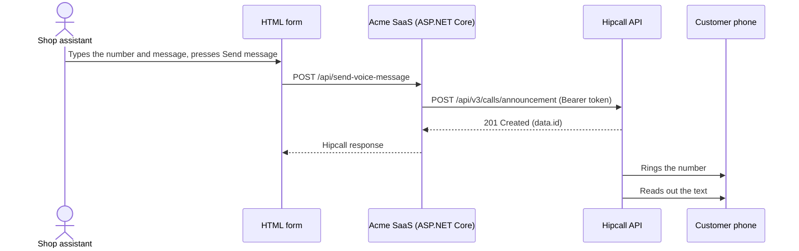

## Overview

Acme SaaS is a made-up company that sells order management software to online shops. When a parcel is ready, a shop assistant rings the customer and says the same sentence every time. Acme SaaS wants to reduce that to one button: the assistant types the number and the message, presses send, the customer's phone rings, and the message is read out loud. Nobody needs to speak on the shop's end of the line. The customer listens and hangs up.

The `POST /api/v3/calls/announcement` endpoint does this. The request names the number to call, the Hipcall number the call leaves from, and the message. The message can be a piece of text (text-to-speech), the address of an audio file, or a greeting you have saved in the dashboard.

This guide builds an ASP.NET Core Minimal API that takes a number and a message from an HTML form and passes them to Hipcall. It authenticates with an API key, so no OAuth2 flow is needed. The second half of the guide covers the cases where the API returns a success response and the phone still does not ring.



## Before you start

You need:

- .NET 8 SDK (`dotnet --version` must print 8.0 or higher).
- A Hipcall plan with API access.
- An API key created under `Settings > Developer > API Keys (Ayarlar > Geliştirici > API Anahtarları)`.
- An active Hipcall number for the calls to leave from.

Find the `id` of that number with `GET /api/v3/numbers`:

```bash
curl -sS -H "Authorization: Bearer $HIPCALL_API_TOKEN" \
  https://use.hipcall.com/api/v3/numbers
```

Note the `id` of a number whose `state` is `active`. It goes into the requests as `number_id`:

```json
{
  "data": [
    {
      "id": 938,
      "name": "Main line",
      "state": "passive",
      "number": "+442079XXXXXX",
      "locale": "en_GB",
      "business_hours": "open",
      "user_case": "all"
    },
    {
      "id": 942,
      "name": "Main line",
      "state": "active",
      "number": "+442079XXXXXX",
      "locale": "en_GB",
      "business_hours": "open",
      "user_case": "all"
    }
  ],
  "meta": { "count": 2, "offset": 0, "limit": 10 }
}
```

Keep the API key and the number ID in environment variables:

```bash
export HIPCALL_API_TOKEN="..."
export HIPCALL_NUMBER_ID="942"
```

On Windows PowerShell:

```powershell
$env:HIPCALL_API_TOKEN = "..."
$env:HIPCALL_NUMBER_ID = "942"
```

`HIPCALL_BASE_URL` is optional and defaults to `https://use.hipcall.com`.

## Step 1: Choose the message type

Send exactly one of `tts`, `audio_url` and `greeting_id` in the request body.

The `tts` object carries the text to read (`text`) and a language code (`language`). `audio_url` is the address of an audio file for Hipcall to play. `greeting_id` is the ID of a greeting saved in the dashboard, and you can list your greetings with `GET /api/v3/greetings`:

```bash
curl -sS -H "Authorization: Bearer $HIPCALL_API_TOKEN" \
  "https://use.hipcall.com/api/v3/greetings?limit=10&sort=id.asc"
```

```json
{
  "data": [
    {
      "id": 3372,
      "name": "Out of hours",
      "state": "active",
      "direct_dial_extension": false,
      "input_timeout": 0,
      "max_input_try_count": 0
    },
    {
      "id": 3373,
      "name": "Welcome",
      "state": "active",
      "direct_dial_extension": true,
      "input_timeout": 3,
      "max_input_try_count": 0
    }
  ],
  "meta": { "count": 2, "offset": 0, "limit": 10 }
}
```

This guide uses `tts`. If you decide to pass an `audio_url`, make sure the audio file is publicly reachable and points directly to a valid sound file (such as `.mp3` or `.wav`). If the file cannot be reached, the destination phone still rings, but the call drops once answered because the audio cannot be played.

## Step 2: Send the announcement request

Send the number to call, the `number_id`, the repeat count and a `tts` object to `POST /api/v3/calls/announcement`:

```csharp
var payload = JsonSerializer.Serialize(new
{
    callee_number = "+447700XXXXXX",
    number_id = 942,
    repeat = 1,
    tts = new
    {
        language = "en-GB",
        text = "Your order has been dispatched."
    }
});
using var content = new StringContent(payload, Encoding.UTF8, "application/json");
using var response = await http.PostAsync("/api/v3/calls/announcement", content);
```

A successful request returns `201 Created`. Log the `id` in the body:

```json
{
  "data": {
    "id": "4f003b1c-XXXX-XXXX-XXXX-XXXXXXXXXXXX"
  }
}
```

Our tests used the language code `tr-TR`. Place a test call before you rely on any other code, because Hipcall accepts a language code it does not recognise and the phone never rings (see "When it fails").

What we saw in testing:

- A number sent without the `+` (`447700XXXXXX`) was still called. Storing numbers with the `+` keeps them consistent across your systems.
- With the text `selam nasılsınızacaba....`, the dots were not read out and the run-together words were read normally.
- `repeat` sets how many times the message is read and must be between 1 and 5.
- `pause_ms` sets a wait time in milliseconds and can be at most 10000.

## Step 3: Connect the form and the endpoint

The Minimal API takes `calleeNumber`, `text`, `language` and `repeat` from the browser, forwards them to Hipcall, and returns Hipcall's response to the browser with its status code unchanged. The error body is never swallowed, so a 422 message shows up in the form. The API key and the `number_id` stay on the server and never reach the browser.

## The full script

Create a new web project, replace `Program.cs` with the code below, and add `wwwroot/index.html`:

```bash
dotnet new web -n Hipcall.VoiceMessage
```

```csharp
using System.Net.Http.Headers;
using System.Text;
using System.Text.Json;

static string Env(string name) =>
    Environment.GetEnvironmentVariable(name)
    ?? throw new InvalidOperationException($"{name} is not set.");

var baseUrl = Environment.GetEnvironmentVariable("HIPCALL_BASE_URL") ?? "https://use.hipcall.com";
var apiToken = Env("HIPCALL_API_TOKEN");
var numberId = int.Parse(Env("HIPCALL_NUMBER_ID"));

var builder = WebApplication.CreateBuilder(args);
builder.WebHost.ConfigureKestrel(options => options.ListenAnyIP(5000));

builder.Services.AddHttpClient("hipcall", client =>
{
    client.BaseAddress = new Uri(baseUrl);
    client.DefaultRequestHeaders.Authorization = new AuthenticationHeaderValue("Bearer", apiToken);
    client.DefaultRequestHeaders.Accept.Add(new MediaTypeWithQualityHeaderValue("application/json"));
    client.Timeout = TimeSpan.FromSeconds(15);
});

var app = builder.Build();

app.UseDefaultFiles();
app.UseStaticFiles();

app.MapPost("/api/send-voice-message", async (VoiceMessageRequest request, IHttpClientFactory factory) =>
{
    if (string.IsNullOrWhiteSpace(request.CalleeNumber) || string.IsNullOrWhiteSpace(request.Text))
    {
        return Results.BadRequest(new { error = "calleeNumber and text are required." });
    }

    var repeat = request.Repeat ?? 1;
    if (repeat is < 1 or > 5)
    {
        return Results.BadRequest(new { error = "repeat must be between 1 and 5." });
    }

    var payload = JsonSerializer.Serialize(new
    {
        callee_number = request.CalleeNumber.Trim(),
        number_id = numberId,
        repeat,
        tts = new
        {
            language = string.IsNullOrWhiteSpace(request.Language) ? "en-GB" : request.Language,
            text = request.Text.Trim()
        }
    });

    var http = factory.CreateClient("hipcall");
    using var content = new StringContent(payload, Encoding.UTF8, "application/json");

    try
    {
        using var response = await http.PostAsync("/api/v3/calls/announcement", content);
        var body = await response.Content.ReadAsStringAsync();
        Console.WriteLine($"Announcement response ({(int)response.StatusCode}): {body}");

        return Results.Content(body, "application/json", statusCode: (int)response.StatusCode);
    }
    catch (HttpRequestException ex)
    {
        Console.WriteLine($"Hipcall request failed: {ex.Message}");
        return Results.Json(new { error = "Could not reach Hipcall." }, statusCode: StatusCodes.Status502BadGateway);
    }
});

app.Run();

record VoiceMessageRequest(string? CalleeNumber, string? Text, string? Language, int? Repeat);
```

`wwwroot/index.html` holds a form with number, message, language and repeat fields, and an area that shows the Hipcall response:

```html
<!DOCTYPE html>
<html lang="en-GB">
<head>
  <meta charset="utf-8" />
  <title>Send a voice message</title>
</head>
<body>
  <form id="form">
    <p><input id="callee" placeholder="+447700XXXXXX" required /></p>
    <p><textarea id="text" rows="4" cols="40" placeholder="Your order has been dispatched." required></textarea></p>
    <p><input id="language" value="en-GB" /> <input id="repeat" type="number" min="1" max="5" value="1" /></p>
    <p><button>Send message</button></p>
  </form>
  <pre id="result"></pre>
  <script>
    document.getElementById("form").addEventListener("submit", async (event) => {
      event.preventDefault();
      const response = await fetch("/api/send-voice-message", {
        method: "POST",
        headers: { "content-type": "application/json" },
        body: JSON.stringify({
          calleeNumber: document.getElementById("callee").value,
          text: document.getElementById("text").value,
          language: document.getElementById("language").value,
          repeat: Number(document.getElementById("repeat").value)
        })
      });
      document.getElementById("result").textContent = response.status + "\n" + await response.text();
    });
  </script>
</body>
</html>
```

With the environment variables set, run the application:

```bash
dotnet run
```

Open `http://localhost:5000`, type a number and a message, and select **Send message**. The form shows the `201` status code and the `id`, and the console logs:

```text
Announcement response (201): {"data":{"id":"4f003b1c-XXXX-XXXX-XXXX-XXXXXXXXXXXX"}}
```

## When it fails

### 422 Unprocessable Entity: Values out of range

`repeat` must be between 1 and 5. Sending 6 returned:

```json
{
  "errors": {
    "repeat": [
      "6 is larger than inclusive maximum 5"
    ]
  }
}
```

Sending 0 returned:

```json
{
  "errors": {
    "repeat": [
      "0 is smaller than inclusive minimum 1"
    ]
  }
}
```

The upper limit for `pause_ms` is 10000. Sending 86400000 returned:

```json
{
  "errors": {
    "pause_ms": [
      "86400000 is larger than inclusive maximum 10000"
    ]
  }
}
```

Validate all three values in your own code before you send the request. The endpoint in this guide does that for `repeat`.

### 422 Unprocessable Entity: Message type error

When more than one of `greeting_id`, `audio_url` and `tts` is in the same request:

```json
{
  "errors": {
    "announcement": [
      "give only one of greeting_id, audio_url or tts"
    ]
  }
}
```

When none of them is sent:

```json
{
  "errors": {
    "announcement": [
      "give one of greeting_id, audio_url or tts"
    ]
  }
}
```

Leave a single message field in the request body.

### The response says success and the phone does not ring

In these cases the API returns no error, yet the expected call does not happen:

- An invalid language code: with a `language` such as `zr-XZ` we got a success response with an `id`, and the phone did not ring.
- A very long text: when we repeated "selam nasılsınız acaba selam nasılsınız" until the text ran to several hundred characters, the request succeeded and the phone did not ring. Find the limit on your own account by testing, and keep messages short.
- An unreachable `audio_url`: The destination phone rings, but the call drops once answered because the audio cannot be loaded.

A `201` response therefore does not prove that the call took place. Log the `id` from every successful response, and place a test call to your own phone before you ship a new language code or a longer text.

## Parameter reference

### Announcement request body (`POST /api/v3/calls/announcement`)

| Field | Type | Rule |
|---|---|---|
| `callee_number` | string | Number to call. Both `+447700XXXXXX` and `447700XXXXXX` formats were called. |
| `number_id` | integer | ID of the active Hipcall number the call leaves from (`GET /api/v3/numbers`). |
| `repeat` | integer | How many times the message is played. Must be between 1 and 5. |
| `pause_ms` | integer | Wait time in milliseconds. At most 10000. |
| `tts` | object | Text-to-speech. Carries `language` (for example `"tr-TR"`) and `text`. |
| `audio_url` | string | Address of the audio file to play. |
| `greeting_id` | integer | ID of a greeting saved in the dashboard (`GET /api/v3/greetings`). |

Send exactly one of `tts`, `audio_url` and `greeting_id`.

### Successful response

| Field | Type | Description |
|---|---|---|
| `data.id` | string | ID of the announcement request (UUID). |

## Next steps

- Browse all endpoints in the [Hipcall API Reference](https://use.hipcall.com/api-docs/).
- Ask questions in the [Hipcall Community](https://community.hipcall.com/).
