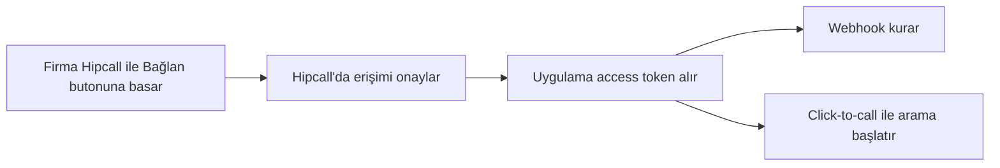

## Genel bakış

Hipcall ile birlikte çalışan bir CRM ya da sipariş yazılımı düşünün. Bu yazılımı kullanan firma, arama başlatmak veya bir çağrının bittiğini öğrenmek için her seferinde Hipcall paneline geçmek istemez. Bunların zaten açık olan ekranda olmasını bekler.

Bu yazı dizisi, böyle yazılımlar geliştiren iş ortakları için hazırlandı. Firma, iş ortağının uygulamasında bir kez "Hipcall ile Bağlan" butonuna basar. Sonraki ayarları ve istekleri uygulama, Hipcall API üzerinden firma adına yapar.

Bu yazıda akışın mantığını ve dizide geçen beş kavramı kısaca anlatıyoruz. Kurulum adımları ve kod örnekleri her kavramın kendi yazısında.

## Akış nasıl işler

Her şey OAuth2 ile başlar. Firma butona bastığında Hipcall'ın giriş ve onay ekranına gider, uygulamanın hangi izinleri istediğini görür ve onaylar. Hipcall uygulamaya bir access token verir. Uygulama webhook kurmak ya da arama başlatmak için bundan sonra bu token'ı kullanır.

Firma hiçbir API anahtarı kopyalamaz. İş ortağı da firmanın Hipcall şifresini hiç görmez.

## Dizideki kavramlar

### OAuth2

OAuth2, bir uygulamanın kullanıcı adına başka bir servise erişmesini sağlayan yetkilendirme standardıdır. Hipcall'da uygulama kullanıcıyı `/oauth/authorize` adresine yönlendirir. Kullanıcı onaylayınca dönen kodu `/oauth/token` adresinde access token ile değiştirir. Token yaklaşık bir saat geçerlidir. Uygulama `offline_access` kapsamını isterse cevapta bir refresh token da gelir.

Uygulamanın neye erişebileceğini kapsamlar (scope) belirler. Örneğin webhook oluşturmak için `webhooks:write` gerekir.

### Click-to-call

Click-to-call, uygulamanın içindeki bir butonla arama başlatmaktır. Temsilci CRM'deki müşteri kartında "Ara" butonuna bastığında uygulama Hipcall API'ye bir istek gönderir. Önerilen ayarda önce temsilcinin Hipcall uygulaması çalar, temsilci açınca müşteri aranır. İsterseniz müşterinin numarasını temsilciden gizleyebilirsiniz. Müşterinin ekranında da temsilcinin kişisel numarası değil, firmanın numarası görünür.

### Hızlı arama

Hızlı arama, hangi numaranın aranacağına sizin web servisinizin karar verdiği bir dahili hattır. Kurye, hızlı aramanın dahili numarasını çevirir ve sipariş numarasını tuşlar. Hipcall tuşlanan rakamları POST isteğiyle web servisinize gönderir, servis aranacak numarayı döner ve Hipcall bu numarayı arar. Kurye müşteriyle konuşur ama numarasını hiç görmez. KVKK gereği müşteri numarasının kuryede kalmaması gereken durumlar için uygundur.

Hızlı arama kaydı panelde bir kez oluşturulur. Servis adresi ve dahili numara orada tanımlanır.

### SIP bağlantıları

SIP, internet üzerinden sesli arama kurmak için kullanılan protokoldür. Harici SIP bağlantısı Hipcall'ı başka bir SIP sistemine bağlar. Bu sistem ofisteki IP santral olabilir ya da çağrıları cevaplayan VAPI gibi bir yapay zekâ ses platformu. İki tarafa da aynı kullanıcı adı ve parola girilir. Hipcall'dan çıkan çağrıların gideceği SIP adresi ise sonlandırma URI'si olarak tanımlanır. Bağlantıya atanan dahiliye gelen çağrılar karşı sisteme aktarılır.

### Webhook

Webhook (webkanca), hesabınızda bir olay olduğunda Hipcall'ın sunucunuza gönderdiği HTTP isteğidir. Çağrı bittiğinde Hipcall `call.ended` olayını HTTPS adresinize POST eder. İsteğin gerçekten Hipcall'dan geldiğini imzasına bakarak doğrularsınız. Uygulama OAuth2 token'ıyla webhook'u API üzerinden kendisi oluşturabilir. Böylece firmanın panelde webhook açıp imza anahtarını kopyalaması gerekmez.

## Başlamadan önce

Dizideki yazılar için şunlar gerekir:

- API ve webhook özelliklerini içeren bir Hipcall paketi.
- Client ID, client secret ve redirect URI içeren bir OAuth uygulaması.
- Erişimi onaylayan Hipcall kullanıcısında gerekli izinler. Webhook oluşturmak için `settings::developer` izni gerekir.
- İnternetten erişilebilen bir sunucu. Webhook da hızlı arama da Hipcall'ın sizin sunucunuza istek göndermesine dayanır. Webhook adresi HTTPS olmalıdır. Geliştirme sırasında ngrok gibi bir tünel kullanabilirsiniz.

## Sonraki adımlar

- [Hipcall OAuth2 ile yetkilendirme ve token alma](/blog/hipcall-oauth2-ile-yetkilendirme-ve-token-alma/) yazısında OAuth2 istemci bilgilerini alıp ilk token takasını yapın.
- [OAuth2 API üzerinden Webkancalarını ayarlamak](/blog/oauth2-ile-hipcall-webhook-kurma/) yazısında akışı ASP.NET Core ile baştan sona kurun.
- [OAuth2 ile Click-to-Call arama başlatma](/blog/oauth2-ile-click-to-call-arama-baslatma/) yazısında click-to-call isteğini ve maskelemeyi inceleyin.
- Tüm endpoint'ler için [Hipcall API referansına](https://use.hipcall.com.tr/api-docs/) bakın.
- Sorularınızı [Hipcall Community](https://community.hipcall.com/) üzerinden sorun.

