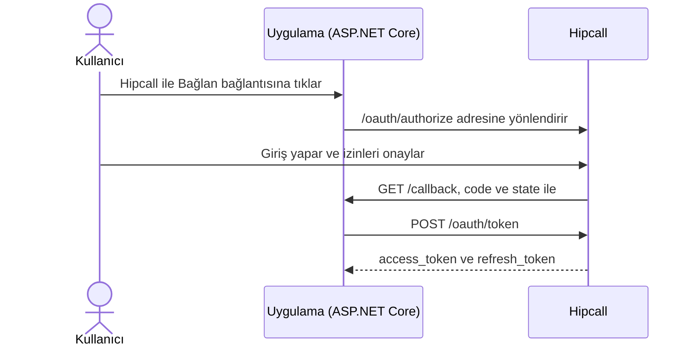

## Genel bakış

OAuth2 Authorization Code akışı, uygulamanızın bir Hipcall hesabına kullanıcı izniyle bağlanmasını sağlar. Kullanıcı Hipcall şifresini sizin uygulamanıza girmez ve panelden API anahtarı kopyalamaz. Uygulamanızdaki bağlantıya tıklar, Hipcall ekranında istenen izinleri onaylar ve tarayıcı tek kullanımlık bir yetkilendirme koduyla sunucunuza döner. Arka ucunuz bu kodu `access_token` ile takas eder ve sonraki API isteklerini bu token ile gönderir.

Bu yazıda Hipcall'dan OAuth2 istemci bilgilerini istemeyi, yetkilendirme URL'sini kurmayı ve ASP.NET Core Minimal API ile yetkilendirme kodunu `access_token` ile değiştirmeyi anlatıyoruz.



## Başlamadan önce

Gereksinimler:

- .NET 8 SDK (`dotnet --version` çıktısı 8.0 veya üzeri olmalıdır).
- API özelliği açık bir Hipcall paketi.
- Dışarıdan erişilebilen bir HTTPS adresi. Yerel geliştirmede 5080 portunu ngrok gibi bir tünelle dışarı açın:

```bash
ngrok http 5080
```

### İstemci bilgilerinizi Hipcall'dan alın

OAuth2 uygulamaları kullanıcı panelinden açılmaz. `Client ID` ve `Client Secret` almak için uygulama bilgilerinizi Hipcall ekibine iletmeniz gerekir.

Başvuruda şu üç bilgiyi paylaşın:

- **Uygulama tipi:** Arka uç sunucunuzda `client_secret` saklayacağınız için uygulamanızın bir **Web uygulaması** olduğunu belirtin.
- **Yönlendirme adresi (Redirect URI):** Kullanıcı erişimi onayladıktan sonra Hipcall'ın tarayıcıyı geri göndereceği tam HTTPS adresi. Örneğin üretimde `https://your-server.example.com/callback`, yerel testte ngrok adresiniz olan `https://your-tunnel.ngrok-free.dev/callback`.
- **İzin kapsamları (Scopes):** Uygulamanızın kullanacağı kapsamlar. Temel yetkilendirme için `profile`, `email` ve `offline_access` isteyebilirsiniz. Çağrı veya webhook uç noktalarını da kullanacaksanız `communication:read` ve `webhooks:write` gibi kapsamları başvuruda belirtin; kapsamların OAuth uygulamanız için Hipcall tarafında da açılması gerekir.

Kaydınız tamamlandığında size bir **Client ID** ve **Client Secret** verilir. Bunları kodun içine yazmayın, ortam değişkeninde tutun:

```bash
export HIPCALL_CLIENT_ID="..."
export HIPCALL_CLIENT_SECRET="..."
export PUBLIC_URL="https://your-server.example.com"
```

Windows PowerShell üzerinde:

```powershell
$env:HIPCALL_CLIENT_ID = "..."
$env:HIPCALL_CLIENT_SECRET = "..."
$env:PUBLIC_URL = "https://your-server.example.com"
```

`HIPCALL_BASE_URL` isteğe bağlıdır ve varsayılan değeri `https://use.hipcall.com.tr` adresidir. Uygulama `redirect_uri` değerini `PUBLIC_URL` sonuna `/callback` ekleyerek üretir.

## Adım 1: Yetkilendirme URL'sini oluşturun ve kullanıcıyı yönlendirin

Kullanıcıyı Hipcall'ın onay ekranına göndermek için tarayıcıyı `/oauth/authorize` adresine yönlendirin:

```http
GET https://use.hipcall.com.tr/oauth/authorize
  ?response_type=code
  &client_id=YOUR_CLIENT_ID
  &redirect_uri=https%3A%2F%2Fyour-server.example.com%2Fcallback
  &scope=profile+email+offline_access
  &state=5718F6D482AE78DF3322714ECAB6BD7E
```

URL'deki her parametre şu işe yarar:

- `response_type`: Authorization Code akışı için her zaman `code` gönderilir.
- `client_id`: Hipcall'dan aldığınız uygulama kimliği.
- `redirect_uri`: Hipcall'a kaydettirdiğiniz geri dönüş adresiyle karakteri karakterine aynı olmalıdır. URL kodlaması (`https%3A%2F%2F...`) uygulanarak eklenir.
- `scope`: Uygulamanın istediği izinler. Birden fazla kapsam istendiğinde aralarına `+` konur. `profile` kullanıcının ad ve ID bilgilerini, `email` e-posta adresini okur, `offline_access` ise erişim süresi dolduğunda yeni token alabilmek için `refresh_token` döndürür.
- `state`: Siteler arası istek sahteciliğini (CSRF) önlemek için uygulamanızın her giriş denemesinde ürettiği rastgele değer. Hipcall bu değeri değiştirmeden `/callback` adresine geri gönderir; uygulamanız kendi ürettiği listede olmayan bir `state` görürse isteği reddeder.

ASP.NET Core içinde `/login` uç noktası rastgele bir `state` üretir, belleğe kaydeder ve yönlendirmeyi başlatır:

```csharp
app.MapGet("/login", () =>
{
    var state = Convert.ToHexString(RandomNumberGenerator.GetBytes(16));
    pendingStates[state] = true;

    return Results.Redirect($"{baseUrl}/oauth/authorize?response_type=code"
        + $"&client_id={Uri.EscapeDataString(clientId)}"
        + $"&redirect_uri={Uri.EscapeDataString(redirectUri)}"
        + $"&scope={scope}&state={state}");
});
```

Kullanıcı Hipcall'da oturum açıp izni onayladığında tarayıcı `https://your-server.example.com/callback?code=...&state=...` adresine döner.

## Adım 2: Yetkilendirme kodunu erişim belirteciyle takas edin

Callback uç noktanız önce `state` değerini kontrol eder, ardından gelen `code` değerini `application/x-www-form-urlencoded` gövdesiyle `POST /oauth/token` adresine gönderir:

```csharp
using var tokenResponse = await http.PostAsync("/oauth/token", new FormUrlEncodedContent(
    new Dictionary<string, string>
    {
        ["grant_type"] = "authorization_code",
        ["code"] = code,
        ["client_id"] = clientId,
        ["client_secret"] = clientSecret,
        ["redirect_uri"] = redirectUri
    }));
```

Takas başarılı olduğunda Hipcall `200 OK` ve aşağıdaki JSON gövdesini döner:

```json
{
  "access_token": "SFMyNTY.g2gD...",
  "token_type": "Bearer",
  "expires_in": 3599,
  "refresh_token": "YTFjTxd_Mfen...",
  "scope": "profile email offline_access"
}
```

`access_token` 3599 saniye (yaklaşık bir saat) geçerlidir. `scope` alanı, Hipcall'ın bu token için onayladığı kapsamları listeler. Sonraki API isteklerinde bu token `Authorization: Bearer <access_token>` başlığıyla gönderilir.

## Betiğin tamamı

Yeni bir web projesi oluşturun ve `Program.cs` dosyasını aşağıdaki kodla değiştirin:

```bash
dotnet new web -n Hipcall.OAuth
```

```csharp
using System.Collections.Concurrent;
using System.Security.Cryptography;
using System.Text.Json;

static string Env(string name) =>
    Environment.GetEnvironmentVariable(name)
    ?? throw new InvalidOperationException($"{name} is not set.");

var baseUrl = Environment.GetEnvironmentVariable("HIPCALL_BASE_URL") ?? "https://use.hipcall.com.tr";
var clientId = Env("HIPCALL_CLIENT_ID");
var clientSecret = Env("HIPCALL_CLIENT_SECRET");
var publicUrl = Env("PUBLIC_URL").TrimEnd('/');
var redirectUri = $"{publicUrl}/callback";
const string scope = "profile+email+offline_access";

var builder = WebApplication.CreateBuilder(args);
builder.WebHost.ConfigureKestrel(options => options.ListenAnyIP(5080));
var app = builder.Build();

var http = new HttpClient { BaseAddress = new Uri(baseUrl) };
var pendingStates = new ConcurrentDictionary<string, bool>();

app.MapGet("/", () => Results.Content("<a href=\"/login\">Connect Hipcall</a>", "text/html"));

app.MapGet("/login", () =>
{
    var state = Convert.ToHexString(RandomNumberGenerator.GetBytes(16));
    pendingStates[state] = true;

    return Results.Redirect($"{baseUrl}/oauth/authorize?response_type=code"
        + $"&client_id={Uri.EscapeDataString(clientId)}"
        + $"&redirect_uri={Uri.EscapeDataString(redirectUri)}"
        + $"&scope={scope}&state={state}");
});

app.MapGet("/callback", async (string? code, string? state, string? error) =>
{
    if (error is not null)
    {
        return Results.BadRequest($"Hipcall returned an error: {error}");
    }

    if (code is null || state is null || !pendingStates.TryRemove(state, out _))
    {
        return Results.BadRequest("The code is missing or the state is unknown.");
    }

    using var tokenResponse = await http.PostAsync("/oauth/token", new FormUrlEncodedContent(
        new Dictionary<string, string>
        {
            ["grant_type"] = "authorization_code",
            ["code"] = code,
            ["client_id"] = clientId,
            ["client_secret"] = clientSecret,
            ["redirect_uri"] = redirectUri
        }));
    var tokenBody = await tokenResponse.Content.ReadAsStringAsync();
    if (!tokenResponse.IsSuccessStatusCode)
    {
        return Results.Content(tokenBody, "application/json", statusCode: (int)tokenResponse.StatusCode);
    }

    using var tokenJson = JsonDocument.Parse(tokenBody);
    var root = tokenJson.RootElement;
    var accessToken = root.GetProperty("access_token").GetString()!;
    var expiresIn = root.TryGetProperty("expires_in", out var exp) ? exp.GetInt32() : 0;
    var granted = root.TryGetProperty("scope", out var scopeValue) ? scopeValue.GetString() : null;

    Console.WriteLine($"Token received. Expires in: {expiresIn}s");
    Console.WriteLine($"Granted scopes: {granted ?? "(not returned)"}");

    return Results.Ok(new
    {
        token_type = "Bearer",
        expires_in = expiresIn,
        scope = granted
    });
});

app.Run();
```

Ortam değişkenleri tanımlıyken uygulamayı başlatın:

```bash
dotnet run
```

Tarayıcıda `PUBLIC_URL` adresinizi açın, **Connect Hipcall** bağlantısına tıklayın ve erişimi onaylayın. Konsolda alınan token süresi ve onaylanan kapsamlar görünür:

```text
Token received. Expires in: 3599s
Granted scopes: profile email offline_access
```

## Hata aldığınızda

### 400 Bad Request: invalid_grant

Token takası sırasında `/oauth/token` şu yanıtı döndürürse:

```json
{
  "error": "invalid_grant",
  "error_description": "The provided authorization grant is invalid, expired, revoked, does not match the redirection URI used in the authorization request, or was issued to another client."
}
```

İki yaygın nedeni vardır:

- **Yetkilendirme kodu birden fazla kez kullanıldı:** `code` tek kullanımlıktır. Kullanıcı `/callback` sayfasını tarayıcıda yenilerse aynı `code` tekrar gönderilir ve reddedilir. Gerçek bir uygulamada token alındıktan sonra kullanıcıyı kök dizine (`/`) yönlendirin veya adres çubuğundaki sorgu parametrelerini `window.history.replaceState({}, document.title, "/")` ile temizleyin.
- **Redirect URI uyuşmazlığı:** `/oauth/authorize` ve `/oauth/token` isteklerinde gönderilen `redirect_uri`, Hipcall'da tanımlı adresle birebir aynı olmalıdır. Sondaki `/` işareti veya `http` ile `https` farkı hataya yol açar.

### 401 Unauthorized

`access_token` süresi dolmuş veya hatalı gönderilmişse API istekleri `401` döner:

```json
{
  "errors": {
    "detail": "Not authorized. Check your API token is valid and not expired."
  }
}
```

Token yaklaşık bir saat sonra sona erer. İlk yetkilendirmede `offline_access` kapsamını istediyseniz sakladığınız `refresh_token` ile yeni bir `access_token` alın.

### 403 Forbidden: insufficient_scope

Token, çağrılan uç noktanın istediği kapsamı taşımıyorsa API `403` döner:

```json
{
  "error": "insufficient_scope",
  "errors": {
    "detail": "Forbidden",
    "required_scope": "webhooks:write"
  }
}
```

Konsoldaki `Granted scopes` satırını kontrol edin. Authorize URL'sinde bir kapsamı istemiş olsanız bile, o kapsam Hipcall tarafında OAuth uygulamanız için açılmamışsa token içinde verilmez. Hipcall ekibinden ilgili kapsamı uygulamanız için etkinleştirmesini isteyin ve yeniden giriş yapın.

### Tarayıcıda CORS hatası

`/oauth/token` uç noktasını önyüzdeki JavaScript (`fetch` veya `XMLHttpRequest`) ile doğrudan çağırmaya çalışırsanız tarayıcı isteği CORS politikası nedeniyle engeller. Ayrıca `client_secret` bilgisini tarayıcıya koymak anahtarın herkese açılmasına neden olur. Token takasını her zaman ASP.NET Core gibi bir arka uç sunucusundan yapın.

## Parametre listesi

### Authorize isteği (`GET /oauth/authorize`)

| Parametre | Tip | Zorunlu | Açıklama |
|---|---|---|---|
| `response_type` | string | evet | Her zaman `code`. |
| `client_id` | string | evet | Hipcall'dan alınan Client ID. |
| `redirect_uri` | string | evet | Hipcall'a kaydedilen HTTPS geri dönüş adresi. |
| `scope` | string | evet | `+` ile ayrılmış izin kapsamları. |
| `state` | string | evet | CSRF koruması için üretilen rastgele değer. |

### Token isteği (`POST /oauth/token`)

Gövde `application/x-www-form-urlencoded` olarak gönderilir.

| Parametre | Tip | Zorunlu | Açıklama |
|---|---|---|---|
| `grant_type` | string | evet | Her zaman `authorization_code`. |
| `code` | string | evet | Callback'ten gelen yetkilendirme kodu. |
| `client_id` | string | evet | Hipcall'dan alınan Client ID. |
| `client_secret` | string | evet | Hipcall'dan alınan Client Secret. |
| `redirect_uri` | string | evet | Authorize isteğindeki `redirect_uri` ile aynı değer. |

### Temel izin kapsamları

| Kapsam | Açıklama |
|---|---|
| `profile` | Kullanıcının ad, soyad, ID ve numara gibi profil bilgilerini okuma. |
| `email` | Kullanıcının e-posta adresini okuma. |
| `offline_access` | Token yenilemek için `refresh_token` alma. |
| `contacts:read` | Rehberdeki kişi ve firmaları okuma. |
| `communication:read` | Çağrı kayıtlarını okuma ve çağrı olaylarına abone olma. |
| `webhooks:write` | Webhook oluşturma, güncelleme, silme ve test olayı gönderme. |

## Sonraki adımlar

- Aldığınız OAuth2 belirteciyle otomatik webhook kurmak için [OAuth2 API üzerinden Webkancalarını ayarlamak](/blog/oauth2-ile-hipcall-webhook-kurma/) yazısını inceleyin.
- Aynı belirteçle tek butonla arama başlatmak için [OAuth2 ile Click-to-Call arama başlatma](/blog/oauth2-ile-click-to-call-arama-baslatma/) yazısına göz atın.
- Tüm uç noktaları [Hipcall API Referansı](https://use.hipcall.com.tr/api-docs/) sayfasından inceleyin.
- Sorularınızı [Hipcall Community](https://community.hipcall.com/) üzerinden sorun.

