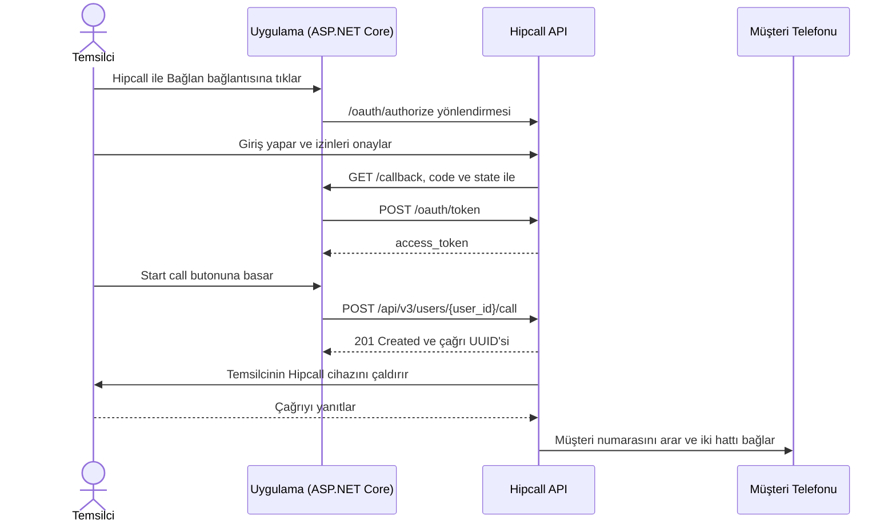

## Genel bakış

CRM veya sipariş yönetim yazılımı kullanan bir ekip, müşteriyi aramak için her seferinde Hipcall paneline geçmek ya da telefon numarasını elle tuşlamak istemez. Kullanıcı Hipcall hesabını OAuth2 ile bir kez bağladığında, uygulamanızdaki tek bir butonla doğrudan kendi ekranından arama başlatabilir.

Bu yazıda ASP.NET Core Minimal API ile OAuth2 üzerinden `access_token` almayı ve `POST /api/v3/users/{user_id}/call` uç noktasına istek göndererek tek butonla giden arama (click-to-call) başlatmayı anlatıyoruz.



## Başlamadan önce

Gereksinimler:

- .NET 8 SDK (`dotnet --version` çıktısı 8.0 veya üzeri olmalıdır).
- API özelliği açık bir Hipcall paketi.
- Client ID, Client Secret ve Redirect URI içeren bir Hipcall OAuth2 uygulaması. Çağrı başlatabilmek için uygulamanın `communication` kapsamını isteyebilmesi gerekir. İstemci bilgilerini nasıl alacağınızı [Hipcall OAuth2 ile yetkilendirme ve token alma](/blog/hipcall-oauth2-ile-yetkilendirme-ve-token-alma/) yazısında bulabilirsiniz.
- Çağrıyı başlatacak Hipcall kullanıcısının ID'si (`user_id`) ve bu kullanıcının açık, internete bağlı bir Hipcall cihazı (web, masaüstü veya mobil uygulama).
- OAuth2 geri dönüş adresi (`/callback`) için dışarıdan erişilebilen bir HTTPS adresi. Yerel geliştirmede 5080 portunu ngrok gibi bir tünelle dışarı açın:

```bash
ngrok http 5080
```

İstemci bilgilerinizi ortam değişkenlerinde tutun:

```bash
export HIPCALL_CLIENT_ID="..."
export HIPCALL_CLIENT_SECRET="..."
export PUBLIC_URL="https://your-server.example.com"
```

Windows PowerShell üzerinde:

```powershell
$env:HIPCALL_CLIENT_ID = "..."
$env:HIPCALL_CLIENT_SECRET = "..."
$env:PUBLIC_URL = "https://your-server.example.com"
```

`HIPCALL_BASE_URL` isteğe bağlıdır ve varsayılan değeri `https://use.hipcall.com.tr` adresidir.

## Adım 1: OAuth2 ile yetkilendirin ve erişim belirtecini alın

Kullanıcıyı Hipcall'ın onay ekranına göndermek için `/oauth/authorize` adresine yönlendirin. Çağrı başlatmak için `scope` parametresine `communication` kapsamını ekleyin:

```http
GET https://use.hipcall.com.tr/oauth/authorize
  ?response_type=code
  &client_id=YOUR_CLIENT_ID
  &redirect_uri=https%3A%2F%2Fyour-server.example.com%2Fcallback
  &scope=profile+email+offline_access+communication
  &state=5718F6D482AE78DF3322714ECAB6BD7E
```

Kullanıcı erişimi onayladığında Hipcall tarayıcıyı `/callback?code=...&state=...` adresinize döndürür. Sunucunuz `state` değerini doğruladıktan sonra `code` değerini `POST /oauth/token` adresine göndererek `access_token` alır:

```csharp
using var tokenResponse = await http.PostAsync("/oauth/token", new FormUrlEncodedContent(
    new Dictionary<string, string>
    {
        ["grant_type"] = "authorization_code",
        ["code"] = code,
        ["client_id"] = clientId,
        ["client_secret"] = clientSecret,
        ["redirect_uri"] = redirectUri
    }));
```

## Adım 2: Tek butonla giden arama başlatın

Token alındıktan sonra kullanıcı uygulamadaki **Start call** butonuna bastığında sunucunuz `POST /api/v3/users/{user_id}/call` uç noktasına Bearer token ile JSON gövdesi gönderir:

```csharp
var payload = JsonSerializer.Serialize(new
{
    callee_number = calleeNumber,
    ring_user_first = true,
    call_masking = true,
    call_masking_name = "Support Team"
});
using var request = new HttpRequestMessage(HttpMethod.Post, $"/api/v3/users/{userId}/call")
{
    Content = new StringContent(payload, Encoding.UTF8, "application/json")
};
request.Headers.Authorization = new AuthenticationHeaderValue("Bearer", savedToken);

using var response = await http.SendAsync(request);
```

İstek kabul edildiğinde Hipcall `201 Created` ve sıraya alınan çağrının kimliğini döner:

```json
{
  "data": {
    "id": "19d354e6-2be8-4c4e-bd49-fd12545f71a4"
  }
}
```

### Çağrı akışı ve parametrelerin davranışı

- **`201 Created` yanıtının anlamı:** `201` kodu, santral katmanının (telephony layer) çağrı isteğini kabul edip sıraya aldığını gösterir; müşterinin telefonu açtığı veya temsilcinin o an çevrimiçi olduğu anlamına gelmez. Çağrının bağlanıp bağlanmadığını ve süresini öğrenmek için `call.ended` webhook olayını dinleyin veya `GET /api/v3/calls` uç noktasını sorgulayın.
- **`ring_user_first`:** `true` gönderildiğinde Hipcall önce temsilcinin kendi kayıtlı cihazını çaldırır. Temsilci çağrıyı yanıtladığı anda sistem `callee_number` numarasını arar ve iki bacağı birbirine bağlar (bridge). `false` gönderilirse sistem temsilcinin telefonunu çaldırmadan doğrudan bağlantı kurmaya çalışır; temsilci çevrimiçi değilse çağrı düşer.
- **`call_masking` ve `call_masking_name`:** `call_masking: true` gönderildiğinde temsilcinin Hipcall ekranında müşterinin gerçek numarası yerine `0000000000` görünür. `call_masking_name` alanına `"Support Team"` gibi bir metin verirseniz sıfırların yerini bu etiket alır. Müşteri ise temsilcinin şahsi numarasını değil, şirketin kurumsal dış numarasını görür. Raporlama ve faturalandırmanın bozulmaması için çağrı geçmişinde (`GET /api/v3/calls`) gerçek numaralar saklanır.
- **`number_id` (isteğe bağlı):** Çağrının şirketin hangi dış numarası üzerinden çıkacağını belirler (`GET /api/v3/numbers` ile listelenen ID'lerden biri). Gönderilmezse kullanıcının Hipcall profilindeki varsayılan numara kullanılır.

## Betiğin tamamı

Yeni bir web projesi oluşturun ve `Program.cs` dosyasını aşağıdaki kodla değiştirin:

```bash
dotnet new web -n Hipcall.ClickToCall
```

```csharp
using System.Collections.Concurrent;
using System.Net.Http.Headers;
using System.Security.Cryptography;
using System.Text;
using System.Text.Json;

static string Env(string name) =>
    Environment.GetEnvironmentVariable(name)
    ?? throw new InvalidOperationException($"{name} is not set.");

var baseUrl = Environment.GetEnvironmentVariable("HIPCALL_BASE_URL") ?? "https://use.hipcall.com.tr";
var clientId = Env("HIPCALL_CLIENT_ID");
var clientSecret = Env("HIPCALL_CLIENT_SECRET");
var publicUrl = Env("PUBLIC_URL").TrimEnd('/');
var redirectUri = $"{publicUrl}/callback";
const string scope = "profile+email+offline_access+communication";

var builder = WebApplication.CreateBuilder(args);
builder.WebHost.ConfigureKestrel(options => options.ListenAnyIP(5080));
var app = builder.Build();

var http = new HttpClient { BaseAddress = new Uri(baseUrl) };
var pendingStates = new ConcurrentDictionary<string, bool>();
string? savedToken = null;

app.MapGet("/", () => Results.Content("<a href=\"/login\">Connect Hipcall</a>", "text/html"));

app.MapGet("/login", () =>
{
    var state = Convert.ToHexString(RandomNumberGenerator.GetBytes(16));
    pendingStates[state] = true;

    return Results.Redirect($"{baseUrl}/oauth/authorize?response_type=code"
        + $"&client_id={Uri.EscapeDataString(clientId)}"
        + $"&redirect_uri={Uri.EscapeDataString(redirectUri)}"
        + $"&scope={scope}&state={state}");
});

app.MapGet("/callback", async (string? code, string? state, string? error) =>
{
    if (error is not null)
    {
        return Results.BadRequest($"Hipcall returned an error: {error}");
    }

    if (code is null || state is null || !pendingStates.TryRemove(state, out _))
    {
        return Results.BadRequest("The code is missing or the state is unknown.");
    }

    using var tokenResponse = await http.PostAsync("/oauth/token", new FormUrlEncodedContent(
        new Dictionary<string, string>
        {
            ["grant_type"] = "authorization_code",
            ["code"] = code,
            ["client_id"] = clientId,
            ["client_secret"] = clientSecret,
            ["redirect_uri"] = redirectUri
        }));
    var tokenBody = await tokenResponse.Content.ReadAsStringAsync();
    if (!tokenResponse.IsSuccessStatusCode)
    {
        return Results.Content(tokenBody, "application/json", statusCode: (int)tokenResponse.StatusCode);
    }

    using var tokenJson = JsonDocument.Parse(tokenBody);
    savedToken = tokenJson.RootElement.GetProperty("access_token").GetString()!;
    var granted = tokenJson.RootElement.TryGetProperty("scope", out var scopeValue) ? scopeValue.GetString() : null;
    Console.WriteLine($"Granted scopes: {granted ?? "(not returned)"}");

    return Results.Content(
        "<form method=\"post\" action=\"/call\">"
        + "<input name=\"user_id\" placeholder=\"4200\" required /> "
        + "<input name=\"callee_number\" placeholder=\"+90530XXXXXXX\" required /> "
        + "<button>Start call</button>"
        + "</form>",
        "text/html");
});

app.MapPost("/call", async (HttpRequest req) =>
{
    if (savedToken is null)
    {
        return Results.BadRequest("Connect Hipcall first.");
    }

    var form = await req.ReadFormAsync();
    var userId = form["user_id"].ToString();
    var calleeNumber = form["callee_number"].ToString();

    var payload = JsonSerializer.Serialize(new
    {
        callee_number = calleeNumber,
        ring_user_first = true,
        call_masking = true,
        call_masking_name = "Support Team"
    });
    using var request = new HttpRequestMessage(HttpMethod.Post, $"/api/v3/users/{userId}/call")
    {
        Content = new StringContent(payload, Encoding.UTF8, "application/json")
    };
    request.Headers.Authorization = new AuthenticationHeaderValue("Bearer", savedToken);

    using var response = await http.SendAsync(request);
    var body = await response.Content.ReadAsStringAsync();
    Console.WriteLine($"Call response ({(int)response.StatusCode}): {body}");

    return Results.Content(body, "application/json", statusCode: (int)response.StatusCode);
});

app.Run();
```

Ortam değişkenleri tanımlıyken uygulamayı çalıştırın:

```bash
dotnet run
```

Tarayıcıda `PUBLIC_URL` adresinizi açın, **Connect Hipcall** bağlantısına tıklayın ve erişimi onaylayın. Açılan ekranda kullanıcı ID'sini (örneğin `4200`) ve aranacak numarayı (`+90530XXXXXXX`) girip **Start call** butonuna basın. Önce temsilcinin Hipcall uygulaması çalar; çağrı yanıtlandığında müşteri aranır. Konsol çıktısı şöyledir:

```text
Granted scopes: profile email offline_access communication
Call response (201): {"data":{"id":"19d354e6-2be8-4c4e-bd49-fd12545f71a4"}}
```

## Hata aldığınızda

### 422 Unprocessable Entity: Eksik zorunlu alan

`callee_number` veya `ring_user_first` alanı gönderilmezse ya da boş bırakılırsa API `422` döner:

```json
{
  "errors": {
    "callee_number": ["can't be blank"]
  }
}
```

İstek gövdesinde `callee_number` (E.164 formatında telefon numarası) ve `ring_user_first` (`true` veya `false`) alanlarının bulunduğundan emin olun.

### 404 Not Found: Geçersiz user_id

URL'deki `user_id` hesabınızda kayıtlı bir kullanıcıya ait değilse API `404` döner:

```json
{
  "errors": {
    "user_id": ["No result for user_id: 21212212"]
  }
}
```

Hesaptaki kullanıcı kimliklerini görmek için `GET /api/v3/users` uç noktasını çağırın ve aktif bir kullanıcının `id` değerini kullanın.

### 403 Forbidden: insufficient_scope

OAuth2 token'ı çağrı başlatma yetkisine sahip değilse API `403` döner. Konsoldaki `Granted scopes` satırında `communication` kapsamının bulunduğunu kontrol edin. Kapsam listede yoksa Hipcall ekibinden OAuth uygulamanız için bu kapsamı etkinleştirmesini isteyin ve yeniden giriş yapın.

### API 201 dönüyor ama telefon çalmıyor

Temsilcinin Hipcall uygulaması kapalıyken veya cihazı uçak modundayken arama başlattığınızda da API `201 Created` döndürür; çünkü HTTP yanıtı çağrının santral kuyruğuna alındığını bildirir. Çağrı başlatmadan önce temsilcinin Hipcall web, masaüstü veya mobil uygulamasının açık olduğundan emin olun ve `ring_user_first: true` kullanın.

## Parametre listesi

### Çağrı başlatma isteği (`POST /api/v3/users/{user_id}/call`)

| Parametre | Konum | Tip | Zorunlu | Açıklama |
|---|---|---|---|---|
| `user_id` | path | integer | evet | Cihazı çaldırılacak Hipcall kullanıcısının ID'si. |
| `callee_number` | body | string | evet | Aranacak telefon numarası (E.164 formatı, örneğin `+90530XXXXXXX`). |
| `ring_user_first` | body | boolean | evet | `true` olduğunda önce temsilcinin cihazı çalar, yanıtlandığında müşteri aranır. |
| `number_id` | body | integer | hayır | Aramada kullanılacak kurumsal dış numaranın ID'si. Gönderilmezse kullanıcının varsayılan numarası kullanılır. |
| `call_masking` | body | boolean | hayır | `true` olduğunda temsilcinin ekranında müşteri numarası gizlenir (`0000000000`). |
| `call_masking_name` | body | string | hayır | Maskeleme açıkken temsilcinin ekranında sıfırlar yerine gösterilecek metin (örneğin `"Support Team"`). |

## Sonraki adımlar

- Başlattığınız aramaların ne zaman bittiğini, süresini ve kimin kapattığını öğrenmek için [OAuth2 API üzerinden Webkancalarını ayarlamak](/blog/oauth2-ile-hipcall-webhook-kurma/) yazısındaki `call.ended` webhook kurulumunu ekleyin.
- OAuth2 akışının detayları için [Hipcall OAuth2 ile yetkilendirme ve token alma](/blog/hipcall-oauth2-ile-yetkilendirme-ve-token-alma/) yazısına göz atın.
- Tüm uç noktaları [Hipcall API Referansı](https://use.hipcall.com.tr/api-docs/) sayfasından inceleyin.
- Sorularınızı [Hipcall Community](https://community.hipcall.com/) üzerinden sorun.

