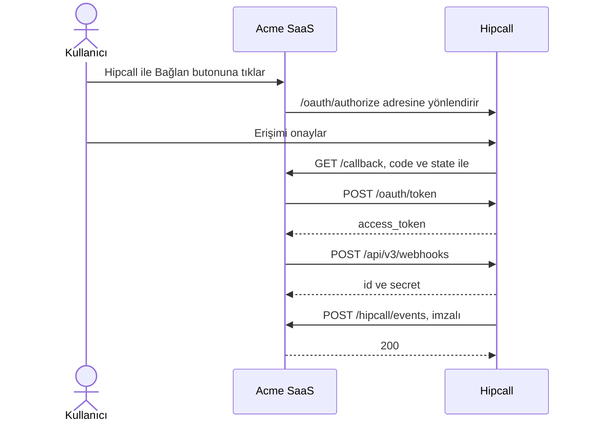

## Genel bakış

Acme SaaS, müşterilerinin çağrıları bittiği anda haberdar olmak isteyen hayali bir entegratör firma. Kurulumu elle yaptırmak müşteriye fazla iş bırakır: Hipcall paneline girmesi, webhook oluşturması, URL'yi Acme SaaS'tan kopyalaması, sonra imza anahtarını geri taşıması gerekir. OAuth2 ve Webhook API ile müşteri tek bir butona tıklar, webhook'u Acme SaaS kendisi kurar.

Bu yazıda akışı ASP.NET Core Minimal API ile kuruyoruz. Uygulama kullanıcıyı erişimi onaylaması için Hipcall'a yönlendirir, dönen code değerini token ile değiştirir, `call.ended` webhook'unu oluşturur, imza anahtarını saklar, gelen her isteği doğrular ve istenirse Hipcall'dan test olayı ister.



## Başlamadan önce

Gereksinimler:

- .NET 8 SDK (`dotnet --version` çıktısı 8.0 veya üzeri olmalıdır).
- Client ID, client secret ve redirect URI içeren bir OAuth uygulaması. Uygulamanın `webhooks:write` ve `communication:read` kapsamlarını isteyebilmesi gerekir. Webhook oluşturmak için `webhooks:write` şarttır. `call.ended` olayına abone olmak için ayrıca olayın kabul ettiği bir kapsam gerekir; `communication:read` bunlardan biridir.
- Erişimi onaylayan Hipcall kullanıcısında `settings::developer` izni.
- Webhook içeren bir Hipcall paketi.
- Boş bir webhook hakkı. Her hesapta varsayılan olarak en fazla 3 webhook olabilir ve limit hesaptaki tüm webhook'ları sayar.
- Dışarıdan erişilebilen bir HTTPS adresi. Hipcall düz HTTP adreslerine gönderim yapmaz. Yerel geliştirmede 5080 portunu ngrok gibi bir tünelle dışarı açın:

```bash
ngrok http 5080
```

Uygulama redirect URI'yi ve webhook URL'sini bu tek adresten üretir. `https://your-server.example.com/callback` adresini OAuth uygulamasının redirect URI'si olarak kaydedin.

Client secret'ı kodun içine yazmayın, ortam değişkeninde tutun:

```bash
export HIPCALL_CLIENT_ID="..."
export HIPCALL_CLIENT_SECRET="..."
export PUBLIC_URL="https://your-server.example.com"
```

Windows PowerShell üzerinde:

```powershell
$env:HIPCALL_CLIENT_ID = "..."
$env:HIPCALL_CLIENT_SECRET = "..."
$env:PUBLIC_URL = "https://your-server.example.com"
```

`HIPCALL_BASE_URL` isteğe bağlıdır ve varsayılan değeri `https://use.hipcall.com.tr` adresidir.

## Adım 1: Kullanıcıyı Hipcall'a yönlendirin

Tarayıcıyı authorize endpoint'ine yönlendirin:

```http
GET https://use.hipcall.com.tr/oauth/authorize
  ?response_type=code
  &client_id=YOUR_CLIENT_ID
  &redirect_uri=https%3A%2F%2Fyour-server.example.com%2Fcallback
  &scope=profile+email+offline_access+contacts:read+webhooks:read+webhooks:write+communication:read
  &state=5718F6D482AE78DF3322714ECAB6BD7E
```

`state`, uygulamanın hatırladığı rastgele bir değerdir. Hipcall onu değiştirmeden geri gönderir. Callback, state değerini tanımadığı her isteği reddeder.

```csharp
app.MapGet("/login", () =>
{
    var state = Convert.ToHexString(RandomNumberGenerator.GetBytes(16));
    pendingStates[state] = true;

    return Results.Redirect($"{baseUrl}/oauth/authorize?response_type=code"
        + $"&client_id={Uri.EscapeDataString(clientId)}"
        + $"&redirect_uri={Uri.EscapeDataString(redirectUri)}"
        + $"&scope={scope}&state={state}");
});
```

Kullanıcı Hipcall'a giriş yapıp erişimi onaylar. Hipcall tarayıcıyı `https://your-server.example.com/callback?code=...&state=...` adresine yönlendirir.

## Adım 2: Code değerini token ile değiştirin

Code değerini form gövdesiyle token endpoint'ine gönderin:

```csharp
using var tokenResponse = await http.PostAsync("/oauth/token", new FormUrlEncodedContent(
    new Dictionary<string, string>
    {
        ["grant_type"] = "authorization_code",
        ["code"] = code,
        ["client_id"] = clientId,
        ["client_secret"] = clientSecret,
        ["redirect_uri"] = redirectUri
    }));
```

Başarılı cevap `200` olur ve gövdesi şuna benzer. Örnekte uygulamanın okuduğu alanlar var:

```json
{
  "access_token": "SFMyNTY.g2gD...",
  "token_type": "Bearer",
  "expires_in": 3599,
  "scope": "profile email contacts:read webhooks:write communication:read offline_access"
}
```

Devam etmeden önce `scope` alanına bakın. Hipcall'ın gerçekte verdiği kapsamları listeler ve uygulamanın istediğinden az olabilir ("Hata aldığınızda" bölümündeki `403` maddesine bakın). Token 3599 saniye sonra geçerliliğini yitirir.

## Adım 3: Webhook'u oluşturun

Token ile `POST /api/v3/webhooks` çağrısını yapın. Gövdede bir ad, alıcı URL'niz ve abone olunacak olaylar bulunur:

```csharp
var payload = JsonSerializer.Serialize(new
{
    name = "Acme SaaS - Hangup Sync",
    url = receiverUrl,
    event_types = new[] { "call.ended" }
});
using var request = new HttpRequestMessage(HttpMethod.Post, "/api/v3/webhooks")
{
    Content = new StringContent(payload, Encoding.UTF8, "application/json")
};
request.Headers.Authorization = new AuthenticationHeaderValue("Bearer", accessToken);
using var response = await http.SendAsync(request);
```

Başarılı çağrı `2xx` durum kodu ve şu gövdeyi döndürür. `health` gibi alanlar burada çıkarıldı:

```json
{
  "data": {
    "id": "06a1bf55-9709-4403-bea5-37d6aa96c7ea",
    "name": "Acme SaaS - Hangup Sync",
    "state": "active",
    "secret": "whsec_XXXXXXXXXXXXXXXXXXXXXXXXXXXXXXXXXXXXXXXXXXX=",
    "url": "https://your-server.example.com/hipcall/events",
    "event_types": ["call.ended"],
    "include_recording_links": false,
    "previous_secret_expires_at": null
  }
}
```

Secret tek bu cevapta görünür, `GET /api/v3/webhooks/{id}` onu hiçbir zaman döndürmez. `data.id` ve `data.secret` değerlerini hemen kaydedin. Secret'ı kaybederseniz `POST /api/v3/webhooks/{id}/rotate-secret` ile yenisini üretin. Eski secret 24 saat daha geçerli kalır.

Örnek uygulama iki değeri access token ile birlikte `webhook.json` dosyasına yazar. Bu dosyayı gizli veri sayın ve sürüm kontrolüne eklemeyin. Üretimde şifreli bir veritabanında, müşteri başına bir kayıt olarak saklayın.

## Adım 4: İmzayı doğrulayın

Hipcall'dan gelen her istek [Standard Webhooks](https://www.standardwebhooks.com) spesifikasyonuna uyar. Aşağıda test sırasında aldığımız bir `webhook.test` teslimatının başlıkları, kısaltılmış hâliyle:

```http
POST /hipcall/events HTTP/1.1
content-type: application/json
user-agent: Hipcall-Webhooks/1.0
webhook-id: evt_qn5a3svvwkx7ep3p5w5dzit4a4
webhook-timestamp: 1793176960
webhook-signature: v1,puuxXYjVf14o... v1,Sj1bLEjN/rj+...
```

Başlıkta iki imza var, çünkü bu webhook'un secret'ı yaklaşık iki dakika önce döndürülmüştü (rotate). Döndürmeden sonraki 24 saat boyunca her istek, geçerli her secret için bir imza taşır.

Bir isteği doğrulamak için:

1. Gövdeyi ham bayt olarak okuyun. JSON'u ayrıştırıp yeniden serileştirmeyin, en küçük değişiklik imzayı bozar.
2. İmzalanan metni oluşturun: `{webhook-id}.{webhook-timestamp}.{gövde}`.
3. Bu metnin HMAC-SHA256 değerini hesaplayın. Anahtar, secret'ın `whsec_` sonrasındaki kısmının base64 çözülmüş hâlidir.
4. Sonucu base64'e çevirin ve `webhook-signature` başlığındaki her `v1,` değeriyle sabit zamanlı karşılaştırmayla kıyaslayın. Değerlerden biri eşleşirse isteği kabul edin.
5. `webhook-timestamp` değeri saatinizden 5 dakikadan fazla uzaksa isteği reddedin.

Kontrol başarısız olursa `401`, olay işlenirse `200` dönün. Hipcall her `2xx` cevabını teslim edilmiş sayar. Mükerrer teslimatlar, olay sırası ve yeniden denemeler için {{ article#bc6395ea-a4ee-4268-a816-ae12ee0e4a47 }} yazısına bakın.

Gövde her zaman aynı dört alandan oluşur. Test olayı şöyledir:

```json
{
  "id": "evt_qn5a3svvwkx7ep3p5w5dzit4a4",
  "type": "webhook.test",
  "timestamp": "2026-10-28T08:42:39Z",
  "data": {
    "endpoint_id": "357ffdcc-0fb3-4ae4-ac40-3e12a79888cb",
    "message": "Hipcall webhook test"
  }
}
```

Görüşme sonlandığında gelen `call.ended` olay gövdesi şöyledir:

```json
{
  "id": "evt_v7hpribzapcoppnlhrrhggg2ze",
  "type": "call.ended",
  "timestamp": "2026-10-22T11:54:39Z",
  "data": {
    "uuid": "8bd0a813-605b-4943-a30a-ed780f25777c",
    "direction": "inbound",
    "caller_number": "+90551XXXXXXX",
    "callee_number": "+90850XXXXXXX",
    "caller_id": null,
    "caller_type": "contact",
    "callee_id": 101,
    "callee_type": "user",
    "contact_id": 1050,
    "deal_id": null,
    "company_id": null,
    "user_id": 101,
    "number_id": 10,
    "channel_id": 10,
    "channel_type": "number",
    "started_at": "2026-10-22T11:54:07Z",
    "answered_at": "2026-10-22T11:54:12Z",
    "bridged_at": "2026-10-22T11:54:12Z",
    "ended_at": "2026-10-22T11:54:39Z",
    "call_duration": 32,
    "first_touch_duration": 27,
    "team_touch_at": null,
    "credited": false,
    "hangup_by": "contact",
    "missing_call": false,
    "missing_call_reason": null,
    "callback_time": null,
    "callback_user_id": null,
    "callback_cdr_uuid": null,
    "voicemail_id": null,
    "voicemail_type": null,
    "voicemail_url": null,
    "has_recording": false,
    "record_url": null,
    "call_flow": [
      {
        "action": "hangup",
        "detail": { "hangup_by": "contact" },
        "timestamp": 1792657639
      },
      {
        "action": "bridge",
        "detail": { "id": 101, "type": "user" },
        "timestamp": 1792657612
      },
      {
        "action": "init",
        "detail": { "id": 1050, "type": "contact" },
        "timestamp": 1792657607
      }
    ]
  }
}
```

`hangup_by` değeri `contact` veya `user` olur. `call_duration` saniye cinsindendir.

## Adım 5: Test olayı gönderin

`POST /api/v3/webhooks/{id}/test` çağrısı, Hipcall'ın URL'nize imzalı bir `webhook.test` olayı göndermesini sağlar. Gövde boştur ve webhook'un `webhook.test` olayına abone olması gerekmez.

```csharp
using var request = new HttpRequestMessage(HttpMethod.Post, $"/api/v3/webhooks/{saved.Id}/test")
{
    Content = new StringContent("")
};
request.Headers.Authorization = new AuthenticationHeaderValue("Bearer", saved.AccessToken);
using var response = await http.SendAsync(request);
```

Cevap, Hipcall'ın olayı kuyruğa aldığını gösterir. `payload` gibi alanlar burada çıkarıldı:

```json
{
  "data": {
    "id": 48,
    "status": "pending",
    "event_type": "webhook.test",
    "attempts": [],
    "attempt_count": 0
  }
}
```

`id` değeri teslimat kimliğidir. `GET /api/v3/webhooks/{id}/deliveries/48` çağrısı sunucunuzun `200` dönüp dönmediğini gösterir. Alıcı konsola `Test event received.` yazar.

## Betiğin tamamı

Web proje şablonu implicit using'leri açar, bu yüzden aşağıdaki `using` satırları yeterlidir. Projeyi oluşturun ve `Program.cs` dosyasını aşağıdaki kodla değiştirin:

```bash
dotnet new web -n Hipcall.OAuthWebhook
```

```csharp
using System.Collections.Concurrent;
using System.Net.Http.Headers;
using System.Security.Cryptography;
using System.Text;
using System.Text.Json;

static string Env(string name) =>
    Environment.GetEnvironmentVariable(name)
    ?? throw new InvalidOperationException($"{name} is not set.");

var baseUrl = Environment.GetEnvironmentVariable("HIPCALL_BASE_URL") ?? "https://use.hipcall.com.tr";
var clientId = Env("HIPCALL_CLIENT_ID");
var clientSecret = Env("HIPCALL_CLIENT_SECRET");
var publicUrl = Env("PUBLIC_URL").TrimEnd('/');
var redirectUri = $"{publicUrl}/callback";
var receiverUrl = $"{publicUrl}/hipcall/events";
const string scope = "profile+email+offline_access+contacts:read+webhooks:read+webhooks:write+communication:read";
const string storePath = "webhook.json";

var builder = WebApplication.CreateBuilder(args);
builder.WebHost.ConfigureKestrel(options => options.ListenAnyIP(5080));
var app = builder.Build();

var http = new HttpClient { BaseAddress = new Uri(baseUrl) };
var pendingStates = new ConcurrentDictionary<string, bool>();

app.MapGet("/", () => Results.Content("<a href=\"/login\">Connect Hipcall</a>", "text/html"));

app.MapGet("/login", () =>
{
    var state = Convert.ToHexString(RandomNumberGenerator.GetBytes(16));
    pendingStates[state] = true;

    return Results.Redirect($"{baseUrl}/oauth/authorize?response_type=code"
        + $"&client_id={Uri.EscapeDataString(clientId)}"
        + $"&redirect_uri={Uri.EscapeDataString(redirectUri)}"
        + $"&scope={scope}&state={state}");
});

app.MapGet("/callback", async (string? code, string? state, string? error) =>
{
    if (error is not null)
    {
        return Results.BadRequest($"Hipcall returned an error: {error}");
    }

    if (code is null || state is null || !pendingStates.TryRemove(state, out _))
    {
        return Results.BadRequest("The code is missing or the state is unknown.");
    }

    using var tokenResponse = await http.PostAsync("/oauth/token", new FormUrlEncodedContent(
        new Dictionary<string, string>
        {
            ["grant_type"] = "authorization_code",
            ["code"] = code,
            ["client_id"] = clientId,
            ["client_secret"] = clientSecret,
            ["redirect_uri"] = redirectUri
        }));
    var tokenBody = await tokenResponse.Content.ReadAsStringAsync();
    if (!tokenResponse.IsSuccessStatusCode)
    {
        return Results.Content(tokenBody, "application/json", statusCode: (int)tokenResponse.StatusCode);
    }

    using var tokenJson = JsonDocument.Parse(tokenBody);
    var accessToken = tokenJson.RootElement.GetProperty("access_token").GetString()!;
    var granted = tokenJson.RootElement.TryGetProperty("scope", out var scopeValue) ? scopeValue.GetString() : null;
    Console.WriteLine($"Granted scopes: {granted ?? "(not returned)"}");

    var payload = JsonSerializer.Serialize(new
    {
        name = "Acme SaaS - Hangup Sync",
        url = receiverUrl,
        event_types = new[] { "call.ended" }
    });
    using var request = new HttpRequestMessage(HttpMethod.Post, "/api/v3/webhooks")
    {
        Content = new StringContent(payload, Encoding.UTF8, "application/json")
    };
    request.Headers.Authorization = new AuthenticationHeaderValue("Bearer", accessToken);

    using var response = await http.SendAsync(request);
    var body = await response.Content.ReadAsStringAsync();
    if (!response.IsSuccessStatusCode)
    {
        return Results.Content(body, "application/json", statusCode: (int)response.StatusCode);
    }

    using var created = JsonDocument.Parse(body);
    var data = created.RootElement.GetProperty("data");
    var saved = new SavedWebhook(
        data.GetProperty("id").GetString()!,
        data.GetProperty("secret").GetString()!,
        accessToken);
    await File.WriteAllTextAsync(storePath, JsonSerializer.Serialize(saved));

    return Results.Content(
        $"Webhook {saved.Id} created."
        + "<form method=\"post\" action=\"/trigger-test\"><button>Send test event</button></form>",
        "text/html");
});

app.MapPost("/trigger-test", async () =>
{
    var saved = LoadWebhook();
    if (saved is null)
    {
        return Results.BadRequest("No webhook is saved yet. Connect Hipcall first.");
    }

    using var request = new HttpRequestMessage(HttpMethod.Post, $"/api/v3/webhooks/{saved.Id}/test")
    {
        Content = new StringContent("")
    };
    request.Headers.Authorization = new AuthenticationHeaderValue("Bearer", saved.AccessToken);

    using var response = await http.SendAsync(request);
    var body = await response.Content.ReadAsStringAsync();
    return Results.Content(body, "application/json", statusCode: (int)response.StatusCode);
});

app.MapPost("/hipcall/events", async (HttpRequest request) =>
{
    using var buffer = new MemoryStream();
    await request.Body.CopyToAsync(buffer);
    var rawBody = buffer.ToArray();

    var saved = LoadWebhook();
    if (saved is null)
    {
        return Results.StatusCode(StatusCodes.Status503ServiceUnavailable);
    }

    var valid = IsValidSignature(
        saved.Secret,
        request.Headers["webhook-id"].ToString(),
        request.Headers["webhook-timestamp"].ToString(),
        rawBody,
        request.Headers["webhook-signature"].ToString());
    if (!valid)
    {
        return Results.Unauthorized();
    }

    using var doc = JsonDocument.Parse(rawBody);
    var type = Field(doc.RootElement, "type");
    var data = doc.RootElement.TryGetProperty("data", out var dataValue) ? dataValue : default;

    if (type == "webhook.test")
    {
        Console.WriteLine("Test event received.");
    }
    else if (type == "call.ended")
    {
        Console.WriteLine($"call.ended {Field(data, "uuid")}: {Mask(Field(data, "caller_number"))} -> "
            + $"{Mask(Field(data, "callee_number"))}, {Field(data, "call_duration")} s, "
            + $"hung up by {Field(data, "hangup_by")}");
    }
    else
    {
        Console.WriteLine($"Ignored {type}");
    }

    return Results.Ok();
});

app.Run();

SavedWebhook? LoadWebhook() =>
    File.Exists(storePath)
        ? JsonSerializer.Deserialize<SavedWebhook>(File.ReadAllText(storePath))
        : null;

static string Mask(string value) =>
    value.Length > 6 ? string.Concat(value.AsSpan(0, 6), "XXXXXX") : value;

static string Field(JsonElement element, string name) =>
    element.ValueKind == JsonValueKind.Object
    && element.TryGetProperty(name, out var value)
    && value.ValueKind != JsonValueKind.Null
        ? value.ToString()
        : "-";

static bool IsValidSignature(string secret, string id, string timestamp, byte[] body, string signatureHeader)
{
    if (id.Length == 0 || !long.TryParse(timestamp, out var seconds))
    {
        return false;
    }

    var age = DateTimeOffset.UtcNow - DateTimeOffset.FromUnixTimeSeconds(seconds);
    if (age.Duration() > TimeSpan.FromMinutes(5))
    {
        return false;
    }

    byte[] key;
    try
    {
        key = Convert.FromBase64String(secret.StartsWith("whsec_") ? secret["whsec_".Length..] : secret);
    }
    catch (FormatException)
    {
        return false;
    }

    var signedText = Encoding.UTF8.GetBytes($"{id}.{timestamp}.").Concat(body).ToArray();
    var expected = HMACSHA256.HashData(key, signedText);

    foreach (var part in signatureHeader.Split(' ', StringSplitOptions.RemoveEmptyEntries))
    {
        var pieces = part.Split(',', 2);
        if (pieces.Length != 2 || pieces[0] != "v1")
        {
            continue;
        }

        try
        {
            if (CryptographicOperations.FixedTimeEquals(Convert.FromBase64String(pieces[1]), expected))
            {
                return true;
            }
        }
        catch (FormatException)
        {
        }
    }

    return false;
}

record SavedWebhook(string Id, string Secret, string AccessToken);
```

Ortam değişkenleri tanımlıyken uygulamayı başlatın ve tüneli açık tutun:

```bash
dotnet run
```

Herkese açık adresi tarayıcıda açın, Connect Hipcall bağlantısına tıklayın ve erişimi onaylayın. Ardından Send test event butonuna tıklayın. Konsolda şu satırlar görünür; her `call.ended` olayı için bir satır daha eklenir:

```text
Granted scopes: profile email contacts:read webhooks:write communication:read offline_access
Test event received.
call.ended 8bd0a813-605b-4943-a30a-ed780f25777c: +90551XXXXXXX -> +90850XXXXXXX, 32 s, hung up by contact
```

Webhook kaydedildikten sonra reddedilen bir isteği görmek için yanlış imzalı bir istek gönderin. Uygulama boş gövdeyle `401` döner:

```bash
curl -i -X POST http://localhost:5080/hipcall/events \
  -H "content-type: application/json" \
  -H "webhook-id: evt_local_test" \
  -H "webhook-timestamp: $(date +%s)" \
  -H "webhook-signature: v1,AAAA" \
  -d '{"id":"evt_local_test","type":"webhook.test","timestamp":"2026-10-22T08:00:00Z","data":{}}'
```

## Hata aldığınızda

### 403: insufficient_scope

```json
{
  "error": "insufficient_scope",
  "errors": {
    "detail": "Forbidden",
    "required_scope": "webhooks:write"
  }
}
```

Token `webhooks:write` kapsamını taşımıyor. Konsoldaki `Granted scopes` satırına bakın. İlk denememizde authorize URL'si `webhooks:write` istediği hâlde token `profile email contacts:read communication:read offline_access` kapsamlarıyla döndü. Hipcall bu kapsamı, OAuth uygulaması için etkinleştirildikten sonra verdi. Kapsamı etkinleştirin, sonra uygulamanın yeni bir token alması için baştan bağlanın.

### 422: webhook_limit_reached

```json
{
  "error": "webhook_limit_reached",
  "errors": {
    "detail": "This account has reached its webhook limit."
  }
}
```

Hesap, izin verilen en fazla webhook sayısına ulaşmış. Settings > Developer > Webhooks (Ayarlar > Geliştirici > Webhooks) sayfasını açın, kullanmadığınız bir webhook'u silin ve yeniden bağlanın. OAuth token'ı kendi uygulamasının oluşturduğu webhook'ları listeler. Bu yüzden panelden veya API token'ı ile oluşturulmuş bir webhook `GET /api/v3/webhooks` cevabında görünmez.

Paketiniz webhook içermiyorsa API bunun yerine `api_feature_missing` hata koduyla cevap verir.

### Test olayı: webhook_not_active

```json
{
  "error": "webhook_not_active",
  "errors": {
    "detail": "Only an active webhook can be sent a test event."
  }
}
```

Dokümantasyon durum kodunu `422` veya `400` olarak veriyor. Duraklatılmış bir webhook'un durumu `passive` olur. `PATCH /api/v3/webhooks/{id}` çağrısına `{"state": "active"}` göndererek yeniden açın ve testi tekrarlayın.

### Test olayı: 409 webhook_test_pending

Aynı anda yolda tek bir test olayı bulunabilir. İlki teslim edilene kadar bekleyin, sonra bir sonrakini gönderin.

### Teslimat 404 ve bir ngrok mesajı gösteriyor

Tünel çalışmadığında webhook'un teslimat kaydı `404` durumunu ve şu cevap gövdesini gösterir:

```text
The endpoint your-server.ngrok-free.dev is offline.

ERR_NGROK_3200
```

`404` cevabı kodunuzdan değil, ngrok'tan gelir. Tüneli `PUBLIC_URL` ile aynı adresle başlatın. Hipcall başarısız teslimatı yaklaşık 3 güne yayılan 10 denemeyle tekrar eder, bu yüzden tünel geri geldiğinde olay yine de ulaşır.

### Alıcınız 401 dönüyor

İmza kontrolü başarısız oldu. Şunlara bakın:

- `webhook.json` içindeki secret bu webhook'a ait mi? Eski bir webhook'un secret'ı eşleşmez.
- Kod ham gövdeyi okuyor ve değiştirmiyor mu?
- Saatiniz gerçek saatten en fazla 5 dakika sapıyor mu?

## Parametre listesi

### Authorize isteği

| Parametre | Tip | Zorunlu | Açıklama |
|---|---|---|---|
| `response_type` | string | evet | Her zaman `code`. |
| `client_id` | string | evet | OAuth uygulamanızın client ID'si. |
| `redirect_uri` | string | evet | OAuth uygulamanızın callback adresi. Token isteğinde aynı değeri gönderin. |
| `scope` | string | evet | `+` ile ayrılmış kapsamlar. Aşağıdaki tabloya bakın. |
| `state` | string | evet | Rastgele bir değer. Hipcall onu değiştirmeden geri gönderir. |

### Token isteği

Bu alanları `application/x-www-form-urlencoded` olarak `POST /oauth/token` adresine gönderin.

| Parametre | Tip | Zorunlu | Açıklama |
|---|---|---|---|
| `grant_type` | string | evet | Her zaman `authorization_code`. |
| `code` | string | evet | Callback'ten gelen code. |
| `client_id` | string | evet | OAuth uygulamanızın client ID'si. |
| `client_secret` | string | evet | OAuth uygulamanızın client secret'ı. |
| `redirect_uri` | string | evet | Authorize isteğindeki değerle aynı. |

### Webhook oluşturma gövdesi

| Alan | Tip | Açıklama |
|---|---|---|
| `name` | string | Webhook listesinde görünen ad. |
| `url` | string | HTTPS alıcı adresiniz. Herkese açık internetten erişilebilir olmalıdır. |
| `event_types` | string dizisi | Abone olunacak olaylar, örneğin `["call.ended"]`. |

### Kapsamlar

| Kapsam | İzin verdiği işlem |
|---|---|
| `webhooks:write` | Webhook oluşturma, değiştirme ve silme, test olayı gönderme, secret döndürme. |
| `webhooks:read` | Webhook'ları ve teslimatlarını listeleme ve okuma. `webhooks:write` da buna izin verir. |
| `communication:read` | `call.ended` gibi çağrı olaylarına abone olma. `communication` da çalışır. |

Bu yazıdaki authorize URL'si ayrıca `profile`, `email`, `contacts:read` ve `offline_access` kapsamlarını da ister. Dokümantasyondaki webhook endpoint'leri bunları şart koşmaz.

## Sonraki adımlar

- Eski token geçerliliğini yitirmeden yenisini alın. Örnek uygulama ilk token'ı saklar, bu yüzden yaklaşık bir saat sonra test olayı göndermek için yeniden giriş gerekir.
- Her müşterinin webhook ID'sini, secret'ını ve token'ını bir veritabanında saklayın, müşteri başına bir webhook kullanın.
- Gelen olayları veritabanınıza (PostgreSQL, SQL Server, SQLite vb.) uuid bazında tekilleştirerek kaydedin.
- Sorularınızı [Hipcall Community](https://community.hipcall.com/) üzerinden sorun.
