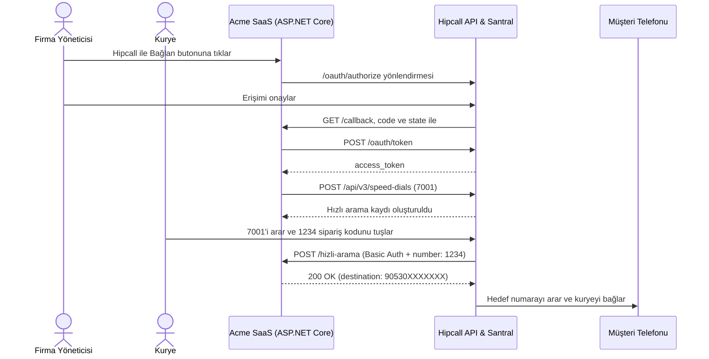

## Genel bakış

Acme SaaS, saha kuryelerinin müşterileri sipariş numarasıyla aramasını sağlayan hayali bir teslimat yazılımı. KVKK kuralları gereği kuryenin müşterinin şahsi telefon numarasını görmemesi gerekir. Hipcall'un hızlı arama (speed dial) özelliği bu sorunu çözer: kurye hızlı aramanın dahili numarasını (`7001`) çevirir ve sipariş kodunu (`1234`) tuşlar. Hipcall tuşlanan rakamları Acme SaaS'ın web servisine sorar, servis müşterinin telefon numarasını döner ve Hipcall iki tarafı birbirine bağlar.

Müşteriden Hipcall paneline girip hızlı arama kaydı açmasını, web servisi URL'sini yapıştırmasını ve Basic Auth bilgilerini elle girmesini istemek kurulumu zorlaştırır. OAuth2 ve Hızlı Arama API'si ile müşteri tek bir butona tıklar; Acme SaaS `7001` dahili hattını API üzerinden kendisi kurar.

Bu yazıda akışı ASP.NET Core Minimal API ile kuruyoruz. Uygulama kullanıcıyı erişimi onaylaması için Hipcall'a yönlendirir, dönen kodu token ile değiştirir, `POST /api/v3/speed-dials` ile `7001` hızlı aramasını oluşturur ve kurye aradığında `/hizli-arama` uç noktasından müşteri numarasını döndürür.



## Başlamadan önce

Gereksinimler:

- .NET 8 SDK (`dotnet --version` çıktısı 8.0 veya üzeri olmalıdır).
- API özelliği açık bir Hipcall paketi.
- Client ID, Client Secret ve Redirect URI içeren bir Hipcall OAuth2 uygulaması. Hızlı arama oluşturabilmek için uygulamanın `communication_settings:write` kapsamını isteyebilmesi gerekir. İstemci bilgilerini nasıl alacağınızı [Hipcall OAuth2 ile yetkilendirme ve token alma](/blog/hipcall-oauth2-ile-yetkilendirme-ve-token-alma/) yazısında bulabilirsiniz.
- Erişimi onaylayan Hipcall kullanıcısında `communication::settings` izni.
- Hesapta başka bir kullanıcı, takım, karşılama anonsu veya hızlı arama tarafından kullanılmayan boş bir dahili numara (bu örnekte `7001`).
- Dışarıdan erişilebilen bir HTTPS adresi. Hipcall, hızlı arama oluşturulurken `web_service_url` adresinin `https://` ile başladığını ve genel internetten erişilebilir olduğunu kontrol eder. Yerel geliştirmede 5080 portunu ngrok gibi bir tünelle dışarı açın:

```bash
ngrok http 5080
```

`https://your-server.example.com/callback` adresini OAuth uygulamasının redirect URI'si olarak kaydedin. Gizli anahtarları kodun içine yazmayın, ortam değişkenlerinde tutun:

```bash
export HIPCALL_CLIENT_ID="..."
export HIPCALL_CLIENT_SECRET="..."
export PUBLIC_URL="https://your-server.example.com"
export WEB_SERVICE_PASSWORD="..."
```

Windows PowerShell üzerinde:

```powershell
$env:HIPCALL_CLIENT_ID = "..."
$env:HIPCALL_CLIENT_SECRET = "..."
$env:PUBLIC_URL = "https://your-server.example.com"
$env:WEB_SERVICE_PASSWORD = "..."
```

`HIPCALL_BASE_URL` isteğe bağlıdır ve varsayılan değeri `https://use.hipcall.com.tr` adresidir.

## Adım 1: Kullanıcıyı Hipcall'a yönlendirin ve token alın

Tarayıcıyı `/oauth/authorize` uç noktasına yönlendirin ve `scope` parametresine `communication_settings:write` kapsamını ekleyin:

```http
GET https://use.hipcall.com.tr/oauth/authorize
  ?response_type=code
  &client_id=YOUR_CLIENT_ID
  &redirect_uri=https%3A%2F%2Fyour-server.example.com%2Fcallback
  &scope=profile+email+offline_access+communication_settings:write
  &state=5718F6D482AE78DF3322714ECAB6BD7E
```

Kullanıcı Hipcall'a giriş yapıp erişimi onayladığında tarayıcı `/callback?code=...&state=...` adresine döner. Callback uç noktanız `state` değerini kontrol eder ve `code` değerini `POST /oauth/token` adresine göndererek `access_token` alır:

```csharp
using var tokenResponse = await http.PostAsync("/oauth/token", new FormUrlEncodedContent(
    new Dictionary<string, string>
    {
        ["grant_type"] = "authorization_code",
        ["code"] = code,
        ["client_id"] = clientId,
        ["client_secret"] = clientSecret,
        ["redirect_uri"] = redirectUri
    }));
```

Devam etmeden önce dönen JSON içindeki `scope` alanını kontrol edin; `communication_settings:write` kapsamının Hipcall tarafından onaylandığından emin olun.

## Adım 2: Hızlı arama kaydını oluşturun

Aldığınız `access_token` ile `POST /api/v3/speed-dials` uç noktasını çağırın. Gövdede dahili numara (`extension_number`), kayıt adı (`name`), web servisinizin HTTPS adresi (`web_service_url`) ve Basic Auth bilgileri yer alır:

```csharp
var payload = JsonSerializer.Serialize(new
{
    extension_number = "7001",
    name = "Order status",
    web_service_auth = true,
    web_service_password = webServicePassword,
    web_service_url = webServiceUrl,
    web_service_username = webServiceUsername
});
using var request = new HttpRequestMessage(HttpMethod.Post, "/api/v3/speed-dials")
{
    Content = new StringContent(payload, Encoding.UTF8, "application/json")
};
request.Headers.Authorization = new AuthenticationHeaderValue("Bearer", accessToken);
using var response = await http.SendAsync(request);
```

Başarılı çağrı `2xx` durum kodu ve oluşturulan kaydın detaylarını döndürür:

```json
{
  "data": {
    "id": "dd8fad9f-2689-48cc-8e34-67e182e6cc51",
    "name": "Order status",
    "state": "active",
    "inserted_at": "2026-11-03T08:11:43",
    "updated_at": "2026-11-03T08:11:43",
    "extension_number": "7001",
    "web_service_url": "https://your-server.example.com/hizli-arama",
    "web_service_auth": true,
    "web_service_username": "hipcall"
  }
}
```

Bu uç noktayla ilgili üç kurala dikkat edin:

- **`web_service_password` yanıt içinde dönmez:** Parola alanı yazılabilir (write-only) bir alandır. Güvenlik nedeniyle ne oluşturma yanıtında ne de `GET /api/v3/speed-dials` sorgularında geri döndürülür.
- **Basic Auth zorunluluğu:** `web_service_auth` alanı `true` gönderildiğinde hem `web_service_username` hem de `web_service_password` alanlarının dolu olması şarttır.
- **Varsayılan durum ve anonslar:** İstek gövdesinde `state` belirtilmezse kayıt `active` durumda açılır ve hesabın varsayılan giriş/hata anonslarını çalar. Kaydı daha sonra duraklatmak isterseniz `PATCH /api/v3/speed-dials/{id}` adresine `{"state": "passive"}` gönderebilirsiniz.

### Telefon numarasını 7001 dahili hattına yönlendirme

Hipcall API'sinde bir dış telefon numarasını oluşturulan dahili hatta (`7001`) bağlayacak bir uç nokta yoktur. Dış hattan arayan kuryelerin bu hızlı aramaya düşmesi için, kayıt oluşturulduktan sonra kullanıcıya uygulamanızın ekranında şu yönergeyi gösterin:

> Hızlı aramanız (7001 dahili hattı) API ile kuruldu. Dış aramaların bu hatta yönlenmesi için Hipcall panelinde **Ayarlar > Telefon Sistemi > Telefon Numaraları** bölümüne gidin, numaranızı seçin ve **Çalışma Saatleri** sekmesindeki **Mesai içi hedef** alanını **7001** dahili hattına yönlendirin.

## Adım 3: Sipariş numarasından müşteri telefonunu döndürün

Kurye `7001` dahili hattına bağlanıp anonsu dinledikten sonra sipariş kodunu (örneğin `1234`) tuşladığında Hipcall, `web_service_url` adresinize HTTP POST isteği gönderir:

```json
{
  "timestamp": 1791891730,
  "number": "1234",
  "uuid": "e785a112-4c9b-41d0-9b1e-1029384787e5",
  "user_id": null,
  "speed_dial_id": 19
}
```

Gövdedeki `number` alanı, kuryenin tuşladığı DTMF rakamlarını (sipariş kodunu) taşır. `web_service_auth: true` tanımlandığı için Hipcall isteğe `Authorization: Basic <Base64>` başlığını ekler.

Dinleyici uç noktanız (`/hizli-arama`) şu adımları çalıştırmalıdır:

1. `Authorization` başlığındaki Base64 kimlik bilgisini çözüp kullanıcı adı ve parolayı sabit zamanlı karşılaştırmayla (`CryptographicOperations.FixedTimeEquals`) doğrulayın. Hatalıysa `401` dönün.
2. Gövdedeki `number` alanını okuyun ve veritabanınızda bu sipariş koduna ait müşteri telefon numarasını bulun.
3. **3 saniye** içinde HTTP `200` durum kodu ve başında `+` olmadan, ülke kodu dahil rakamlardan oluşan `destination` alanını döndürün:

```json
{
  "destination": "90530XXXXXXX"
}
```

Hipcall bu yanıtı aldığı anda `destination` numarasını arar ve kuryeyi müşteriye bağlar; kurye müşterinin numarasını hiçbir aşamada görmez.

## Betiğin tamamı

Yeni bir web projesi oluşturun ve `Program.cs` dosyasını aşağıdaki kodla değiştirin:

```bash
dotnet new web -n Hipcall.SpeedDial
```

```csharp
using System.Collections.Concurrent;
using System.Net.Http.Headers;
using System.Security.Cryptography;
using System.Text;
using System.Text.Json;

static string Env(string name) =>
    Environment.GetEnvironmentVariable(name)
    ?? throw new InvalidOperationException($"{name} is not set.");

var baseUrl = Environment.GetEnvironmentVariable("HIPCALL_BASE_URL") ?? "https://use.hipcall.com.tr";
var clientId = Env("HIPCALL_CLIENT_ID");
var clientSecret = Env("HIPCALL_CLIENT_SECRET");
var publicUrl = Env("PUBLIC_URL").TrimEnd('/');
var webServiceUsername = Environment.GetEnvironmentVariable("WEB_SERVICE_USERNAME") ?? "hipcall";
var webServicePassword = Env("WEB_SERVICE_PASSWORD");
var redirectUri = $"{publicUrl}/callback";
var webServiceUrl = $"{publicUrl}/hizli-arama";
const string scope = "profile+email+offline_access+communication_settings:write";

var orders = new Dictionary<string, string>
{
    ["1234"] = "90530XXXXXXX"
};

var builder = WebApplication.CreateBuilder(args);
builder.WebHost.ConfigureKestrel(options => options.ListenAnyIP(5080));
var app = builder.Build();

var http = new HttpClient { BaseAddress = new Uri(baseUrl) };
var pendingStates = new ConcurrentDictionary<string, bool>();

app.MapGet("/", () => Results.Content("<a href=\"/login\">Connect Hipcall</a>", "text/html"));

app.MapGet("/login", () =>
{
    var state = Convert.ToHexString(RandomNumberGenerator.GetBytes(16));
    pendingStates[state] = true;

    return Results.Redirect($"{baseUrl}/oauth/authorize?response_type=code"
        + $"&client_id={Uri.EscapeDataString(clientId)}"
        + $"&redirect_uri={Uri.EscapeDataString(redirectUri)}"
        + $"&scope={scope}&state={state}");
});

app.MapGet("/callback", async (string? code, string? state, string? error) =>
{
    if (error is not null)
    {
        return Results.BadRequest($"Hipcall returned an error: {error}");
    }

    if (code is null || state is null || !pendingStates.TryRemove(state, out _))
    {
        return Results.BadRequest("The code is missing or the state is unknown.");
    }

    using var tokenResponse = await http.PostAsync("/oauth/token", new FormUrlEncodedContent(
        new Dictionary<string, string>
        {
            ["grant_type"] = "authorization_code",
            ["code"] = code,
            ["client_id"] = clientId,
            ["client_secret"] = clientSecret,
            ["redirect_uri"] = redirectUri
        }));
    var tokenBody = await tokenResponse.Content.ReadAsStringAsync();
    if (!tokenResponse.IsSuccessStatusCode)
    {
        return Results.Content(tokenBody, "application/json", statusCode: (int)tokenResponse.StatusCode);
    }

    using var tokenJson = JsonDocument.Parse(tokenBody);
    var accessToken = tokenJson.RootElement.GetProperty("access_token").GetString()!;
    var granted = tokenJson.RootElement.TryGetProperty("scope", out var scopeValue) ? scopeValue.GetString() : null;
    Console.WriteLine($"Granted scopes: {granted ?? "(not returned)"}");

    var payload = JsonSerializer.Serialize(new
    {
        extension_number = "7001",
        name = "Order status",
        web_service_auth = true,
        web_service_password = webServicePassword,
        web_service_url = webServiceUrl,
        web_service_username = webServiceUsername
    });
    using var request = new HttpRequestMessage(HttpMethod.Post, "/api/v3/speed-dials")
    {
        Content = new StringContent(payload, Encoding.UTF8, "application/json")
    };
    request.Headers.Authorization = new AuthenticationHeaderValue("Bearer", accessToken);

    using var response = await http.SendAsync(request);
    var body = await response.Content.ReadAsStringAsync();
    if (!response.IsSuccessStatusCode)
    {
        return Results.Content(body, "application/json", statusCode: (int)response.StatusCode);
    }

    using var created = JsonDocument.Parse(body);
    var id = created.RootElement.GetProperty("data").GetProperty("id").GetString();
    Console.WriteLine($"Speed dial 7001 created: {id}");

    return Results.Content(
        "<p>Hızlı aramanız (7001 dahili hattı) API ile başarıyla kuruldu. "
        + "Sistemin çalışması için şimdi Hipcall panelinde <b>Ayarlar -&gt; Telefon Numaraları</b> bölümüne gidip, "
        + "numaranızın 'Mesai içi hedefini' yeni oluşan <b>7001</b> dahili hattına yönlendirmeyi unutmayın!</p>",
        "text/html; charset=utf-8");
});

app.MapPost("/hizli-arama", async (HttpRequest request) =>
{
    if (!IsValidBasicAuth(request.Headers.Authorization.ToString(), webServiceUsername, webServicePassword))
    {
        return Results.Unauthorized();
    }

    using var doc = await JsonDocument.ParseAsync(request.Body);
    var orderNumber = doc.RootElement.TryGetProperty("number", out var numProp) ? numProp.GetString() : null;
    if (orderNumber is null || !orders.TryGetValue(orderNumber, out var destination))
    {
        Console.WriteLine($"Order not found: {orderNumber ?? "(empty)"}");
        return Results.NotFound();
    }

    Console.WriteLine($"Order {orderNumber} routed to {Mask(destination)}");
    return Results.Ok(new { destination });
});

app.Run();

static string Mask(string value) =>
    value.Length > 5 ? string.Concat(value.AsSpan(0, 5), "XXXXXXX") : value;

static bool IsValidBasicAuth(string header, string expectedUser, string expectedPass)
{
    if (!header.StartsWith("Basic ", StringComparison.OrdinalIgnoreCase))
    {
        return false;
    }

    byte[] raw;
    try
    {
        raw = Convert.FromBase64String(header["Basic ".Length..].Trim());
    }
    catch (FormatException)
    {
        return false;
    }

    var parts = Encoding.UTF8.GetString(raw).Split(':', 2);
    if (parts.Length != 2)
    {
        return false;
    }

    var userOk = CryptographicOperations.FixedTimeEquals(
        Encoding.UTF8.GetBytes(parts[0]),
        Encoding.UTF8.GetBytes(expectedUser));
    var passOk = CryptographicOperations.FixedTimeEquals(
        Encoding.UTF8.GetBytes(parts[1]),
        Encoding.UTF8.GetBytes(expectedPass));

    return userOk && passOk;
}
```

Ortam değişkenleri tanımlıyken uygulamayı başlatın ve tüneli açık tutun:

```bash
dotnet run
```

Tarayıcıda `PUBLIC_URL` adresinizi açın, **Connect Hipcall** bağlantısına tıklayın ve erişimi onaylayın. `7001` hızlı araması oluşturulduktan sonra `/hizli-arama` uç noktasını yerel olarak test etmek için `curl` ile bir istek gönderin:

```bash
curl -i -X POST http://localhost:5080/hizli-arama \
  -u "hipcall:$WEB_SERVICE_PASSWORD" \
  -H "content-type: application/json" \
  -d '{"timestamp":1791891730,"number":"1234","uuid":"e785a112-4c9b-41d0-9b1e-1029384787e5","user_id":null,"speed_dial_id":19}'
```

Uygulama `200 OK` ve hedef numarayı döner, konsola da aşağıdaki satırları yazar:

```text
Granted scopes: profile email offline_access communication_settings:write
Speed dial 7001 created: dd8fad9f-2689-48cc-8e34-67e182e6cc51
Order 1234 routed to 90530XXXXXXX
```

## Hata aldığınızda

### 403 Forbidden: insufficient_scope

```json
{
  "error": "insufficient_scope",
  "errors": {
    "detail": "Forbidden",
    "required_scope": "communication_settings:write"
  }
}
```

Token `communication_settings:write` kapsamını taşımıyor. Konsoldaki `Granted scopes` satırını kontrol edin. Authorize URL'sinde bu kapsamı istemiş olsanız bile, kapsam Hipcall tarafında OAuth uygulamanız için etkinleştirilmemişse token içinde verilmez. Hipcall ekibinden OAuth uygulamanız için `communication_settings:write` (ve listeleme kullanacaksanız `communication_settings:read`) kapsamını açmasını isteyin, ardından yeniden giriş yapın. Ayrıca erişimi onaylayan Hipcall kullanıcısının `communication::settings` iznine sahip olduğundan emin olun.

### 422 Unprocessable Entity: Dahili numara veya URL hatası

`POST /api/v3/speed-dials` çağrısı `422` dönerse üç noktayı kontrol edin:

- **Dahili numara çakışması:** Gönderdiğiniz `extension_number` (`7001`), hesaptaki başka bir hızlı arama, kullanıcı, takım veya karşılama anonsu tarafından kullanılıyor olabilir. `GET /api/v3/speed-dials` veya `GET /api/v3/extensions` ile mevcut dahilileri kontrol edip boş bir numara seçin.
- **`web_service_url` erişilebilir değil:** Hipcall, kaydı oluştururken `web_service_url` adresinin `https://` ile başladığını ve genel internetten erişilebildiğini kontrol eder. Ngrok tünelinizin açık olduğundan emin olun.
- **Eksik Basic Auth alanları:** `web_service_auth: true` gönderildiğinde `web_service_username` ve `web_service_password` alanlarının ikisi de zorunludur.

### Hipcall hata anonsu çalıp çağrıyı kapatıyor

Kurye sipariş kodunu tuşladıktan sonra Hipcall hata anonsu çalıp görüşmeyi sonlandırıyorsa şu durumlardan biri gerçekleşmiştir:

- Web servisiniz **3 saniye** içinde yanıt vermedi.
- Web servisiniz `200 OK` dışında bir HTTP durum kodu (`401`, `404`, `500`) döndü.
- Hipcall'da kayıtlı Basic Auth kullanıcı adı/parolası ile sunucunuzun beklediği değerler eşleşmedi.
- Dönen JSON gövdesindeki `destination` alanı geçerli rakamlardan oluşmuyor.

## Parametre listesi

### Hızlı arama oluşturma gövdesi (`POST /api/v3/speed-dials`)

| Alan | Tip | Zorunlu | Açıklama |
|---|---|---|---|
| `extension_number` | string | evet | Hızlı aramaya atanacak boş dahili hat numarası (örneğin `"7001"`). |
| `name` | string | evet | Hızlı arama listesinde görünecek ad (örneğin `"Order status"`). |
| `web_service_url` | string | evet | Hipcall'un tuşlanan rakamları POST edeceği genel HTTPS adresi. |
| `web_service_auth` | boolean | evet | `true` olduğunda Hipcall istekleri Basic Auth başlığıyla gönderir. |
| `web_service_username` | string | koşullu | `web_service_auth: true` ise zorunlu. Basic Auth kullanıcı adı. |
| `web_service_password` | string | koşullu | `web_service_auth: true` ise zorunlu. Yazılabilir (write-only) alandır, API yanıtlarında geri dönmez. |
| `state` | string | hayır | `"active"` (varsayılan) veya `"passive"`. |

### Web servisine gelen istek (`POST /hizli-arama`) ve beklenen yanıt

| Alan | Yön | Tip | Açıklama |
|---|---|---|---|
| `timestamp` | İstek | integer | İsteğin gönderildiği Unix zaman damgası. |
| `number` | İstek | string | Arayan kişinin tuşladığı DTMF rakamları (sipariş kodu). |
| `uuid` | İstek | string | Çağrının benzersiz kimliği (UUID). |
| `user_id` | İstek | integer / null | Çağrıyı başlatan Hipcall kullanıcısının ID'si. Dış hattan geliyorsa `null` olur. |
| `speed_dial_id` | İstek | integer | Tetiklenen hızlı arama kaydının ID'si. |
| `destination` | Yanıt | string | Hipcall'un arayacağı hedef telefon numarası (örneğin `"90530XXXXXXX"`). |

### İzin kapsamları

| Kapsam | İzin verdiği işlem |
|---|---|
| `communication_settings:write` | Hızlı arama oluşturma (`POST /api/v3/speed-dials`) ve güncelleme (`PATCH /api/v3/speed-dials/{id}`). |
| `communication_settings:read` | Hızlı aramaları listeleme (`GET /api/v3/speed-dials`) ve tekil kayıt okuma (`GET /api/v3/speed-dials/{id}`). `communication_settings:write` da buna izin verir. |

## Sonraki adımlar

- Hızlı arama üzerinden bağlanan görüşmeler bittiğinde çağrı süresini ve ses kaydını almak için [OAuth2 API üzerinden Webkancalarını ayarlamak](/blog/oauth2-ile-hipcall-webhook-kurma/) yazısındaki `call.ended` webhook kurulumunu ekleyin.
- Uygulamanızın içinden tek butonla giden arama başlatmak için [OAuth2 ile Click-to-Call arama başlatma](/blog/oauth2-ile-click-to-call-arama-baslatma/) yazısına göz atın.
- Tüm uç noktaları [Hipcall API Referansı](https://use.hipcall.com.tr/api-docs/) sayfasından inceleyin.
- Sorularınızı [Hipcall Community](https://community.hipcall.com/) üzerinden sorun.
