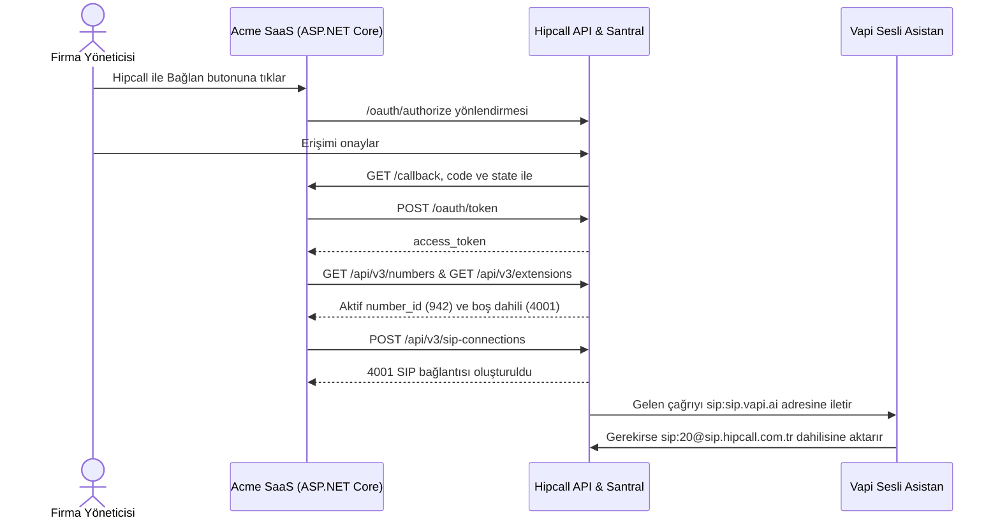

## Genel bakış

Acme SaaS, müşterilerinin telefon hatlarına Vapi tabanlı bir yapay zekâ sesli asistan bağlamak isteyen hayali bir entegratör firma. Gelen çağrıları önce Vapi asistanı karşılar; arayan kişi canlı bir temsilciyle görüşmek istediğinde Vapi çağrıyı SIP üzerinden tekrar Hipcall'daki bir dahili numaraya (örneğin `20`) aktarır.

Müşteriden Hipcall panelinde SIP bağlantısı açmasını, aktif telefon numarasını seçmesini, boş dahili bulmasını ve sonlandırma kimlik bilgilerini tek tek girmesini istemek hataya açıktır. OAuth2 ve SIP Bağlantıları API'si ile müşteri tek bir butona tıklar; Acme SaaS aktif numarayı ve boş dahiliyi bulup Vapi SIP bağlantısını otomatik kurar.

Bu yazıda önce Vapi panelindeki asistan, SIP Trunk ve çağrı aktarma (Transfer Call) ayarlarını, ardından ASP.NET Core Minimal API ile OAuth2 üzerinden `POST /api/v3/sip-connections` kurulumunu anlatıyoruz.



## Başlamadan önce

Gereksinimler:

- .NET 8 SDK (`dotnet --version` çıktısı 8.0 veya üzeri olmalıdır).
- Bir [Vapi](https://dashboard.vapi.ai) hesabı.
- API ve SIP bağlantısı özelliklerini içeren bir Hipcall paketi ve hesapta en az bir aktif (`state: "active"`) telefon numarası.
- Client ID, Client Secret ve Redirect URI içeren bir Hipcall OAuth2 uygulaması. Uygulamanın `communication_settings:read` ve `communication_settings:write` kapsamlarını isteyebilmesi gerekir. İstemci bilgilerini nasıl alacağınızı {{ article#d9f0a09d-9e32-475e-a808-5013773c09f2 }} yazısında bulabilirsiniz.
- Erişimi onaylayan Hipcall kullanıcısında `communication::settings` izni.
- OAuth2 geri dönüş adresi (`/callback`) için dışarıdan erişilebilen bir HTTPS adresi. Yerel geliştirmede 5000 portunu ngrok ile dışarı açın:

```bash
ngrok http 5000
```

İstemci bilgilerinizi ve SIP kimlik bilgilerinizi ortam değişkenlerinde tutun:

```bash
export HIPCALL_CLIENT_ID="..."
export HIPCALL_CLIENT_SECRET="..."
export PUBLIC_URL="https://your-server.example.com"
export SIP_USERNAME="90850XXXXXXX"
export SIP_PASSWORD="..."
export TERMINATION_AUTH_PASSWORD="..."
```

Windows PowerShell üzerinde:

```powershell
$env:HIPCALL_CLIENT_ID = "..."
$env:HIPCALL_CLIENT_SECRET = "..."
$env:PUBLIC_URL = "https://your-server.example.com"
$env:SIP_USERNAME = "90850XXXXXXX"
$env:SIP_PASSWORD = "..."
$env:TERMINATION_AUTH_PASSWORD = "..."
```

`SIP_PASSWORD` ve `TERMINATION_AUTH_PASSWORD`, Hipcall panelinde **Ayarlar > Telefon Sistemi > Telefon Numaraları > Bağlantı Ayarları** altındaki telefon numarası şifresidir. `HIPCALL_BASE_URL` isteğe bağlıdır ve varsayılan değeri `https://use.hipcall.com.tr` adresidir.

## Adım 1: Vapi üzerinde asistanı ve BYO SIP Trunk numarasını hazırlayın

Hipcall'dan çıkan çağrıların Vapi tarafından kabul edilmesi için Vapi panelinde üç kaydı sırasıyla oluşturun:

1. **Asistan oluşturun (Assistants > Create Assistant):** Vapi panelinde **Create Assistant** butonuna tıklayın. Asistanın müşteriyi nasıl karşılayacağını ve hangi sorulara nasıl yanıt vereceğini sistem komutuna (prompt) yazın.
2. **SIP Trunk tanımlayın (Integrations > SIP Trunk):** Sol menüden **Integrations** bölümüne geçin, **SIP Trunk** kartından **Add New SIP Trunk** ve ardından **Configure** seçeneğine tıklayın. Bağlantıya bir ad verin ve Hipcall SIP sunucusunun IP adresini (`31.192.211.146`) girip başka bir ayara dokunmadan **Save** ile kaydedin. Bu işlem Vapi tarafında bir SIP Trunk Credential oluşturur.
3. **Telefon numarasını ekleyin (Phone Numbers > Create Phone Number):** Sol menüden **Phone Numbers** sayfasına gidin, **Create Phone Number** butonuna basın ve **BYO SIP Trunk Number** sekmesini seçin:
   - Hipcall telefon numaranızı (`+90850XXXXXXX`) girin.
   - **Allow Non-E164** seçeneğini etkinleştirin.
   - **SIP Trunk Credential** alanında bir önceki adımda oluşturduğunuz SIP Trunk kaydını seçip kaydedin.
   - Sayfanın alt kısmındaki asistan seçim alanından ilk adımda oluşturduğunuz asistanı bu numaraya bağlayın.

## Adım 2: OAuth2 ile bağlanın, aktif numarayı ve boş dahiliyi bulun

Kullanıcıyı `/oauth/authorize` adresine yönlendirin ve `scope` parametresine `communication_settings:read` ile `communication_settings:write` kapsamlarını ekleyin:

```http
GET https://use.hipcall.com.tr/oauth/authorize
  ?response_type=code
  &client_id=YOUR_CLIENT_ID
  &redirect_uri=https%3A%2F%2Fyour-server.example.com%2Fcallback
  &scope=profile+email+offline_access+communication_settings:read+communication_settings:write
  &state=5718F6D482AE78DF3322714ECAB6BD7E
```

`/callback` uç noktanız `code` değerini `POST /oauth/token` adresinde `access_token` ile takas ettikten sonra, SIP bağlantısı kurmak için gereken iki bilgiyi API'den çeker:

1. **Aktif telefon numarası (`GET /api/v3/numbers?limit=100`):** Hesaptaki numaraları listeler ve `state` değeri `"active"` olan ilk numaranın `id` değerini (örneğin `942`) ve `+90` ile başlayan `number` alanını (`"+90850XXXXXXX"`) alır.
2. **Boş dahili numara (`GET /api/v3/extensions?limit=100` ve `GET /api/v3/sip-connections?limit=100`):** Hesapta kullanımda olan tüm dahili numaraları toplar ve `4001`'den başlayarak listede yer almayan ilk boş dahili numarayı (örneğin `"4001"`) seçer.

## Adım 3: API üzerinden SIP bağlantısını oluşturun

SIP bağlantısını kurarken kullanılan yapılandırma değerleri şu şekildedir:

```json
{
  "VapiTerminationUri": "sip:sip.vapi.ai",
  "SipUsername": "90850XXXXXXX",
  "SipPassword": "...",
  "TerminationAuthPassword": "..."
}
```

- **`vapiTerminationUri` (`termination_uri`):** Vapi için sabit bir değerdir ve her zaman `"sip:sip.vapi.ai"` olarak gönderilir.
- **`sipUsername` (`username`) ve `termination_auth_username`:** Her iki alanda da Vapi'ye bağladığınız Hipcall telefon numaranız kullanılır. `termination_auth_username` alanı `+` ile başlayan telefon numarası (`"+90850XXXXXXX"`) olmalıdır; `username` alanında ise başında `+` olmasına gerek yoktur (`"90850XXXXXXX"`).
- **`sipPassword` ve `terminationAuthPassword`:** Telefon numaranızın bağlantı ayarlarından alınan şifredir.

Hazırlanan verilerle `POST /api/v3/sip-connections` uç noktasına istek gönderin:

```csharp
var sipPayload = JsonSerializer.Serialize(new
{
    extension_number = freeExtension,
    name = "Vapi SIP Integration",
    number_id = activeNumberId.Value,
    termination_uri = vapiTerminationUri,
    username = sipUsername,
    password = sipPassword,
    termination_auth_enabled = true,
    termination_auth_username = activePhoneNumber,
    termination_auth_password = terminationAuthPassword
});
using var sipRequest = new HttpRequestMessage(HttpMethod.Post, "/api/v3/sip-connections")
{
    Content = new StringContent(sipPayload, Encoding.UTF8, "application/json")
};
sipRequest.Headers.Authorization = new AuthenticationHeaderValue("Bearer", accessToken);
using var sipResponse = await http.SendAsync(sipRequest);
```

Başarılı çağrı `201 Created` ve oluşturulan SIP bağlantısının detaylarını döner:

```json
{
  "data": {
    "id": 301,
    "name": "Vapi SIP Integration",
    "number": {
      "id": 942,
      "number": "+90850XXXXXXX",
      "country": "TR"
    },
    "username": "90850XXXXXXX",
    "realm": "sipcs.hipcall.com.tr",
    "inserted_at": "2026-11-04T13:23:38",
    "updated_at": "2026-11-04T13:23:38",
    "extension_number": "4001",
    "created_by_user_id": 4200,
    "termination_uri": "sip:sip.vapi.ai",
    "number_id": 942,
    "termination_auth_enabled": true,
    "termination_auth_username": "+90850XXXXXXX"
  }
}
```

### Kimlik doğrulama ve telefon yönlendirme kuralları

- **Gelen ve giden kimlik doğrulama alanları:** İstek gövdesindeki `username`, `termination_auth_username` (`+90850XXXXXXX`) ve şifre değerleri Vapi üzerindeki Inbound SIP (BYO SIP Trunk) ayarlarınızla uyumlu olmalıdır. API şema kuralı gereği `username` alanı `^[A-Za-z0-9._-]{3,64}$` formatındadır (başında `+` olmadan yazılır) ve `password` alanı 12 ile 128 karakter arasında olmalıdır (`password` gönderilmezse Hipcall otomatik 16 karakterli bir parola üretir).
- **Şifrelerin gizliliği:** `password` alanı oluşturma (`POST /api/v3/sip-connections`) veya parola sıfırlama (`POST /api/v3/sip-connections/{id}/reset-password`) yanıtında tek seferlik düz metin olarak döner. Hipcall şifreleri veritabanında özet (digest) olarak sakladığı için `GET /api/v3/sip-connections` sorgularında ne `password` ne de `termination_auth_password` alanı gösterilir.
- **Telefon numarasını 4001 dahili hattına yönlendirme:** Dış aramaların Vapi'ye düşmesi için Hipcall panelinde **Ayarlar > Telefon Sistemi > Telefon Numaraları** menüsünden numaranızı seçin, **Çalışma Saatleri** sekmesine geçin ve **Mesai içi hedef** alanını yeni oluşturulan **4001** SIP dahili numarasına yönlendirin.

## Adım 4: Vapi'den Hipcall dahili numarasına çağrı aktarma (Transfer Call)

Vapi asistanı müşteriyle konuşurken çağrıyı Hipcall'daki bir temsilciye veya departman dahilisine (örneğin `20` numaralı dahiliye) aktarmak için Vapi panelinde şu ayarları yapın:

1. **Transfer Call aracı oluşturun (Tools > Create Tool):** Vapi sol menüsünden **Tools** sayfasına gidin, **Create Tool** butonuna basın ve **Transfer Call** aracını seçin.
2. **SIP hedefini tanımlayın (Add Destination > SIP):** Araca bir ad verin, **Add Destination** kısmından **SIP** seçeneğini işaretleyin ve hedef SIP URI alanına aktarmak istediğiniz Hipcall dahili numarasını yazın:

```text
sip:20@sip.hipcall.com.tr
```

Buradaki `20` yerine çağrıyı yönlendirmek istediğiniz kendi dahili numaranızı yazın. Aracın **Description** alanına asistanın hangi durumda aktarım yapacağını açıkça yazın ve **Publish** butonuna basın.

3. **Aracı asistana bağlayın:** **Assistants** sayfasına dönün, asistanınızın üst menüsündeki **Tools** sekmesinden **Add Tool** diyerek oluşturduğunuz Transfer Call aracını ekleyin. Asistanın ana sistem komutunda (prompt) bu aracı ne zaman çalıştıracağını belirtin.
4. **Son çare (Fallback) numarasını girin ve yayınlayın:** Asistanın **Advanced** sekmesinin en altındaki numara alanına, hiçbir yönlendirme yanıt vermezse son çare olarak aranacak telefon numarasını girin ve **Publish** ile asistanı yayınlayın.

## Betiğin tamamı

Yeni bir web projesi oluşturun ve `Program.cs` dosyasını aşağıdaki kodla değiştirin:

```bash
dotnet new web -n Hipcall.SipConnection
```

```csharp
using System.Collections.Concurrent;
using System.Net;
using System.Net.Http.Headers;
using System.Security.Cryptography;
using System.Text;
using System.Text.Json;

static string Env(string name) =>
    Environment.GetEnvironmentVariable(name)
    ?? throw new InvalidOperationException($"{name} is not set.");

var baseUrl = Environment.GetEnvironmentVariable("HIPCALL_BASE_URL") ?? "https://use.hipcall.com.tr";
var clientId = Env("HIPCALL_CLIENT_ID");
var clientSecret = Env("HIPCALL_CLIENT_SECRET");
var publicUrl = Env("PUBLIC_URL").TrimEnd('/');
var redirectUri = $"{publicUrl}/callback";
var vapiTerminationUri = Environment.GetEnvironmentVariable("VAPI_TERMINATION_URI") ?? "sip:sip.vapi.ai";
var sipUsername = Env("SIP_USERNAME").TrimStart('+');
var sipPassword = Env("SIP_PASSWORD");
var terminationAuthPassword = Environment.GetEnvironmentVariable("TERMINATION_AUTH_PASSWORD") ?? sipPassword;
const string scope = "profile+email+offline_access+communication_settings:read+communication_settings:write";

var builder = WebApplication.CreateBuilder(args);
builder.WebHost.ConfigureKestrel(options => options.ListenAnyIP(5000));
var app = builder.Build();

var http = new HttpClient { BaseAddress = new Uri(baseUrl) };
http.DefaultRequestHeaders.Accept.Add(new MediaTypeWithQualityHeaderValue("application/json"));
var pendingStates = new ConcurrentDictionary<string, bool>();

app.MapGet("/", () => Results.Content("<a href=\"/login\">Connect Hipcall and Set Up Vapi SIP</a>", "text/html"));

app.MapGet("/login", () =>
{
    var state = Convert.ToHexString(RandomNumberGenerator.GetBytes(16));
    pendingStates[state] = true;

    return Results.Redirect($"{baseUrl}/oauth/authorize?response_type=code"
        + $"&client_id={Uri.EscapeDataString(clientId)}"
        + $"&redirect_uri={Uri.EscapeDataString(redirectUri)}"
        + $"&scope={scope}&state={state}");
});

app.MapGet("/callback", async (string? code, string? state, string? error) =>
{
    if (error is not null)
    {
        return Results.BadRequest($"Hipcall returned an error: {error}");
    }

    if (code is null || state is null || !pendingStates.TryRemove(state, out _))
    {
        return Results.BadRequest("The code is missing or the state is unknown.");
    }

    using var tokenResponse = await http.PostAsync("/oauth/token", new FormUrlEncodedContent(
        new Dictionary<string, string>
        {
            ["grant_type"] = "authorization_code",
            ["code"] = code,
            ["client_id"] = clientId,
            ["client_secret"] = clientSecret,
            ["redirect_uri"] = redirectUri
        }));
    var tokenBody = await tokenResponse.Content.ReadAsStringAsync();
    if (!tokenResponse.IsSuccessStatusCode)
    {
        return Results.Content(tokenBody, "application/json", statusCode: (int)tokenResponse.StatusCode);
    }

    using var tokenJson = JsonDocument.Parse(tokenBody);
    var accessToken = tokenJson.RootElement.GetProperty("access_token").GetString()!;
    var granted = tokenJson.RootElement.TryGetProperty("scope", out var scopeValue) ? scopeValue.GetString() : null;
    Console.WriteLine($"Granted scopes: {granted ?? "(not returned)"}");

    using var numbersRequest = new HttpRequestMessage(HttpMethod.Get, "/api/v3/numbers?limit=100");
    numbersRequest.Headers.Authorization = new AuthenticationHeaderValue("Bearer", accessToken);
    using var numbersResponse = await http.SendAsync(numbersRequest);
    var numbersBody = await numbersResponse.Content.ReadAsStringAsync();
    if (!numbersResponse.IsSuccessStatusCode)
    {
        return Results.Content(numbersBody, "application/json", statusCode: (int)numbersResponse.StatusCode);
    }

    int? activeNumberId = null;
    string? activePhoneNumber = null;
    using (var numbersDoc = JsonDocument.Parse(numbersBody))
    {
        foreach (var item in numbersDoc.RootElement.GetProperty("data").EnumerateArray())
        {
            if (item.TryGetProperty("state", out var st) && st.GetString() == "active")
            {
                activeNumberId = item.GetProperty("id").GetInt32();
                activePhoneNumber = item.GetProperty("number").GetString();
                break;
            }
        }
    }

    if (activeNumberId is null || activePhoneNumber is null)
    {
        return Results.UnprocessableEntity("No active phone number found in the Hipcall account.");
    }

    var usedExtensions = new HashSet<string>(StringComparer.OrdinalIgnoreCase);

    using var extensionsRequest = new HttpRequestMessage(HttpMethod.Get, "/api/v3/extensions?limit=100");
    extensionsRequest.Headers.Authorization = new AuthenticationHeaderValue("Bearer", accessToken);
    using var extensionsResponse = await http.SendAsync(extensionsRequest);
    var extensionsBody = await extensionsResponse.Content.ReadAsStringAsync();
    if (!extensionsResponse.IsSuccessStatusCode)
    {
        return Results.Content(extensionsBody, "application/json", statusCode: (int)extensionsResponse.StatusCode);
    }

    using (var extensionsDoc = JsonDocument.Parse(extensionsBody))
    {
        foreach (var item in extensionsDoc.RootElement.GetProperty("data").EnumerateArray())
        {
            if (item.TryGetProperty("number", out var numProp))
            {
                usedExtensions.Add(numProp.ToString());
            }
        }
    }

    using var existingSipRequest = new HttpRequestMessage(HttpMethod.Get, "/api/v3/sip-connections?limit=100");
    existingSipRequest.Headers.Authorization = new AuthenticationHeaderValue("Bearer", accessToken);
    using var existingSipResponse = await http.SendAsync(existingSipRequest);
    if (existingSipResponse.IsSuccessStatusCode)
    {
        using var existingSipDoc = JsonDocument.Parse(await existingSipResponse.Content.ReadAsStringAsync());
        foreach (var item in existingSipDoc.RootElement.GetProperty("data").EnumerateArray())
        {
            if (item.TryGetProperty("extension_number", out var extProp) && extProp.ValueKind != JsonValueKind.Null)
            {
                usedExtensions.Add(extProp.ToString());
            }
        }
    }

    var candidate = 4001;
    while (usedExtensions.Contains(candidate.ToString()))
    {
        candidate++;
    }
    var freeExtension = candidate.ToString();

    var sipPayload = JsonSerializer.Serialize(new
    {
        extension_number = freeExtension,
        name = "Vapi SIP Integration",
        number_id = activeNumberId.Value,
        termination_uri = vapiTerminationUri,
        username = sipUsername,
        password = sipPassword,
        termination_auth_enabled = true,
        termination_auth_username = activePhoneNumber,
        termination_auth_password = terminationAuthPassword
    });

    using var sipRequest = new HttpRequestMessage(HttpMethod.Post, "/api/v3/sip-connections")
    {
        Content = new StringContent(sipPayload, Encoding.UTF8, "application/json")
    };
    sipRequest.Headers.Authorization = new AuthenticationHeaderValue("Bearer", accessToken);

    using var sipResponse = await http.SendAsync(sipRequest);
    var sipBody = await sipResponse.Content.ReadAsStringAsync();
    Console.WriteLine($"SIP connection response ({(int)sipResponse.StatusCode}): {sipBody}");

    return Results.Content(sipBody, "application/json", statusCode: (int)sipResponse.StatusCode);
});

app.Run();
```

Ortam değişkenleri tanımlıyken uygulamayı çalıştırın:

```bash
dotnet run
```

Tarayıcıda `PUBLIC_URL` adresinizi açın, **Connect Hipcall and Set Up Vapi SIP** bağlantısına tıklayın ve erişimi onaylayın. Konsol çıktısı şöyledir:

```text
Granted scopes: profile email offline_access communication_settings:read communication_settings:write
SIP connection response (201): {"data":{"id":301,"name":"Vapi SIP Integration","extension_number":"4001","termination_uri":"sip:sip.vapi.ai","number_id":942,"termination_auth_enabled":true,"termination_auth_username":"+90850XXXXXXX"}}
```

## Hata aldığınızda

### 422 Unprocessable Entity: Doğrulama hataları

`POST /api/v3/sip-connections` çağrısı `422` dönerse hata gövdesindeki alanı kontrol edin:

```json
{
  "errors": {
    "extension_number": [
      "has already been taken"
    ],
    "termination_auth_password": [
      "is required when termination authentication is enabled"
    ],
    "password": [
      "String length is smaller than minLength: 12"
    ],
    "username": [
      "Invalid format. Expected ~r/^[A-Za-z0-9._-]{3,64}$/"
    ]
  }
}
```

- **`extension_number: has already been taken`:** Seçilen dahili numara hesaptaki başka bir kayıt tarafından kullanılıyor. `GET /api/v3/extensions` varsayılan olarak ilk 10 kaydı döndürdüğü için `?limit=100` parametresiyle hem `/api/v3/extensions` hem de `/api/v3/sip-connections` kayıtlarını kontrol edin.
- **`termination_auth_password: is required when termination authentication is enabled`:** `termination_auth_enabled: true` gönderildiğinde `termination_auth_username` ile birlikte `termination_auth_password` alanı da zorunludur.
- **`username: Invalid format`:** REST API `username` alanında `+` karakterini kabul etmez (`^[A-Za-z0-9._-]{3,64}$`). Telefon numarasını `username` olarak verirken başındaki `+` işaretini kaldırın (`"90850XXXXXXX"`). `termination_auth_username` alanında ise `+90850XXXXXXX` kullanılabilir.
- **`password: String length is smaller than minLength: 12`:** Gönderilen `password` en az 12 karakter olmalıdır.

### 403 Forbidden: insufficient_scope

```json
{
  "error": "insufficient_scope",
  "errors": {
    "detail": "Forbidden",
    "required_scope": "communication_settings:write"
  }
}
```

Token `communication_settings:write` kapsamını taşımıyor veya onaylayan kullanıcının `communication::settings` izni yok. Hipcall ekibinden OAuth uygulamanız için `communication_settings:read` ve `communication_settings:write` kapsamlarını etkinleştirmesini isteyin ve yeniden bağlanın.

## Parametre listesi

### SIP bağlantısı oluşturma gövdesi (`POST /api/v3/sip-connections`)

| Alan | Tip | Zorunlu | Açıklama |
|---|---|---|---|
| `extension_number` | string | evet | Bağlantıya atanacak boş dahili numara (örneğin `"4001"`). |
| `name` | string | evet | SIP bağlantısının panelde görünecek adı. |
| `number_id` | integer | evet | `GET /api/v3/numbers` ile alınan aktif (`state: "active"`) telefon numarasının ID'si. |
| `termination_uri` | string | evet | Çağrının yönlendirileceği hedef SIP URI'si (Vapi için `"sip:sip.vapi.ai"`). |
| `username` | string | evet | Gelen SIP kimlik doğrulama kullanıcı adı (`^[A-Za-z0-9._-]{3,64}$`). |
| `password` | string | hayır | Gelen SIP şifresi (12 ile 128 karakter arası). Gönderilmezse Hipcall 16 karakterli şifre üretir ve tek seferlik yanıtta döner. |
| `termination_auth_enabled` | boolean | hayır | Hedefte (Vapi) sonlandırma kimlik doğrulaması kullanılıp kullanılmayacağı. |
| `termination_auth_username` | string | koşullu | `termination_auth_enabled: true` ise zorunlu. Seçilen telefon numarası (`"+90850XXXXXXX"`). |
| `termination_auth_password` | string | koşullu | `termination_auth_enabled: true` ise zorunlu. Telefon numarasının bağlantı şifresi. |

### İzin kapsamları

| Kapsam | İzin verdiği işlem |
|---|---|
| `communication_settings:write` | SIP bağlantısı oluşturma (`POST /api/v3/sip-connections`), güncelleme (`PATCH /api/v3/sip-connections/{id}`) ve parola sıfırlama (`POST /api/v3/sip-connections/{id}/reset-password`). |
| `communication_settings:read` | SIP bağlantılarını listeleme (`GET /api/v3/sip-connections`) ve tekil kayıt okuma (`GET /api/v3/sip-connections/{id}`). |

## Sonraki adımlar

- Vapi üzerinden geçen veya aktarılan çağrılar bittiğinde bildirim almak için {{ article#108009ea-90ca-4467-b387-93d1c1656ba9 }} yazısındaki `call.ended` webhook kurulumunu ekleyin.
- Kurye veya saha ekiplerinin sipariş koduyla arama yapması için {{ article#1d98a516-fe3d-447f-981a-40d4e1bfe6fb }} yazısını inceleyin.
- Tüm uç noktaları [Hipcall API Referansı](https://use.hipcall.com.tr/api-docs/) sayfasından inceleyin.
- Sorularınızı [Hipcall Community](https://community.hipcall.com/) üzerinden sorun.
