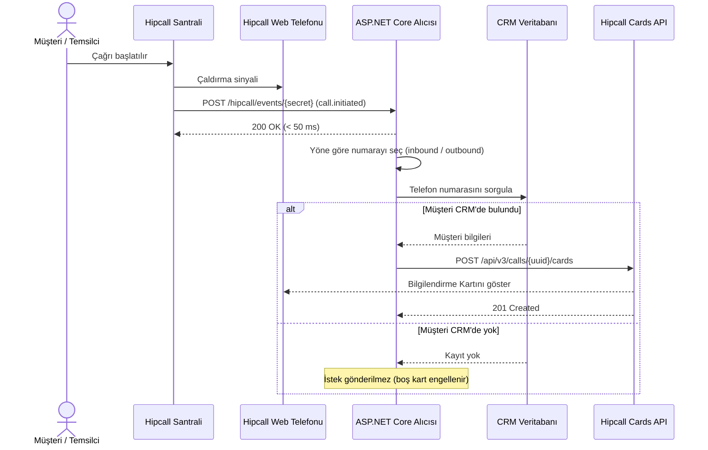

## Genel bakış

Bir müşteri çağrı merkezini aradığında veya temsilci dış arama başlattığında, temsilcinin arayan kişiyi tanıması için CRM sekmesinde telefon numarası araması zaman kaybettirir. Hipcall Bilgilendirme Kartı (Insight Card), telefon henüz çalarken CRM'deki müşteri adını, şirketini, bakiyesini ve son sipariş durumunu doğrudan Hipcall Web Telefonu ekranına taşır.

Bu yazıda ASP.NET Core Minimal API ile `call.initiated` webhook olayını karşılayan, çağrı yönüne göre müşteri numarasını ayıklayan ve `POST /api/v3/calls/{uuid}/cards` endpoint'ine Bilgilendirme Kartı gönderen bir alıcı kuruyoruz.



## Başlamadan önce

Gereksinimler:

- .NET 8 SDK (`dotnet --version` çıktısı 8.0 veya üzeri olmalıdır).
- API erişimi içeren bir Hipcall paketi ve `Settings > Developer > API Keys (Ayarlar > Geliştirici > API Anahtarları)` menüsünden oluşturulmuş bir API anahtarı (`HIPCALL_API_TOKEN`).
- `Settings > Developer > Webhooks (Ayarlar > Geliştirici > Web kancaları)` altında `call.initiated` olayını dinleyen bir webhook kaydı.
- Yerel geliştirmede 5000 portunu dışarı açmak için ngrok:

```bash
ngrok http 5000
```

API anahtarınızı ve webhook URL gizli anahtarınızı ortam değişkenlerinde tutun:

```bash
export HIPCALL_API_TOKEN="..."
export HIPCALL_WEBHOOK_SECRET="..."
```

Windows PowerShell üzerinde:

```powershell
$env:HIPCALL_API_TOKEN = "..."
$env:HIPCALL_WEBHOOK_SECRET = "..."
```

`HIPCALL_BASE_URL` isteğe bağlıdır ve varsayılan değeri `https://use.hipcall.com.tr` adresidir.

## Adım 1: Webhook üzerinden çağrı başlangıcını yakalayın

Hipcall santrali yeni bir çağrı başladığında webhook adresinize `POST` isteği gönderir:

```json
{
  "event": "call.initiated",
  "timestamp": "2026-11-05T12:25:10Z",
  "data": {
    "uuid": "735e2b8e-XXXX-XXXX-XXXX-XXXXXXXXXXXX",
    "direction": "inbound",
    "caller_number": "+90551XXXXXXX",
    "callee_number": "+90850XXXXXXX",
    "started_at": "2026-11-05T12:25:10Z",
    "user_id": 4200
  }
}
```

Gelen verideki iki alan kart basma akışını belirler:

1. **Çağrı kimliği (`data.uuid`):** Bilgilendirme Kartı `POST /api/v3/calls/{uuid}/cards` adresine gönderilirken bu `uuid` kullanılır.
2. **Çağrı yönü (`data.direction`):** Müşterinin telefon numarası çağrı yönüne göre farklı alandadır:
   - `direction` değeri `"inbound"` ise müşteri dışarıdan arıyordur; hedef numara `data.caller_number` alanındadır.
   - `direction` değeri `"outbound"` ise temsilci dışarıyı arıyordur; hedef numara `data.callee_number` alanındadır.

```csharp
var targetPhoneNumber = string.Equals(data.Direction, "inbound", StringComparison.OrdinalIgnoreCase)
    ? data.CallerNumber
    : data.CalleeNumber;
```

Webhook uç noktası CRM sorgusunu ve Hipcall API çağrısını beklememelidir. İsteği `Task.Run` ile arka plana devredip Hipcall'a 50 milisaniyenin altında `200 OK` dönün.

## Adım 2: Aktif çağrıya Bilgilendirme Kartı gönderin

Müşteri numarası CRM'de eşleştiğinde `POST /api/v3/calls/{uuid}/cards` endpoint'ine `"card"` dizisi içeren bir JSON gövdesi gönderin:

```csharp
var jsonOptions = new JsonSerializerOptions
{
    PropertyNamingPolicy = JsonNamingPolicy.SnakeCaseLower,
    DefaultIgnoreCondition = JsonIgnoreCondition.WhenWritingNull,
    PropertyNameCaseInsensitive = true
};

var cardPayload = new InsightCardRoot
{
    Card =
    [
        new InsightCardItem
        {
            Type = "title",
            Text = "Acme CRM",
            Link = "https://crm.example.com/customers/1234"
        },
        new InsightCardItem
        {
            Type = "shortText",
            Label = "Müşteri Adı",
            Text = "Ahmet Y.",
            Link = "https://crm.example.com/contact/1234",
            Ios = "acmecrm://contact/id=1234",
            Android = "acmecrm://contact/id=1234"
        },
        new InsightCardItem
        {
            Type = "shortText",
            Label = "Şirket",
            Text = "Tech A.Ş."
        },
        new InsightCardItem
        {
            Type = "shortText",
            Label = "Segment / Bakiye",
            Text = "VIP - 0,00 TL Borç"
        },
        new InsightCardItem
        {
            Type = "user",
            Label = "Hesap Sahibi",
            UserId = 4200
        }
    ]
};

var json = JsonSerializer.Serialize(cardPayload, jsonOptions);
using var content = new StringContent(json, Encoding.UTF8, "application/json");
using var response = await http.PostAsync($"/api/v3/calls/{Uri.EscapeDataString(callData.Uuid)}/cards", content);
```

Başarılı istek `201 Created` (veya `200 OK`) durum koduyla kaydedilen kartı döner:

```json
{
  "data": {
    "call_id": "735e2b8e-XXXX-XXXX-XXXX-XXXXXXXXXXXX",
    "card": [
      {
        "link": "https://crm.example.com/customers/1234",
        "text": "Acme CRM",
        "type": "title"
      },
      {
        "android": "acmecrm://contact/id=1234",
        "ios": "acmecrm://contact/id=1234",
        "label": "Müşteri Adı",
        "link": "https://crm.example.com/contact/1234",
        "text": "Ahmet Y.",
        "type": "shortText"
      },
      {
        "label": "Şirket",
        "text": "Tech A.Ş.",
        "type": "shortText"
      },
      {
        "label": "Segment / Bakiye",
        "text": "VIP - 0,00 TL Borç",
        "type": "shortText"
      },
      {
        "label": "Hesap Sahibi",
        "type": "user",
        "user_id": 4200
      }
    ]
  }
}
```

### Kart tasarımı ve zamanlama kuralları

- **Müşteri CRM'de yoksa istek göndermeyin:** Hipcall API'si boş bir diziyi (`{"card": []}`) hata vermeden kabul eder, ancak Web Telefonu ekranında içi boş gri bir kutu açılır. Numara CRM'de bulunamadığında HTTP isteği atmadan işlemi sonlandırın.
- **Çağrı başına tek kart:** Bir çağrıya ikinci kez `POST /api/v3/calls/{uuid}/cards` isteği gönderilirse API `200 OK` döner fakat Web Telefonu ilk basılan kartı ekranda tutar ve ikinci bir kart eklemez. Tüm müşteri bilgilerini tek bir istekte gönderin.
- **4 ile 6 satır kullanın:** Web Telefonu penceresinde tuş takımını ve çağrı kapatma butonlarını aşağı itmemek için başlık dahil 4 ile 6 satır (her satırda 30-40 karakteri aşmayan metin) kullanın.
- **2 saniyelik süre bütçesi:** Bir çağrının ortalama çalma süresi 5 ile 15 saniye arasındadır. CRM sorgunuz 2 saniyenin altında tamamlandığında toplam akış yaklaşık 2,5 saniye sürer ve temsilci telefonu açtığı anda kart ekranda hazır olur.
- **Mobil deep link alanları (`ios` ve `android`):** Tarayıcı üzerindeki Web Telefonu `ios` ve `android` alanlarını yok sayar ve `link` alanındaki URL'yi kullanır. Çağrı Hipcall mobil uygulamasından karşılandığında ise bu alanlar yerel CRM uygulamasını açar.

## Adım 3: Kaydedilen kartı sorgulayın

Bir çağrıya kart yazılıp yazılmadığını doğrulamak için `GET /api/v3/calls/{uuid}/cards` endpoint'ine istek gönderin:

```csharp
using var getResponse = await http.GetAsync($"/api/v3/calls/{Uri.EscapeDataString(callUuid)}/cards");
var getBody = await getResponse.Content.ReadAsStringAsync();
```

Başarılı yanıt `200 OK` ve çağrıya bağlı `"card"` dizisini döner:

```json
{
  "data": {
    "call_id": "735e2b8e-XXXX-XXXX-XXXX-XXXXXXXXXXXX",
    "card": [
      {
        "link": "https://crm.example.com/customers/1234",
        "text": "Acme CRM",
        "type": "title"
      },
      {
        "label": "Şirket",
        "text": "Tech A.Ş.",
        "type": "shortText"
      }
    ]
  }
}
```

Kendi CRM veritabanınızda bulunmayan numaralar için yedek olarak `GET /api/v3/lookup/by_phone?phone=+90551XXXXXXX` endpoint'ini sorgulayabilir, numara Hipcall rehberinde kayıtlıysa dönen `contacts` ve `companies` dizilerinden temel kişi ve firma adını karta ekleyebilirsiniz.

## Betiğin tamamı

Yeni bir web projesi oluşturun ve `Program.cs` dosyasını aşağıdaki kodla değiştirin:

```bash
dotnet new web -n Hipcall.InsightCard
```

```csharp
using System.Net.Http.Headers;
using System.Security.Cryptography;
using System.Text;
using System.Text.Json;
using System.Text.Json.Serialization;

static string Env(string name) =>
    Environment.GetEnvironmentVariable(name)
    ?? throw new InvalidOperationException($"{name} is not set.");

var baseUrl = (Environment.GetEnvironmentVariable("HIPCALL_BASE_URL") ?? "https://use.hipcall.com.tr").TrimEnd('/');
var webhookSecret = Env("HIPCALL_WEBHOOK_SECRET");
var apiToken = Env("HIPCALL_API_TOKEN");

var jsonOptions = new JsonSerializerOptions
{
    PropertyNamingPolicy = JsonNamingPolicy.SnakeCaseLower,
    DefaultIgnoreCondition = JsonIgnoreCondition.WhenWritingNull,
    PropertyNameCaseInsensitive = true
};

var http = new HttpClient { BaseAddress = new Uri(baseUrl) };
http.DefaultRequestHeaders.Accept.Add(new MediaTypeWithQualityHeaderValue("application/json"));
http.DefaultRequestHeaders.Authorization = new AuthenticationHeaderValue("Bearer", apiToken);

var builder = WebApplication.CreateBuilder(args);
builder.WebHost.ConfigureKestrel(options => options.ListenAnyIP(5000));
var app = builder.Build();

app.MapPost("/hipcall/events/{secret}", async (string secret, HttpRequest request) =>
{
    var expectedBytes = Encoding.UTF8.GetBytes(webhookSecret);
    var providedBytes = Encoding.UTF8.GetBytes(secret);
    if (expectedBytes.Length != providedBytes.Length ||
        !CryptographicOperations.FixedTimeEquals(expectedBytes, providedBytes))
    {
        return Results.Unauthorized();
    }

    HipcallWebhookPayload? payload;
    try
    {
        payload = await JsonSerializer.DeserializeAsync<HipcallWebhookPayload>(
            request.Body,
            jsonOptions,
            request.HttpContext.RequestAborted);
    }
    catch (JsonException)
    {
        return Results.BadRequest(new { error = "Invalid JSON payload." });
    }

    var eventName = payload?.Event ?? payload?.Type;
    if (payload?.Data is null || string.IsNullOrWhiteSpace(eventName))
    {
        return Results.BadRequest(new { error = "Missing event or data field." });
    }

    var isCallInitiated = string.Equals(eventName, "call.initiated", StringComparison.OrdinalIgnoreCase);

    if (!isCallInitiated)
    {
        return Results.Ok(new { status = "ignored", @event = eventName });
    }

    var data = payload.Data;
    var targetPhoneNumber = string.Equals(data.Direction, "inbound", StringComparison.OrdinalIgnoreCase)
        ? data.CallerNumber
        : data.CalleeNumber;

    _ = Task.Run(() => ProcessInsightCardAsync(data, targetPhoneNumber, http, jsonOptions));

    return Results.Ok(new { status = "accepted", call_uuid = data.Uuid });
});

app.Run();

static async Task ProcessInsightCardAsync(
    HipcallCallData callData,
    string? rawPhoneNumber,
    HttpClient http,
    JsonSerializerOptions jsonOptions)
{
    if (string.IsNullOrWhiteSpace(callData.Uuid) || string.IsNullOrWhiteSpace(rawPhoneNumber))
    {
        return;
    }

    var normalizedPhone = NormalizePhone(rawPhoneNumber);
    Console.WriteLine($"Call initiated. UUID: {callData.Uuid}, Direction: {callData.Direction}, Target: {normalizedPhone}");

    if (normalizedPhone == "+90551XXXXXXX")
    {
        var cardPayload = new InsightCardRoot
        {
            Card =
            [
                new InsightCardItem
                {
                    Type = "title",
                    Text = "Acme CRM",
                    Link = "https://crm.example.com/customers/1234"
                },
                new InsightCardItem
                {
                    Type = "shortText",
                    Label = "Müşteri Adı",
                    Text = "Ahmet Y.",
                    Link = "https://crm.example.com/contact/1234",
                    Ios = "acmecrm://contact/id=1234",
                    Android = "acmecrm://contact/id=1234"
                },
                new InsightCardItem
                {
                    Type = "shortText",
                    Label = "Şirket",
                    Text = "Tech A.Ş."
                },
                new InsightCardItem
                {
                    Type = "shortText",
                    Label = "Segment / Bakiye",
                    Text = "VIP - 0,00 TL Borç"
                },
                new InsightCardItem
                {
                    Type = "shortText",
                    Label = "Son Sipariş",
                    Text = "#9558 - Kargoda"
                }
            ]
        };

        var json = JsonSerializer.Serialize(cardPayload, jsonOptions);
        using var content = new StringContent(json, Encoding.UTF8, "application/json");
        using var response = await http.PostAsync($"/api/v3/calls/{Uri.EscapeDataString(callData.Uuid)}/cards", content);
        var responseBody = await response.Content.ReadAsStringAsync();

        Console.WriteLine($"POST /api/v3/calls/{callData.Uuid}/cards -> {(int)response.StatusCode}: {responseBody}");
    }
    else
    {
        Console.WriteLine($"No CRM match for {normalizedPhone}. Skipping card request.");
    }
}

static string NormalizePhone(string phone)
{
    var digits = new StringBuilder();
    foreach (var ch in phone)
    {
        if (char.IsDigit(ch))
        {
            digits.Append(ch);
        }
    }

    var raw = digits.ToString();
    if (raw.Length == 10 && !raw.StartsWith('0'))
    {
        return "+90" + raw;
    }

    if (raw.Length == 11 && raw.StartsWith('0'))
    {
        return "+9" + raw;
    }

    return "+" + raw;
}

public sealed class HipcallWebhookPayload
{
    public string? Event { get; set; }
    public string? Type { get; set; }
    public string? Timestamp { get; set; }
    public HipcallCallData? Data { get; set; }
}

public sealed class HipcallCallData
{
    public string? Uuid { get; set; }
    public string? Direction { get; set; }
    public string? CallerNumber { get; set; }
    public string? CalleeNumber { get; set; }
    public string? StartedAt { get; set; }
    public int? UserId { get; set; }
}

public sealed class InsightCardRoot
{
    public List<InsightCardItem> Card { get; set; } = [];
}

public sealed class InsightCardItem
{
    public required string Type { get; set; }
    public string? Text { get; set; }
    public string? Label { get; set; }
    public string? Link { get; set; }
    public string? Ios { get; set; }
    public string? Android { get; set; }
    public int? UserId { get; set; }
}
```

Ortam değişkenleri tanımlıyken uygulamayı çalıştırın:

```bash
dotnet run
```

Eşleşen numarayla çağrı başlatıldığında konsol çıktısı şöyledir:

```text
Call initiated. UUID: 735e2b8e-XXXX-XXXX-XXXX-XXXXXXXXXXXX, Direction: inbound, Target: +90551XXXXXXX
POST /api/v3/calls/735e2b8e-XXXX-XXXX-XXXX-XXXXXXXXXXXX/cards -> 201: {"data":{"call_id":"735e2b8e-XXXX-XXXX-XXXX-XXXXXXXXXXXX","card":[{"link":"https://crm.example.com/customers/1234","text":"Acme CRM","type":"title"},{"android":"acmecrm://contact/id=1234","ios":"acmecrm://contact/id=1234","label":"Müşteri Adı","link":"https://crm.example.com/contact/1234","text":"Ahmet Y.","type":"shortText"},{"label":"Şirket","text":"Tech A.Ş.","type":"shortText"},{"label":"Segment / Bakiye","text":"VIP - 0,00 TL Borç","type":"shortText"},{"label":"Son Sipariş","text":"#9558 - Kargoda","type":"shortText"}]}}
```

## Hata aldığınızda

### 422 Unprocessable Entity: Katı şema ve null alan hatası

`shortText` veya `title` satırında `user_id` alanı `null` olarak serileştirilirse API isteği `422` ile reddeder:

```json
{
  "errors": {
    "card": [
      "shortText type only allows fields: type, text, label, link, android, ios. Invalid fields found: user_id in card item 2"
    ]
  }
}
```

`JsonSerializerOptions` içinde `DefaultIgnoreCondition = JsonIgnoreCondition.WhenWritingNull` ayarını etkinleştirerek `null` değerlerin JSON gövdesine yazılmasını engelleyin.

### 422 Unprocessable Entity: Desteklenmeyen satır tipi

`type` alanına `title`, `shortText` veya `user` dışında bir değer gönderildiğinde API `422` döner:

```json
{
  "errors": {
    "card": [
      "Type can be shortText, user or title in the card: {\"label\":\"Yetkili Kişi\",\"text\":\"Ahmet Y.\",\"type\":\"badge\"}"
    ]
  }
}
```

Satır tiplerini `title`, `shortText` ve `user` değerleriyle sınırlandırın.

### API 200 veya 201 dönüyor fakat Web Telefonunda kart görünmüyor

Çağrı kapandıktan sonra `POST /api/v3/calls/{uuid}/cards` isteği gönderilirse API kartı veritabanına yazar ve başarılı durum kodu döner, ancak çağrı ekranı kapandığı için temsilci kartı göremez. Webhook'un ulaştığı an (`started_at`) ile kartın gönderildiği an arasındaki süreyi loglayın ve CRM sorgusunu 2 saniyenin altında tutun.

## Parametre listesi

### Kart satır tipleri (`POST /api/v3/calls/{uuid}/cards`)

| Satır tipi (`type`) | Zorunlu alanlar | İsteğe bağlı alanlar | Açıklama |
|---|---|---|---|
| `title` | `type`, `text` | `link` | Kartın üst kısmındaki kalın ana başlık. `link` verilirse yeni sekmede açma ikonu eklenir. |
| `shortText` | `type`, `text` | `label`, `link`, `ios`, `android` | Sol sütunda `label`, sağ sütunda `text` değerini gösteren bilgi satırı. |
| `user` | `type`, `label`, `user_id` | Yok | `user_id` değerini Hipcall kullanıcısının adıyla eşleştirir; bulunamazsa `User #<id>` yazar. |

### Kart satırı alanları

| Alan | Tip | Açıklama |
|---|---|---|
| `type` | string | Satır tipi: `title`, `shortText` veya `user`. |
| `text` | string | `title` ve `shortText` satırlarında gösterilen metin. |
| `label` | string | Satırın solunda gösterilen etiket. `user` tipinde zorunlu, `shortText` tipinde isteğe bağlıdır. |
| `link` | string | Tıklandığında tarayıcıda yeni sekmede açılacak `https://` adresi. |
| `ios` | string | Hipcall iOS uygulamasında yerel CRM uygulamasını açan deep link URI'si. |
| `android` | string | Hipcall Android uygulamasında yerel CRM uygulamasını açan deep link URI'si. |
| `user_id` | integer | `user` satırında gösterilecek Hipcall kullanıcısının ID'si. |

### Çağrı yönüne göre müşteri numarası (`data.direction`)

| `data.direction` | Temsilci numarası | Müşteri numarası | Açıklama |
|---|---|---|---|
| `inbound` | `data.callee_number` | `data.caller_number` | Müşteri şirketi arıyor; arayan numara CRM'de sorgulanır. |
| `outbound` | `data.caller_number` | `data.callee_number` | Temsilci dış arama yapıyor; aranan numara CRM'de sorgulanır. |

## Sonraki adımlar

- Webhook uç noktasını OAuth2 üzerinden otomatik kaydetmek için [OAuth2 API üzerinden Webkancalarını ayarlamak](/blog/oauth2-ile-hipcall-webhook-kurma/) yazısını inceleyin.
- CRM ekranından tek tıkla dış arama başlatmak için [OAuth2 ile Click-to-Call arama başlatma](/blog/oauth2-ile-click-to-call-arama-baslatma/) yazısına göz atın.
- Tüm uç noktaları [Hipcall API Referansı](https://use.hipcall.com.tr/api-docs/) sayfasından inceleyin.
- Sorularınızı [Hipcall Community](https://community.hipcall.com/) üzerinden sorun.

