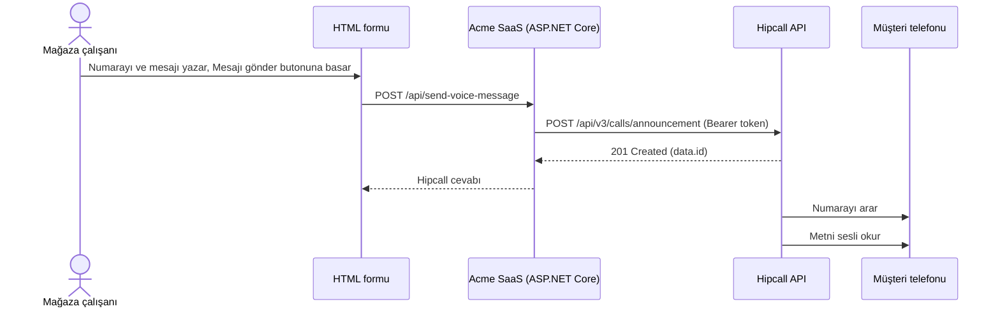

## Genel bakış

Acme SaaS, e-ticaret mağazalarına sipariş yönetimi yazılımı sunan hayali bir firma. Kargo hazır olduğunda mağaza çalışanı müşteriyi arayıp her seferinde aynı cümleyi söylüyor. Acme SaaS bunu panelde tek bir butona indirmek istiyor: çalışan numarayı ve mesajı yazıyor, butona basıyor, müşterinin telefonu çalıyor ve mesaj sesli okunuyor. Hattın bu ucunda konuşacak bir temsilci yok. Müşteri mesajı dinleyip kapatıyor.

Hipcall'daki `POST /api/v3/calls/announcement` endpoint'i bu iş için var. İsteğe aranacak numarayı, aramanın çıkacağı Hipcall numarasını ve mesajı veriyorsunuz. Mesaj bir metin (text-to-speech), bir ses dosyası adresi ya da panelde kayıtlı bir karşılama anonsu olabilir.

Bu yazıda numarayı ve mesajı bir HTML formundan alıp Hipcall'a ileten bir ASP.NET Core Minimal API kuruyoruz. Yetkilendirme doğrudan API anahtarıyla yapılıyor, OAuth2 akışı gerekmiyor. Yazının ikinci yarısı, API'nin başarılı cevap verdiği halde telefonun çalmadığı durumlara ayrıldı.



## Başlamadan önce

Gereksinimler:

- .NET 8 SDK (`dotnet --version` çıktısı 8.0 veya üzeri olmalıdır).
- API özelliği açık bir Hipcall paketi.
- `Settings > Developer > API Keys (Ayarlar > Geliştirici > API Anahtarları)` menüsünden oluşturulmuş bir API anahtarı.
- Aramanın çıkacağı, durumu `active` olan bir Hipcall numarası.

Aramanın çıkacağı numaranın `id` değerini `GET /api/v3/numbers` ile bulun:

```bash
curl -sS -H "Authorization: Bearer $HIPCALL_API_TOKEN" \
  https://use.hipcall.com.tr/api/v3/numbers
```

Cevapta `state` değeri `active` olan bir numaranın `id` alanını not edin. Bu değer isteklerde `number_id` olarak gider:

```json
{
  "data": [
    {
      "id": 938,
      "name": "Üst yönetici",
      "state": "passive",
      "number": "+90850XXXXXXX",
      "locale": "tr_TR",
      "business_hours": "open",
      "user_case": "all"
    },
    {
      "id": 942,
      "name": "Üst yönetici",
      "state": "active",
      "number": "+90850XXXXXXX",
      "locale": "tr_TR",
      "business_hours": "open",
      "user_case": "all"
    }
  ],
  "meta": { "count": 2, "offset": 0, "limit": 10 }
}
```

API anahtarını ve numara kimliğini ortam değişkenlerinde tutun:

```bash
export HIPCALL_API_TOKEN="..."
export HIPCALL_NUMBER_ID="942"
```

Windows PowerShell üzerinde:

```powershell
$env:HIPCALL_API_TOKEN = "..."
$env:HIPCALL_NUMBER_ID = "942"
```

`HIPCALL_BASE_URL` isteğe bağlıdır ve varsayılan değeri `https://use.hipcall.com.tr` adresidir.

## Adım 1: Mesaj türünü seçin

İstek gövdesinde `tts`, `audio_url` ve `greeting_id` alanlarından tam olarak birini göndermelisiniz.

`tts` nesnesi okunacak metni (`text`) ve dil kodunu (`language`) taşır. `audio_url`, Hipcall'un çalacağı bir ses dosyasının adresidir. `greeting_id` ise panelde kayıtlı bir anonsun kimliğidir ve `GET /api/v3/greetings` ile listelenir:

```bash
curl -sS -H "Authorization: Bearer $HIPCALL_API_TOKEN" \
  "https://use.hipcall.com.tr/api/v3/greetings?limit=10&sort=id.asc"
```

```json
{
  "data": [
    {
      "id": 3372,
      "name": "Mesai saatleri dışında",
      "state": "active",
      "direct_dial_extension": false,
      "input_timeout": 0,
      "max_input_try_count": 0
    },
    {
      "id": 3373,
      "name": "Hoş geldiniz",
      "state": "active",
      "direct_dial_extension": true,
      "input_timeout": 3,
      "max_input_try_count": 0
    }
  ],
  "meta": { "count": 2, "offset": 0, "limit": 10 }
}
```

Bu rehberde `tts` seçeneğini kullanıyoruz. `audio_url` parametresini tercih edecekseniz, ses dosyasının internet üzerinden doğrudan erişilebilir (örneğin `.mp3` veya `.wav`) bir bağlantı olmasına dikkat edin. Dosyaya ulaşılamadığında çağrı başlatılır ve hedef telefon çalar; ancak telefon açıldığında ses çalınamadığı için arama sonlanır.

## Adım 2: Anons isteğini gönderin

`POST /api/v3/calls/announcement` endpoint'ine aranacak numarayı, `number_id` değerini, tekrar sayısını ve `tts` nesnesini gönderin:

```csharp
var payload = JsonSerializer.Serialize(new
{
    callee_number = "+90551XXXXXXX",
    number_id = 942,
    repeat = 1,
    tts = new
    {
        language = "tr-TR",
        text = "Siparişiniz kargoya verildi."
    }
});
using var content = new StringContent(payload, Encoding.UTF8, "application/json");
using var response = await http.PostAsync("/api/v3/calls/announcement", content);
```

Başarılı istek `201 Created` döner. Gövdedeki `id` değerini loglayın:

```json
{
  "data": {
    "id": "4f003b1c-XXXX-XXXX-XXXX-XXXXXXXXXXXX"
  }
}
```

Denemelerde şunları gördük:

- Numara `+` olmadan (`90551XXXXXXX`) gönderildiğinde de telefon çaldı. Yine de numaraları `+` ile saklamak, sistemler arasında tutarlılık sağlar.
- `selam nasılsınızacaba....` metni gönderildiğinde noktalar okunmadı, bitişik yazılan sözcükler normal okundu.
- `repeat` mesajın kaç kez okunacağını belirler ve 1 ile 5 arasında olmalıdır.
- `pause_ms` bekleme süresini milisaniye olarak verir ve en fazla 10000 olabilir.

## Adım 3: Formu ve uç noktayı bağlayın

Minimal API tarafı ön yüzden gelen `calleeNumber`, `text`, `language` ve `repeat` alanlarını alır, Hipcall'a gönderir ve Hipcall'un cevabını durum koduyla birlikte olduğu gibi tarayıcıya döndürür. Hata gövdesi yutulmadığı için 422 mesajları formda görünür. API anahtarı ve `number_id` sunucuda kalır, tarayıcıya gitmez.

## Betiğin tamamı

Yeni bir web projesi oluşturun, `Program.cs` dosyasını aşağıdaki kodla değiştirin ve `wwwroot/index.html` dosyasını ekleyin:

```bash
dotnet new web -n Hipcall.VoiceMessage
```

```csharp
using System.Net.Http.Headers;
using System.Text;
using System.Text.Json;

static string Env(string name) =>
    Environment.GetEnvironmentVariable(name)
    ?? throw new InvalidOperationException($"{name} is not set.");

var baseUrl = Environment.GetEnvironmentVariable("HIPCALL_BASE_URL") ?? "https://use.hipcall.com.tr";
var apiToken = Env("HIPCALL_API_TOKEN");
var numberId = int.Parse(Env("HIPCALL_NUMBER_ID"));

var builder = WebApplication.CreateBuilder(args);
builder.WebHost.ConfigureKestrel(options => options.ListenAnyIP(5000));

builder.Services.AddHttpClient("hipcall", client =>
{
    client.BaseAddress = new Uri(baseUrl);
    client.DefaultRequestHeaders.Authorization = new AuthenticationHeaderValue("Bearer", apiToken);
    client.DefaultRequestHeaders.Accept.Add(new MediaTypeWithQualityHeaderValue("application/json"));
    client.Timeout = TimeSpan.FromSeconds(15);
});

var app = builder.Build();

app.UseDefaultFiles();
app.UseStaticFiles();

app.MapPost("/api/send-voice-message", async (VoiceMessageRequest request, IHttpClientFactory factory) =>
{
    if (string.IsNullOrWhiteSpace(request.CalleeNumber) || string.IsNullOrWhiteSpace(request.Text))
    {
        return Results.BadRequest(new { error = "calleeNumber and text are required." });
    }

    var repeat = request.Repeat ?? 1;
    if (repeat is < 1 or > 5)
    {
        return Results.BadRequest(new { error = "repeat must be between 1 and 5." });
    }

    var payload = JsonSerializer.Serialize(new
    {
        callee_number = request.CalleeNumber.Trim(),
        number_id = numberId,
        repeat,
        tts = new
        {
            language = string.IsNullOrWhiteSpace(request.Language) ? "tr-TR" : request.Language,
            text = request.Text.Trim()
        }
    });

    var http = factory.CreateClient("hipcall");
    using var content = new StringContent(payload, Encoding.UTF8, "application/json");

    try
    {
        using var response = await http.PostAsync("/api/v3/calls/announcement", content);
        var body = await response.Content.ReadAsStringAsync();
        Console.WriteLine($"Announcement response ({(int)response.StatusCode}): {body}");

        return Results.Content(body, "application/json", statusCode: (int)response.StatusCode);
    }
    catch (HttpRequestException ex)
    {
        Console.WriteLine($"Hipcall request failed: {ex.Message}");
        return Results.Json(new { error = "Could not reach Hipcall." }, statusCode: StatusCodes.Status502BadGateway);
    }
});

app.Run();

record VoiceMessageRequest(string? CalleeNumber, string? Text, string? Language, int? Repeat);
```

`wwwroot/index.html` dosyası numara, mesaj, dil ve tekrar alanlarını içeren bir form ve Hipcall cevabını gösteren bir alan içerir:

```html
<!DOCTYPE html>
<html lang="tr">
<head>
  <meta charset="utf-8" />
  <title>Sesli mesaj gönder</title>
</head>
<body>
  <form id="form">
    <p><input id="callee" placeholder="+90551XXXXXXX" required /></p>
    <p><textarea id="text" rows="4" cols="40" placeholder="Siparişiniz kargoya verildi." required></textarea></p>
    <p><input id="language" value="tr-TR" /> <input id="repeat" type="number" min="1" max="5" value="1" /></p>
    <p><button>Mesajı gönder</button></p>
  </form>
  <pre id="result"></pre>
  <script>
    document.getElementById("form").addEventListener("submit", async (event) => {
      event.preventDefault();
      const response = await fetch("/api/send-voice-message", {
        method: "POST",
        headers: { "content-type": "application/json" },
        body: JSON.stringify({
          calleeNumber: document.getElementById("callee").value,
          text: document.getElementById("text").value,
          language: document.getElementById("language").value,
          repeat: Number(document.getElementById("repeat").value)
        })
      });
      document.getElementById("result").textContent = response.status + "\n" + await response.text();
    });
  </script>
</body>
</html>
```

Ortam değişkenleri tanımlıyken uygulamayı çalıştırın:

```bash
dotnet run
```

Tarayıcıda `http://localhost:5000` adresini açın, numarayı ve mesajı yazıp **Mesajı gönder** butonuna basın. Form `201` durum kodunu ve `id` değerini gösterir, konsol şunu yazar:

```text
Announcement response (201): {"data":{"id":"4f003b1c-XXXX-XXXX-XXXX-XXXXXXXXXXXX"}}
```

## Hata aldığınızda

### 422 Unprocessable Entity: Sınır dışı değerler

`repeat` 1 ile 5 arasında olmalıdır. 6 gönderdiğimizde:

```json
{
  "errors": {
    "repeat": [
      "6 is larger than inclusive maximum 5"
    ]
  }
}
```

0 gönderdiğimizde:

```json
{
  "errors": {
    "repeat": [
      "0 is smaller than inclusive minimum 1"
    ]
  }
}
```

`pause_ms` için üst sınır 10000'dir. 86400000 gönderdiğimizde:

```json
{
  "errors": {
    "pause_ms": [
      "86400000 is larger than inclusive maximum 10000"
    ]
  }
}
```

Üç değeri de istek göndermeden önce kendi kodunuzda doğrulayın. Örnekteki uç nokta `repeat` değerini bu şekilde denetliyor.

### 422 Unprocessable Entity: Mesaj türü hatası

`greeting_id`, `audio_url` ve `tts` alanlarından birden fazlası aynı istekte gönderilirse:

```json
{
  "errors": {
    "announcement": [
      "give only one of greeting_id, audio_url or tts"
    ]
  }
}
```

Üçünden hiçbiri gönderilmezse:

```json
{
  "errors": {
    "announcement": [
      "give one of greeting_id, audio_url or tts"
    ]
  }
}
```

İstek gövdesinde mesaj türü olarak tek bir alan bırakın.

### Cevap başarılı ama telefon çalmıyor

Aşağıdaki durumlarda API hata döndürmez, ama beklenen arama olmaz:

- Geçersiz dil kodu: `zr-XZ` gibi bir `language` değeriyle `id` içeren başarılı cevap aldık, telefon çalmadı.
- Çok uzun metin: "selam nasılsınız acaba selam nasılsınız" cümlesini birkaç yüz karakter olacak kadar tekrarladığımızda istek başarılı döndü, telefon çalmadı. Sınırı kendi hesabınızda deneyerek belirleyin ve mesajları kısa tutun.
- Ulaşılamayan `audio_url`: Telefon çalar; ancak açıldığında ses dosyası yüklenemediği için arama sonlanır.

Bu yüzden `201` cevabı aramanın yapıldığını göstermez. Başarılı cevabın `id` değerini loglayın. Yeni bir dil kodunu veya metin uzunluğunu canlıya almadan önce kendi telefonunuza deneme araması yapın.

## Parametre listesi

### Anons isteği gövdesi (`POST /api/v3/calls/announcement`)

| Alan | Tip | Kural |
|---|---|---|
| `callee_number` | string | Aranacak numara. `+90551XXXXXXX` ve `90551XXXXXXX` biçimlerinin ikisi de arandı. |
| `number_id` | integer | Aramanın çıkacağı aktif Hipcall numarasının ID'si (`GET /api/v3/numbers`). |
| `repeat` | integer | Mesajın tekrar sayısı. 1 ile 5 arasında olmalıdır. |
| `pause_ms` | integer | Bekleme süresi, milisaniye. En fazla 10000. |
| `tts` | object | Metin okutma. `language` (örneğin `"tr-TR"`) ve `text` alanlarını taşır. |
| `audio_url` | string | Çalınacak ses dosyasının adresi. |
| `greeting_id` | integer | Panelde kayıtlı anonsun ID'si (`GET /api/v3/greetings`). |

`tts`, `audio_url` ve `greeting_id` alanlarından tam olarak biri gönderilmelidir.

### Başarılı cevap

| Alan | Tip | Açıklama |
|---|---|---|
| `data.id` | string | Anons isteğinin kimliği (UUID). |

## Sonraki adımlar

- Tüm endpoint'leri [Hipcall API Referansı](https://use.hipcall.com.tr/api-docs/) sayfasından inceleyin.
- Sorularınızı [Hipcall Community](https://community.hipcall.com/) üzerinden sorun.
